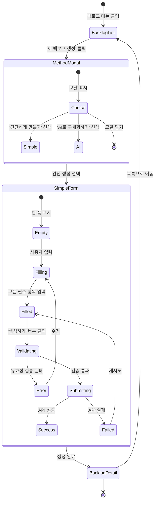
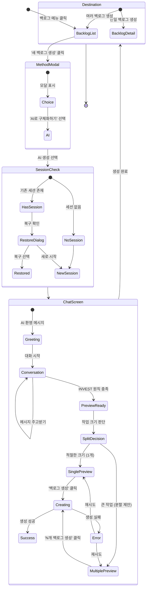
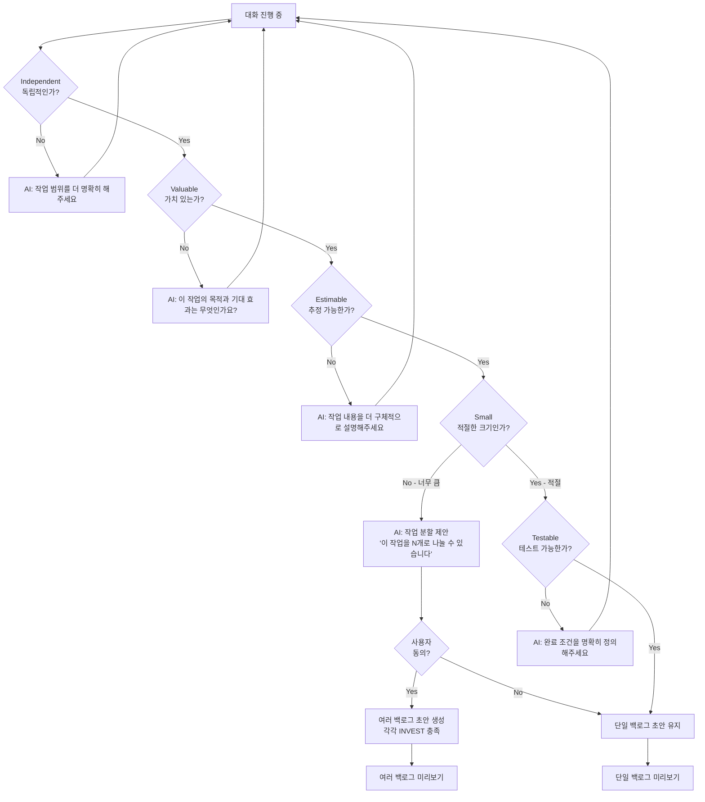
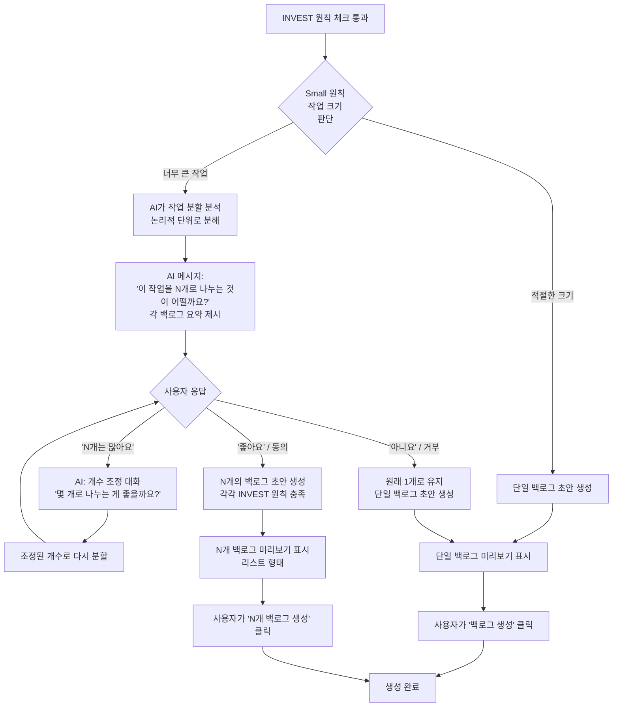
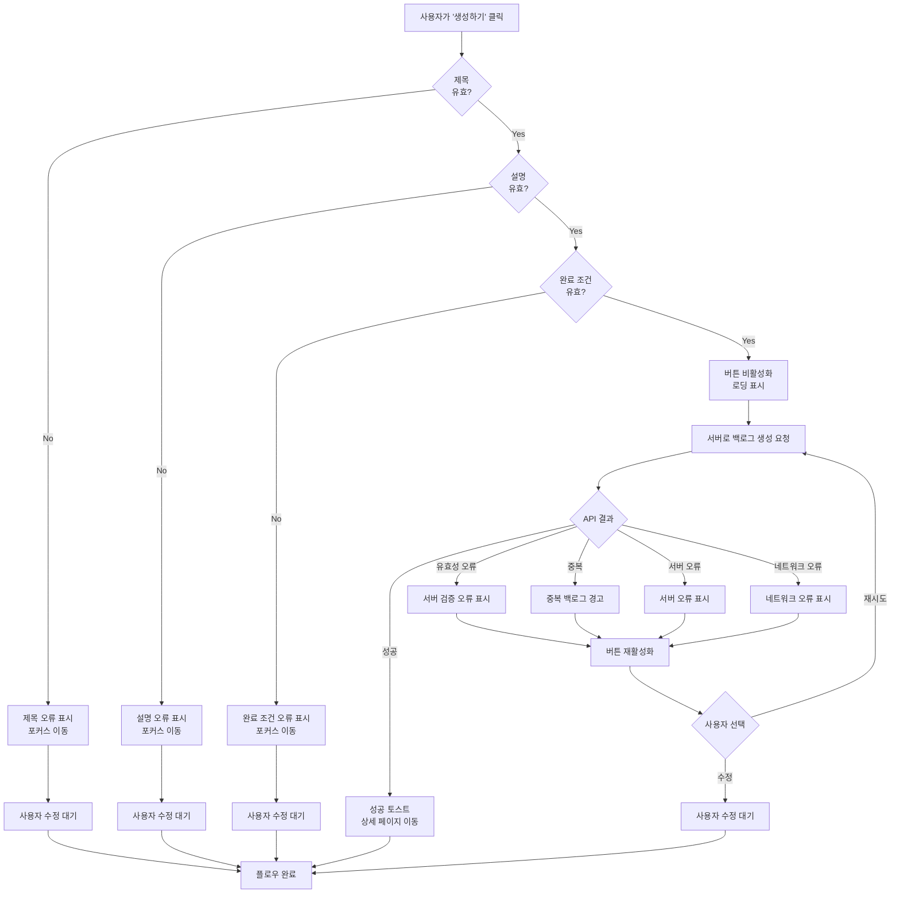
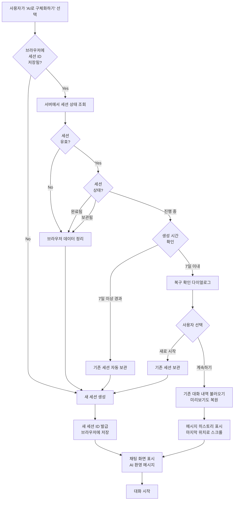

# AI 기반 백로그 생성 플로우 설계 명세서

**작업 ID:** v1.0.0/DS/02
**작성일:** 2025-10-21
**상태:** 설계 완료
**의존성:** v1.0.0/DS/00 (레이아웃 및 네비게이션 시스템), v1.0.0/DS/01 (인증 시스템)

---

## 1. 개요

### 1.1 목적
사용자가 두 가지 방법으로 백로그를 생성할 수 있는 플로우를 설계한다:
1. **간단하게 만들기**: 직접 폼에 입력하여 빠르게 1개의 백로그 생성
2. **AI로 구체화하기**: AI와의 대화를 통해 아이디어를 INVEST 원칙에 맞게 구체화하고, 필요시 여러 개의 작은 백로그로 분할하여 생성

### 1.2 사용자 스토리

#### 스토리 1: 간단하게 만들기
> When 명확한 작업 내용을 이미 알고 있을 때, 사용자는 폼에 직접 입력하여 빠르게 백로그를 생성하고 싶어한다.

#### 스토리 2: AI로 구체화하기
> When 머릿속에 막연한 아이디어가 떠올랐을 때, 사용자는 AI와의 자연스러운 대화를 통해 그 아이디어를 INVEST 원칙에 맞는 실행 가능한 백로그(들)로 변환하고 싶어한다.

### 1.3 범위
- 백로그 생성 방식 선택 모달
- 간단하게 만들기: 폼 화면 및 유효성 검증 (1개 생성)
- AI 채팅 대화 플로우
- INVEST 원칙 기반 백로그 구체화 및 분할 제안
- 백로그 미리보기 및 확정 플로우 (1개 또는 여러 개)
- 화면 전환 및 분기 처리

### 1.4 제약사항
- 두 가지 생성 방법 간 전환은 불가능 (처음 선택한 방법으로 완료)
- 채팅 인터페이스는 모바일과 데스크톱 모두 지원
- 스트리밍 응답은 실시간으로 부드럽게 표시
- 백로그 생성은 한 번의 세션 내에서 완료
- 대화 중 페이지 이탈 시 서버에 저장된 히스토리로 복구 가능

---

## 2. 전체 플로우차트

### 2.1 백로그 생성 전체 플로우 (통합)

```mermaid
flowchart TD
    Start([사용자가 백로그 목록 페이지 접속]) --> CheckEmpty{백로그가<br/>비어있는가?}

    CheckEmpty -->|Yes| ShowEmptyState[빈 상태 화면 표시<br/>'첫 백로그 만들기' 버튼]
    CheckEmpty -->|No| ShowList[백로그 목록 표시<br/>'새 백로그 생성' 버튼]

    ShowEmptyState --> ClickCreate[사용자가 생성 버튼 클릭]
    ShowList --> ClickCreate

    ClickCreate --> ShowModal[생성 방식 선택 모달 표시]

    ShowModal --> UserChoice{사용자 선택}

    UserChoice -->|간단하게 만들기| SimpleFlow[간단 생성 플로우]
    UserChoice -->|AI로 구체화하기| AIFlow[AI 대화 플로우]
    UserChoice -->|모달 닫기| BackToList[목록 페이지 복귀]

    %% 간단 생성 플로우 (1개만 생성)
    SimpleFlow --> SimpleForm[폼 화면 이동<br/>/app/backlog/new/simple]
    SimpleForm --> UserFillForm[사용자가 폼 작성<br/>제목/설명/완료조건]
    UserFillForm --> ValidateForm{유효성 검증}

    ValidateForm -->|실패| ShowFormError[에러 메시지 표시<br/>필수 항목 강조]
    ShowFormError --> UserFillForm

    ValidateForm -->|통과| SubmitSimple[백로그 1개 생성 API 호출]
    SubmitSimple --> SimpleResult{생성 결과}

    SimpleResult -->|성공| SimpleSuccess[성공 토스트 표시]
    SimpleResult -->|실패| SimpleError[에러 메시지 표시<br/>재시도 버튼]

    SimpleError --> UserRetrySimple{사용자 선택}
    UserRetrySimple -->|재시도| SubmitSimple
    UserRetrySimple -->|취소| SimpleForm

    SimpleSuccess --> RedirectDetail[생성된 백로그<br/>상세 페이지로 이동]

    %% AI 대화 플로우 (여러 개 생성 가능)
    AIFlow --> CheckSession{기존 대화<br/>세션이<br/>존재하는가?}

    CheckSession -->|Yes| ShowDialog{대화 복구<br/>확인 다이얼로그}
    CheckSession -->|No| CreateSession[새 대화 세션 생성]

    ShowDialog -->|복구| LoadSession[기존 세션 로드<br/>메시지 히스토리 표시]
    ShowDialog -->|새로 시작| CreateSession

    LoadSession --> ChatScreen
    CreateSession --> ChatScreen[AI 채팅 화면 이동<br/>/app/backlog/new/chat]

    ChatScreen --> AIGreeting[AI 환영 메시지 표시<br/>'어떤 아이디어를 구체화하고 싶으신가요?']

    AIGreeting --> UserInput[사용자 메시지 입력]
    UserInput --> SendMessage[메시지 전송]

    SendMessage --> ShowUserMsg[사용자 메시지 화면에 표시]
    ShowUserMsg --> ShowTyping[AI 응답 대기 중<br/>타이핑 인디케이터]

    ShowTyping --> StreamAI[AI 응답 스트리밍 수신<br/>실시간 텍스트 표시]

    StreamAI --> CheckINVEST{INVEST 원칙<br/>충족 여부<br/>AI 판단}

    CheckINVEST -->|미충족| UserInput
    CheckINVEST -->|충족| CheckSplit{작업이<br/>너무 큰가?<br/>Small 원칙}

    CheckSplit -->|Yes| SuggestSplit[AI가 분할 제안<br/>'이 작업을 N개로 나눌 수 있습니다']
    CheckSplit -->|No| GenerateSingle[단일 백로그 초안 생성]

    SuggestSplit --> UserSplitChoice{사용자 선택}

    UserSplitChoice -->|분할 동의| GenerateMultiple[여러 개의 백로그 초안 생성<br/>각각 INVEST 원칙 충족]
    UserSplitChoice -->|분할 거부| GenerateSingle

    GenerateSingle --> ShowPreviewSingle[단일 백로그<br/>미리보기 패널 표시]
    GenerateMultiple --> ShowPreviewMultiple[여러 백로그<br/>미리보기 패널 표시<br/>리스트 형태]

    ShowPreviewSingle --> ShowCreateBtn['백로그 생성' 버튼 활성화]
    ShowPreviewMultiple --> ShowCreateBtnMulti['N개 백로그 생성' 버튼 활성화]

    ShowCreateBtn --> UserActionSingle{사용자 선택}
    ShowCreateBtnMulti --> UserActionMulti{사용자 선택}

    UserActionSingle -->|대화 계속| MoreChat[추가 메시지 입력]
    UserActionMulti -->|대화 계속| MoreChat

    MoreChat --> UpdateDraft[백로그 초안 업데이트]
    UpdateDraft --> ShowPreviewSingle

    UserActionSingle -->|백로그 생성 클릭| ConfirmCreateSingle[단일 백로그 생성 API 호출]
    UserActionMulti -->|N개 생성 클릭| ConfirmCreateMultiple[여러 백로그 일괄 생성 API 호출]

    ConfirmCreateSingle --> SaveBacklog[백엔드에 백로그 저장<br/>대화 세션 종료]
    ConfirmCreateMultiple --> SaveBacklogs[백엔드에 여러 백로그 저장<br/>대화 세션 종료]

    SaveBacklog --> Success{저장 성공?}
    SaveBacklogs --> SuccessMulti{저장 성공?}

    Success -->|Yes| ShowSuccess[성공 토스트 표시<br/>'백로그가 생성되었습니다']
    Success -->|No| ShowError[에러 메시지 표시<br/>재시도 버튼]

    SuccessMulti -->|Yes| ShowSuccessMulti[성공 토스트 표시<br/>'N개의 백로그가 생성되었습니다']
    SuccessMulti -->|No| ShowErrorMulti[에러 메시지 표시<br/>재시도 버튼]

    ShowError --> UserRetry{사용자 선택}
    ShowErrorMulti --> UserRetryMulti{사용자 선택}

    UserRetry -->|재시도| ConfirmCreateSingle
    UserRetry -->|취소| ChatScreen

    UserRetryMulti -->|재시도| ConfirmCreateMultiple
    UserRetryMulti -->|취소| ChatScreen

    ShowSuccess --> RedirectDetailSingle[생성된 백로그<br/>상세 페이지로 이동]
    ShowSuccessMulti --> RedirectList[백로그 목록 페이지로 이동<br/>생성된 백로그들 표시]

    %% 공통 완료
    RedirectDetail --> End([플로우 종료])
    RedirectDetailSingle --> End
    RedirectList --> End

    BackToList --> Start

    style Start fill:#e1f5e1
    style End fill:#ffe1e1
    style ShowModal fill:#fff9c4
    style SimpleFlow fill:#e3f2fd
    style AIFlow fill:#f3e5f5
    style ChatScreen fill:#e3f2fd
    style ShowPreviewSingle fill:#fff3e0
    style ShowPreviewMultiple fill:#fff3e0
    style SaveBacklog fill:#f3e5f5
    style SaveBacklogs fill:#f3e5f5
```



### 2.2 생성 방식 선택 모달

사용자가 '새 백로그 생성' 버튼을 클릭하면 다음과 같은 모달이 표시됩니다:

```
┌─────────────────────────────────────────────┐
│  백로그를 어떻게 만드시겠어요?        [✕]   │
├─────────────────────────────────────────────┤
│                                             │
│  ┌─────────────────────────────────────┐   │
│  │  📝 간단하게 만들기                  │   │
│  │                                      │   │
│  │  작업 내용이 명확할 때 직접 입력하여 │   │
│  │  빠르게 백로그를 생성합니다.         │   │
│  │                                      │   │
│  │  • 제목, 설명, 완료 조건 직접 입력   │   │
│  │  • 1개의 백로그 생성                 │   │
│  │  • 약 1분 소요                       │   │
│  │                                      │   │
│  │              [선택하기] ────────────→│   │
│  └─────────────────────────────────────┘   │
│                                             │
│  ┌─────────────────────────────────────┐   │
│  │  🤖 AI로 구체화하기                  │   │
│  │                                      │   │
│  │  막연한 아이디어를 AI와 대화하며     │   │
│  │  구체적인 백로그로 발전시킵니다.     │   │
│  │                                      │   │
│  │  • AI가 질문하며 내용을 구체화       │   │
│  │  • INVEST 원칙에 맞게 작게 분할      │   │
│  │  • 1개 또는 여러 개의 백로그 생성    │   │
│  │  • 약 3-5분 소요                     │   │
│  │                                      │   │
│  │              [선택하기] ────────────→│   │
│  └─────────────────────────────────────┘   │
│                                             │
└─────────────────────────────────────────────┘
```

---

## 3. 간단하게 만들기 플로우

### 3.1 화면 전환 다이어그램



### 3.2 간단 생성 폼 화면 구조

```
┌─────────────────────────────────────────────┐
│  [←] 간단하게 백로그 만들기                  │
├─────────────────────────────────────────────┤
│                                             │
│  제목 *                                      │
│  ┌─────────────────────────────────────┐   │
│  │ 예: 메인 페이지 로딩 속도 개선       │   │
│  └─────────────────────────────────────┘   │
│                                             │
│  설명 *                                      │
│  ┌─────────────────────────────────────┐   │
│  │ 사용자 경험 개선을 위해...           │   │
│  │                                      │   │
│  │ (여러 줄 입력 가능)                  │   │
│  │                                      │   │
│  └─────────────────────────────────────┘   │
│  💡 어떤 작업을 왜 해야 하는지 설명해주세요  │
│                                             │
│  완료 조건 *                                 │
│  ┌─────────────────────────────────────┐   │
│  │ Lighthouse 성능 점수 90점 이상       │   │
│  │                                      │   │
│  │ (여러 줄 입력 가능)                  │   │
│  │                                      │   │
│  └─────────────────────────────────────┘   │
│  💡 어떤 상태가 되면 완료인가요?             │
│                                             │
│                    [취소] [생성하기] ───→   │
└─────────────────────────────────────────────┘
```

### 3.3 간단 생성 단계별 동작

#### 3.3.1 폼 진입
```
사용자가 모달에서 '간단하게 만들기' 선택
→ /app/backlog/new/simple 페이지로 이동
→ 빈 폼 표시
→ 제목 입력란에 자동 포커스
```

#### 3.3.2 입력 검증 규칙

| 항목 | 필수 여부 | 최소 길이 | 최대 길이 | 추가 규칙 |
|------|----------|----------|----------|----------|
| 제목 | 필수 | 2자 | 100자 | 공백만 입력 불가 |
| 설명 | 필수 | 10자 | 2000자 | 공백만 입력 불가 |
| 완료 조건 | 필수 | 5자 | 1000자 | 공백만 입력 불가 |

#### 3.3.3 폼 제출 과정

```
1. 사용자가 '생성하기' 버튼 클릭

2. 클라이언트 유효성 검증
   → 실패 시: 첫 번째 오류 항목으로 스크롤 + 포커스

3. 버튼 비활성화 + 로딩 인디케이터 표시

4. 서버로 단일 백로그 생성 요청 전송

5. 응답 처리
   → 성공: 성공 토스트 표시 → 1초 후 생성된 백로그 상세 페이지 이동
   → 실패: 버튼 재활성화 + 에러 메시지 표시 + 데이터 유지
```

### 3.4 간단 생성 에러 처리

| 에러 케이스 | 사용자 피드백 | 액션 |
|------------|--------------|------|
| 필수 항목 누락 | "모든 항목을 입력해주세요" | 첫 번째 빈 항목에 포커스 |
| 제목 길이 초과 | "제목은 100자 이내로 입력해주세요" | 제목 입력란 강조 |
| 네트워크 오류 | "네트워크 연결을 확인해주세요" | [재시도] 버튼 제공 |
| 서버 오류 | "일시적인 오류가 발생했습니다" | [재시도] 버튼 제공 |
| 중복 백로그 | "같은 제목의 백로그가 이미 존재합니��" | 제목 수정 안내 |

---

## 4. AI로 구체화하기 플로우

### 4.1 화면 전환 다이어그램



### 4.2 AI 충분한 정보 판단 기준 (INVEST 원칙)

AI는 **INVEST 원칙**을 기준으로 백로그 초안 생성 여부를 판단합니다.

#### INVEST 원칙 체크리스트

| 원칙 | 의미 | AI 판단 기준 | 예시 질문 |
|------|------|------------|----------|
| **I**ndependent<br/>(독립적) | 다른 작업과 독립적으로 완료 가능 | 작업 범위가 명확히 정의됨 | "이 작업은 다른 작업과 독립적으로 진행 가능한가요?" |
| **N**egotiable<br/>(협상 가능) | 구현 방법이 유연하게 조정 가능 | 목표는 명확하지만 방법은 열려있음 | "구현 방법을 여러 가지로 고려할 수 있나요?" |
| **V**aluable<br/>(가치 있는) | 사용자나 비즈니스에 명확한 가치 제공 | 작업의 목적과 기대 효과가 설명됨 | "이 작업을 통해 얻고자 하는 결과는 무엇인가요?" |
| **E**stimable<br/>(추정 가능) | 작업량 추정이 가능한 구체성 | 작업 내용이 충분히 구체적 | "작업 범위가 명확히 정의되어 있나요?" |
| **S**mall<br/>(작은 크기) | 적절한 크기로 분할 가능 | 너무 크지 않고 관리 가능한 크기 | "이 작업은 한 주 안에 완료 가능한 크기인가요?" |
| **T**estable<br/>(테스트 가능) | 완료 여부를 명확히 판단 가능 | 완료 조건이 구체적으로 정의됨 | "어떤 상태가 되면 '완료'라고 할 수 있을까요?" |

#### INVEST 원칙 충족 판단 프로세스



#### 백로그 분할 예시

**사용자 아이디어**: "웹사이트를 개선하고 싶어요"

**AI 대화를 통한 구체화**:
- AI: "어떤 부분을 개선하고 싶으신가요?"
- 사용자: "성능이랑 디자인 둘 다요"
- AI: "이 작업은 꽤 큰 것 같아요. 다음과 같이 3개로 나누는 것이 어떨까요?"

**분할 제안**:
1. **메인 페이지 로딩 속도 1초 단축**
   - 설명: 이미지 최적화 및 번들 크기 축소
   - 완료 조건: Lighthouse 성능 점수 90점 이상

2. **반응형 헤더 UI 개선**
   - 설명: 모바일/데스크톱 헤더 디자인 개선
   - 완료 조건: 모든 디바이스에서 정상 표시

3. **다크 모드 지원**
   - 설명: 전체 페이지 다크 모드 테마 추가
   - 완료 조건: 토글 버튼으로 전환 가능

### 4.3 대화 단계별 동작

#### 4.3.1 세션 생성 및 진입

**신규 세션 (기존 세션 없음)**
```
1. 사용자가 'AI로 구체화하기' 선택
2. 새 대화 세션 생성
3. 고유 세션 ID 발급 (예: UUID)
4. 브라우저에 세션 ID 저장 (복구용)
5. 채팅 화면으로 이동 (/app/backlog/new/chat)
```

**기존 세션 있음**
```
1. 사용자가 'AI로 구체화하기' 선택
2. 저장된 세션 ID 확인
3. 서버에서 세션 상태 조회

   세션 상태가 '완료' 또는 '보관됨':
   → 새 세션 생성 (신규 플로우)

   세션 상태가 '진행 중':
   → 복구 확인 다이얼로그 표시

     사용자가 '계속하기' 선택:
     → 기존 대화 내역 불러오기
     → 마지막 메시지로 스크롤

     사용자가 '새로 시작' 선택:
     → 기존 세션을 '보관됨' 상태로 변경
     → 새 세션 생성
```

#### 4.3.2 AI 환영 메시지

**신규 세션**
```
AI 자동 메시지:
"안녕하세요! 어떤 아이디어를 구체화하고 싶으신가요?
편하게 말씀해주시면 함께 실행 가능한 백로그로 만들어드릴게요.
필요하다면 작은 단위로 나누어 관리하기 쉽게 도와드릴 수도 있어요."
```

**복구된 세션**
```
기존 대화 내역이 그대로 표시됨
환영 메시지 없음
마지막 메시지 위치로 자동 스크롤
```

#### 4.3.3 메시지 송수신 과정

```
1. 사용자가 메시지 입력 후 전송

2. 화면에 즉시 사용자 메시지 표시 (낙관적 업데이트)

3. 입력창 초기화 및 비활성화

4. AI 응답 대기 표시 (타이핑 인디케이터 "...")

5. 서버로 메시지 전송

6. AI 응답을 실시간 스트리밍으로 수신
   → 토큰(단어 조각) 단위로 받아서
   → 화면에 타이핑 효과로 표시
   → 자동으로 스크롤 하단 이동

7. 스트리밍 완료
   → AI 메시지 완성
   → 입력창 재활성화
   → 전송 버튼 활성화

8. INVEST 원칙 체크
   → 모든 원칙 충족 시:
      - Small 원칙 확인
      - 작업이 너무 크면: 분할 제안
      - 적절한 크기면: 단일 백로그 초안 생성
   → 미충족 시: 추가 질문으로 대화 계속
```

#### 4.3.4 백로그 미리보기

**미리보기 패널 레이아웃 - 단일 백로그 (데스크톱)**
```
┌─────────────────────────────────────────────────────────────┐
│  AI 채팅 화면                                                │
├───────────────────────────┬─────────────────────────────────┤
│                           │                                 │
│  채팅 영역 (좌측 60%)      │  📋 백로그 미리보기 (우측 40%)  │
│                           │                                 │
│  [사용자] 웹사이트 개선     │  제목                           │
│           하고 싶어요       │  메인 페이지 로딩 속도 1초 단축  │
│                           │                                 │
│  [AI] 어떤 부분을          │  설명                           │
│       개선하고 싶으신가요?  │  사용자 경험 개선을 위해        │
│                           │  메인 페이지의 로딩 속도를...   │
│  [사용자] 메인 페이지       │                                 │
│           로딩 속도를...    │  완료 조건                      │
│                           │  • Lighthouse 성능 점수         │
│  [AI] 완료 조건은          │    90점 이상                    │
│       무엇인가요?          │  • 실제 로딩 시간 1초 이내      │
│                           │                                 │
│  [입력창]                  │                                 │
│                           │           [백로그 생성] ───→   │
└───────────────────────────┴─────────────────────────────────┘
```

**미리보기 패널 레이아웃 - 여러 백로그 (데스크톱)**
```
┌─────────────────────────────────────────────────────────────┐
│  AI 채팅 화면                                                │
├───────────────────────────┬─────────────────────────────────┤
│                           │  📋 백로그 미리보기 (우측 40%)  │
│  채팅 영역 (좌측 60%)      │                                 │
│                           │  3개의 백로그로 나누었어요       │
│  [AI] 이 작업을 다음과 같이 │                                 │
│       3개로 나누는 것이     │  ┌─────────────────────────┐   │
│       어떨까요?            │  │ 1️⃣ 메인 페이지 로딩 속도 │   │
│                           │  │    1초 단축              │   │
│  [사용자] 좋아요           │  │                         │   │
│                           │  │ 설명: 이미지 최적화...   │   │
│                           │  │ 완료: Lighthouse 90점... │   │
│                           │  └─────────────────────────┘   │
│                           │                                 │
│                           │  ┌─────────────────────────┐   │
│                           │  │ 2️⃣ 반응형 헤더 UI 개선  │   │
│                           │  │                         │   │
│                           │  │ 설명: 모바일/데스크톱... │   │
│                           │  │ 완료: 모든 디바이스...   │   │
│  [입력창]                  │  └─────────────────────────┘   │
│                           │                                 │
│                           │  ┌─────────────────────────┐   │
│                           │  │ 3️⃣ 다크 모드 지원       │   │
│                           │  │                         │   │
│                           │  │ 설명: 전체 페이지...     │   │
│                           │  │ 완료: 토글 버튼...       │   │
│                           │  └─────────────────────────┘   │
│                           │                                 │
│                           │      [3개 백로그 생성] ───→    │
└───────────────────────────┴─────────────────────────────────┘
```

**미리보기 동작**
- INVEST 원칙 충족 시 슬라이드인 애니메이션으로 나타남
- 단일 백로그: 상세 내용 표시
- 여러 백로그: 리스트 형태로 각 백로그 요약 표시
- 사용자가 추가 메시지를 보내면 미리보기 내용도 실시간 업데이트
- 업데이트 시 부드러운 페이드 효과 적용

#### 4.3.5 백로그 생성

**단일 백로그 생성**
```
1. 사용자가 '백로그 생성' 버튼 클릭

2. 버튼 비활성화 + 로딩 표시

3. 서버로 단일 백로그 생성 요청
   (미리보기의 제목, 설명, 완료조건 + 세션 ID 전송)

4. 서버 처리
   → 백로그 1개를 데이터베이스에 저장
   → 세션 상태를 '완료'로 변경
   → 세션과 백로그 연결

5. 성공 응답 받음
   → 브라우저에 저장된 세션 ID 삭제
   → 성공 토스트 표시: "백로그가 생성되었습니다"
   → 1초 후 생성된 백로그 상세 페이지로 자동 이동

6. 실패 응답 받음
   → 버튼 재활성화
   → 에러 메시지 표시
   → 채팅 화면 유지 (데이터 손실 방지)
   → [재시도] 버튼 제공
```

**여러 백로그 생성**
```
1. 사용자가 'N개 백로그 생성' 버튼 클릭

2. 버튼 비활성화 + 로딩 표시

3. 서버로 여러 백로그 일괄 생성 요청
   (여러 백로그의 제목, 설명, 완료조건 배열 + 세션 ID 전송)

4. 서버 처리
   → 여러 백로그를 데이터베이스에 일괄 저장
   → 세션 상태를 '완료'로 변경
   → 세션과 생성된 모든 백로그 연결

5. 성공 응답 받음
   → 브라우저에 저장된 세션 ID 삭제
   → 성공 토스트 표시: "N개의 백로그가 생성되었습니다"
   → 1초 후 백로그 목록 페이지로 이동 (생성된 백로그들 강조 표시)

6. 실패 응답 받음
   → 버튼 재활성화
   → 에러 메시지 표시
   → 채팅 화면 유지 (데이터 손실 방지)
   → [재시도] 버튼 제공
```

### 4.4 세션 복구 다이얼로그

```
┌─────────────────────────────────────────────┐
│  이전 대화 복구                       [✕]   │
├─────────────────────────────────────────────┤
│                                             │
│  이전에 진행 중이던 대화가 있습니다.         │
│  계속하시겠어요?                             │
│                                             │
│  마지막 메시지:                              │
│  "메인 페이지 로딩 속도를 1초 줄이고..."     │
│                                             │
│  📅 2025-10-21 14:30                        │
│                                             │
│                    [새로 시작] [계속하기] → │
└─────────────────────────────────────────────┘
```

---

## 5. 사용자 여�� 맵 (User Journey Map)

### 5.1 여정 A: 간단하게 만들기 (1개 생성)

| 단계 | 사용자 행동 | 시스템 응답 | 사용자 감정 | 터치포인트 |
|------|------------|------------|------------|-----------|
| **1. 진입** | '백로그' 메뉴 클릭 | 백로그 목록 페이지 로드 | 😊 | 네비게이션 |
| **2. 시작** | '새 백로그 생성' 버튼 클릭 | 생성 방식 선택 모달 표시 | 😊 기대감 | 버튼 |
| **3. 선택** | '간단하게 만들기' 선택 | 폼 화면으로 이동<br/>`/app/backlog/new/simple` | 😊 명확함 | 모달 선택지 |
| **4. 입력** | 제목 입력: "메인 페이지 로딩 속도 개선" | 실시간 글자 수 표시 | 😐 집중 | 입력란 |
| **5. 작성** | 설명 작성 (여러 줄) | 입력 내용 자동 저장 (임시) | 😐 | 텍스트 영역 |
| **6. 완성** | 완료 조건 작성 | 모든 필수 항목 완료 표시 | 😊 만족 | 텍스트 영역 |
| **7. 제출** | '생성하기' 버튼 클릭 | 로딩 인디케이터 | 😐 대기 | 버튼 |
| **8. 완료** | 자동 화면 전환 | 성공 토스트 + 상세 페이지 이동 | 😃 성취감 | 토스트, 페이지 |

**결과**: 1개의 백로그 생성
**소요 시간**: 약 1-2분

### 5.2 여정 B: AI로 구체화하기 - 단일 백로그 (1개 생성)

| 단계 | 사용자 행동 | 시스템 응답 | 사용자 감정 | 터치포인트 |
|------|------------|------------|------------|-----------|
| **1. 진입** | '백로그' 메뉴 클릭 | 백로그 목록 페이지 로드 | 😊 | 네비게이션 |
| **2. 시작** | '새 백로그 생성' 버튼 클릭 | 생성 방식 선택 모달 표시 | 😊 기대감 | 버튼 |
| **3. 선택** | 'AI로 구체화하기' 선택 + 설명 읽기 | 채팅 화면으로 이동<br/>`/app/backlog/new/chat` | 😊 호기심 | 모달 선택지 |
| **4. 환영** | 화면 확인 | AI: "안녕하세요! 어떤 아이디어를..." | 😊 친근함 | AI 메시지 |
| **5. 입력** | "이미지 최적화" 타이핑 후 전송 | 메시지 표시 + AI 타이핑 인디케이터 | 😐 대기 | 입력창 |
| **6. 대화** | AI 응답 확인:<br/>"어떤 부분의 이미지를 최적화하고 싶으신가요?" | 실시간 스트리밍 텍스트 | 😊 참여감 | AI 메시지 |
| **7. 구체화** | "메인 페이지 이미지를 WebP로 변환..." | AI: "완료 조건은 무엇인가요?" | 😊 명확해짐 | 대화 |
| **8. 완성** | "이미지 용량 50% 감소" 응답 | AI: "충분히 구체화되었네요!"<br/>단일 미리보기 패널 슬라이드인 | 😃 성취감 | 미리보기 |
| **9. 확인** | 미리보기에서 내용 확인 | '백로그 생성' 버튼 활성화 | 😊 만족 | 미리보기 UI |
| **10. 생성** | '백로그 생성' 버튼 클릭 | 로딩 → 성공 토스트 → 상세 페이지 | 😃 완료 | 버튼, 토스트 |

**결과**: 1개의 백로그 생성
**소요 시간**: 약 3-5분

### 5.3 여정 C: AI로 구체화하기 - 여러 백로그 (3개 생성)

| 단계 | 사용자 행동 | 시스템 응답 | 사용자 감정 | 터치포인트 |
|------|------------|------------|------------|-----------|
| **1-4** | (여정 B의 1-4단계와 동일) | | 😊 | |
| **5. 입력** | "웹사이트 개선" 타이핑 후 전송 | 메시지 표시 + AI 타이핑 인디케이터 | 😐 대기 | 입력창 |
| **6. 대화** | AI: "어떤 부분을 개선하고 싶으신가요?" | 실시간 스트리밍 텍스트 | 😊 참여감 | AI 메시지 |
| **7. 구체화** | "성능이랑 디자인 둘 다요" | AI: "구체적으로 어떤 개선을 원하시나요?" | 😊 | 대화 |
| **8. 상세화** | "로딩 속도 빠르게, 헤더 반응형으로,<br/>다크모드 추가" | AI: "이해했습니다. 각 항목의 완료 조건은?" | 😊 | 대화 |
| **9. 완료조건** | "로딩 1초, 모든 화면에서 정상 표시,<br/>토글 버튼으로 전환" | AI: "완벽해요! 이 작업은 꽤 큰 것 같아요.<br/>3개로 나누는 것이 어떨까요?" | 🤔 고민 | 대화 |
| **10. 분할제안** | AI가 3개 백로그 제안 확인 | 여러 백로그 미리보기 패널 표시<br/>1. 로딩 속도 개선<br/>2. 헤더 반응형<br/>3. 다크 모드 | 😃 만족 | 미리보기 |
| **11. 동의** | "좋아요" 또는 '3개 백로그 생성' 클릭 | '3개 백로그 생성' 버튼 활성화 | 😊 | 버튼 |
| **12. 생성** | '3개 백로그 생성' 버튼 클릭 | 로딩 → 성공 토스트:<br/>"3개의 백로그가 생성되었습니다" | 😃 성취감 | 토스트 |
| **13. 완료** | 자동 화면 전환 | 백로그 목록 페이지로 이동<br/>생성된 3개 백로그 강조 표시 | 😃 완료 | 목록 페이지 |

**결과**: 3개의 백로그 생성 (INVEST 원칙에 따라 작게 분할)
**소요 시간**: 약 5-7분

### 5.4 여정 D: AI 대화 세션 복구

| 단계 | 사용자 행동 | 시스템 응답 | 사용자 감정 |
|------|------------|------------|-----------|
| **1. 재진입** | 어제 대화 중 페이지를 닫았던 사용자가<br/>다시 'AI로 구체화하기' 선택 | 복구 확인 다이얼로그 표시 | 🤔 고민 |
| **2. 확인** | 마지막 메시지 미리보기 확인 | 날짜/시간 표시 | 😊 기억 |
| **3. 선택** | [계속하기] 클릭 | 이전 대화 히스토리 로드<br/>미리보기도 복원 | 😊 편리함 |
| **4. 계속** | 대화 이어서 진행 | 기존 플로우와 동일 | 😊 연속성 |

---

## 6. 분기 처리 로직

### 6.1 생성 방식 선택 분기

```mermaid
flowchart TD
    Start[사용자가 '새 백로그 생성' 클릭] --> ShowModal[생성 방식 선택 모달 표시]

    ShowModal --> UserAction{사용자 선택}

    UserAction -->|간단하게 만들기| SimpleRoute["/app/backlog/new/simple" 이동]
    UserAction -->|AI로 구체화하기| CheckSession[세션 상태 확인]
    UserAction -->|모달 닫기/ESC| CloseModal[모달 닫기]

    CloseModal --> Remain[목록 페이지 유지]

    SimpleRoute --> SimpleForm[폼 화면 표시]

    CheckSession --> HasSession{기존 세션<br/>존재?}

    HasSession -->|No| CreateSession[새 세션 생성<br/>"/app/backlog/new/chat" 이동]
    HasSession -->|Yes| RestoreDialog[복구 다이얼로그 표시]

    RestoreDialog --> RestoreChoice{사용자 선택}

    RestoreChoice -->|계속하기| LoadSession[기존 세션 로드]
    RestoreChoice -->|새로 시작| ArchiveSession[기존 세션 보관<br/>새 세션 생성]

    LoadSession --> ChatScreen[채팅 화면]
    ArchiveSession --> ChatScreen
    CreateSession --> ChatScreen

    SimpleForm --> End[각 플로우 진행]
    ChatScreen --> End
    Remain --> End
```

### 6.2 AI 백로그 분할 제안 분기



### 6.3 간단 생성 유효성 검증 분기



### 6.4 AI 세션 복구 분기



---

## 7. 라우팅 구조

| 경로 | 화면 | 생성 방식 | 결과 | 설명 |
|------|------|----------|------|------|
| `/app/backlog` | 백로그 목록 | - | - | 전체 백로그 목록 조회, 생성 진입점 |
| `/app/backlog/new/simple` | 간단 생성 폼 | 간단하게 만들기 | 1개 생성 | 직접 입력 폼 화면 |
| `/app/backlog/new/chat` | AI 채팅 화면 | AI로 구체화하기 | 1개 또는 N개 생성 | AI 대화 화면 + 미리보기 패널 |
| `/app/backlog/:id` | 백로그 상세 | - | - | 생성된 백로그 조회/수정 |

---

## 8. 완료 조건 검증

### 8.1 플로우 설계 완료 조건

- [x] 아이디어 입력 → AI 대화 → 백로그 생성 → 완료 확인까지 전체 플로우차트가 작성되어 있다
- [x] 간단하게 만들기 플로우가 추가되어 있다 (1개 생성)
- [x] AI로 구체화하기 플로우에 여러 백로그 분할 기능이 포함되어 있다
- [x] 생성 방식 선택 모달이 설계되어 있다
- [x] 각 단계별 사용자 액션과 시스템 응답이 명확히 정의되어 있다
- [x] 화면 전환 조건 및 분기 처리 로직이 문서화되어 있다
- [x] INVEST 원칙 기반 AI 판단 기준이 정의되어 있다
- [x] Small 원칙에 따른 작업 분할 로직이 설계되어 있다

### 8.2 추가 설계 요소

- [x] 사용자 여정 맵 (간단 생성 + AI 단일 생성 + AI 여러 개 생성) 작성
- [x] 대안 시나리오 (세션 복구) 정의
- [x] 에러 처리 분기 로직 정의
- [x] 라우팅 구조 정의

---

## 9. 다음 단계

Phase 1 완료. 다음은 **Phase 2: 데이터 모델 설계**로 진행합니다.

Phase 2에서는 다음 항목들을 상세 설계합니다:
- 백로그 엔티티 스키마 (책임과 역할에 맞게 작게 분리)
- AI 채팅 메시지 데이터 구조
- 대화 세션 데이터 구조
- API 요청/응답 스키마 (RESTful 설계 원칙)
- 데이터베이스 ERD