# 백로그 생성 기능 요구사항 분석 명세서

**작업 ID:** v1.0.0/DS/backlog-creation/01
**작성일:** 2025-10-22
**상태:** 분석 완료
**의존성:** v1.0.0/DS/00 (레이아웃 및 네비게이션 시스템), v1.0.0/DS/01 (인증 시스템)

---

## 1. 필요 기능 요구사항 작성

### 1.1 핵심 목표

사용자가 **두 가지 방법**으로 백로그를 생성할 수 있는 시스템을 구축한다:

1. **간단하게 만들기**: 명확한 작업 내용을 직접 입력하여 빠르게 1개의 백로그 생성
2. **AI로 구체화하기**: 막연한 아이디어를 AI와 대화하며 INVEST 원칙에 맞게 구체화하고, 필요시 여러 개로 분할하여 생성

### 1.2 사용자 스토리

| ID | 역할 | 목표 | 이유 |
|----|------|------|------|
| US-01 | 사용자 | 명확한 작업을 폼에 직접 입력하여 빠르게 백로그를 생성하고 싶다 | 이미 구체적인 내용을 알고 있어 빠른 입력이 필요함 |
| US-02 | 사용자 | 막연한 아이디어를 AI와 대화하며 실행 가능한 백로그로 만들고 싶다 | 아이디어는 있지만 구체화가 필요하고 INVEST 원칙을 적용하고 싶음 |
| US-03 | 사용자 | AI가 큰 작업을 작은 단위로 분할 제안해주길 원한다 | 관리 가능한 크기로 나누어 진행하고 싶음 |
| US-04 | 사용자 | 대화 중 페이지를 이탈해도 나중에 복구하고 싶다 | 실수로 페이지를 닫거나 네트워크 문제로 중단되어도 작업을 잃지 않고 싶음 |

### 1.3 기능 요구사항 목록

| ID | 기능명 | 우선순위 | 설명 |
|----|--------|---------|------|
| FR-01 | 생성 방식 선택 | P0 (필수) | 사용자가 간단 생성 또는 AI 생성 중 선택 |
| FR-02 | 간단 생성 폼 | P0 (필수) | 제목, 설명, 완료 조건을 직접 입력하여 1개 백로그 생성 |
| FR-03 | AI 채팅 인터페이스 | P0 (필수) | AI와 실시간 대화 인터페이스 |
| FR-04 | INVEST 원칙 판단 | P0 (필수) | AI가 INVEST 원칙 충족 여부를 판단하고 부족한 정보 요청 |
| FR-05 | 작업 분할 제안 | P0 (필수) | AI가 큰 작업을 작게 나누어 여러 백로그 제안 |
| FR-06 | 백로그 미리보기 | P0 (필수) | 생성 전 백로그 내용 확인 (단일 또는 여러 개) |
| FR-07 | 대화 세션 관리 | P1 (중요) | 세션 생성, 저장, 복구, 종료 |
| FR-08 | 세션 복구 | P1 (중요) | 페이지 이탈 후 기존 대화 복구 가능 |
| FR-09 | 유효성 검증 | P0 (필수) | 입력 데이터 검증 |
| FR-10 | 에러 처리 | P0 (필수) | 네트워크, 시스템, 유효성 오류 처리 |
| FR-11 | 실시간 응답 | P1 (중요) | AI 응답을 실시간으로 타이핑 효과로 표시 |
| FR-12 | 반응형 UI | P1 (중요) | 모바일/데스크톱 모두 지원 |

### 1.4 비기능 요구사항

| ID | 분류 | 요구사항 | 측정 기준 |
|----|------|---------|----------|
| NFR-01 | 성능 | AI 응답 첫 응답 지연시간 | 1초 이내 |
| NFR-02 | 성능 | 간단 생성 폼 제출 응답시간 | 500ms 이내 |
| NFR-03 | 사용성 | 간단 생성 완료 시간 | 평균 1-2분 |
| NFR-04 | 사용성 | AI 생성 완료 시간 | 평균 3-7분 |
| NFR-05 | 신뢰성 | 세션 데이터 보존 기간 | 7일 |
| NFR-06 | 호환성 | 브라우저 지원 | Chrome, Safari, Firefox 최신 2개 버전 |
| NFR-07 | 접근성 | 키보드 네비게이션 | 모든 기능 키보드로 접근 가능 |

---

## 2. 전체 맥락 파악 (추상화 - 큰 그림)

### 2.1 시스템 개요

백로그 생성 시스템은 **사용자의 작업 명확도**에 따라 **두 가지 경로**를 제공하는 이원화 구조입니다.

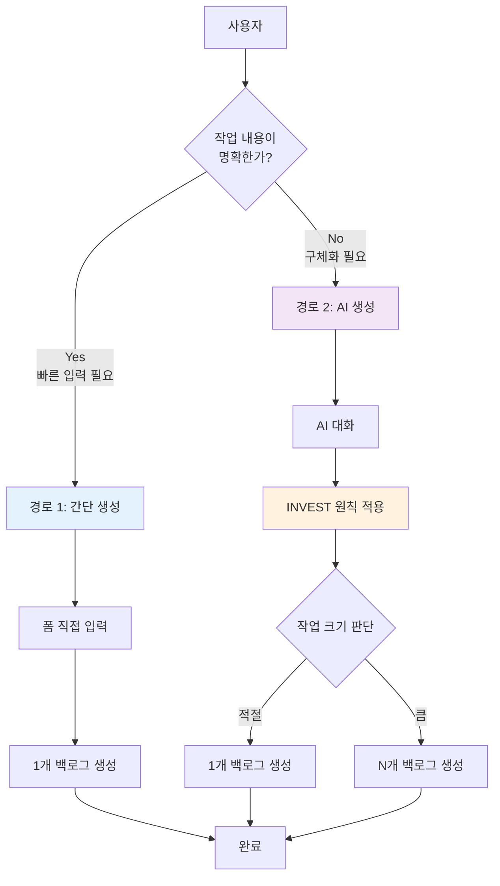

### 2.2 핵심 개념

| 개념 | 설명 | 역할 |
|------|------|------|
| **이원화 진입점** | 간단 생성 vs AI 생성 | 사용자의 상황에 맞는 최적 경로 제공 |
| **INVEST 원칙** | Independent, Negotiable, Valuable, Estimable, Small, Testable | 백로그 품질 보장 기준 |
| **적응형 분할** | AI가 작업 크기에 따라 1개 또는 N개 제안 | 관리 가능한 크기로 자동 조정 |
| **세션 연속성** | 대화 세션 저장 및 복구 | 작업 중단 시에도 데이터 보존 |

### 2.3 시스템 경계

**포함 범위:**
- 백로그 생성 (간단/AI 방식)
- AI 대화 인터페이스
- INVEST 원칙 기반 품질 검증
- 작업 분할 제안
- 세션 관리 및 복구

**제외 범위:**
- 백로그 수정/삭제
- 백로그 상태 변경 (TODO → IN_PROGRESS 등)
- 스토리 포인트 추정
- 팀원 할당
- 댓글 및 첨부파일

---

## 3. 기능 분할 (작은 단위로 나누기)

### 3.1 기능 분류 체계

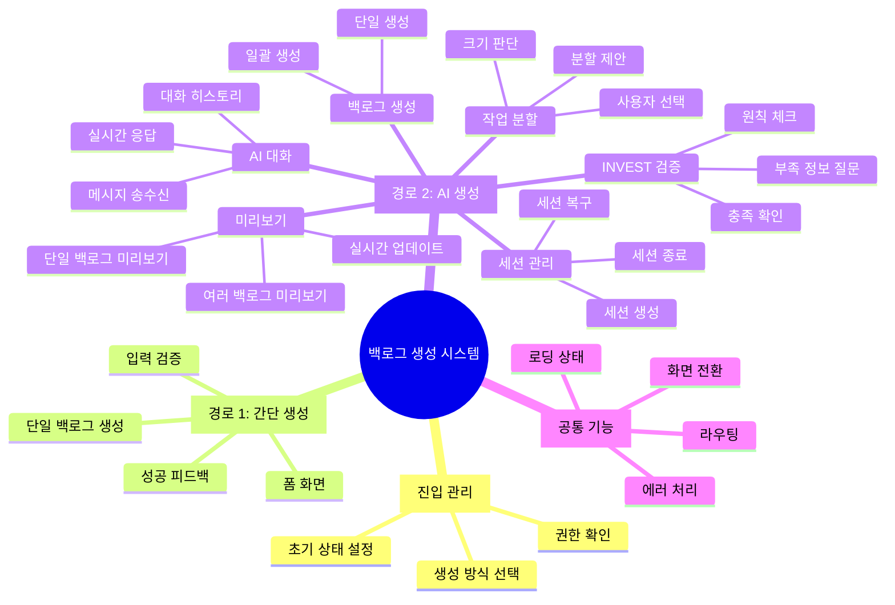

### 3.2 기능 분해 구조 (WBS)

| Level 1 | Level 2 | Level 3 | ID |
|---------|---------|---------|-----|
| **1. 진입 관리** | | | |
| | 1.1 생성 방식 선택 모달 | | F-1.1 |
| | | 1.1.1 모달 UI 표시 | F-1.1.1 |
| | | 1.1.2 간단 생성 선택 처리 | F-1.1.2 |
| | | 1.1.3 AI 생성 선택 처리 | F-1.1.3 |
| | | 1.1.4 모달 닫기 처리 | F-1.1.4 |
| **2. 간단 생성** | | | |
| | 2.1 폼 화면 | | F-2.1 |
| | | 2.1.1 폼 렌더링 | F-2.1.1 |
| | | 2.1.2 입력란 포커스 관리 | F-2.1.2 |
| | | 2.1.3 입력 글자 수 표시 | F-2.1.3 |
| | 2.2 유효성 검증 | | F-2.2 |
| | | 2.2.1 제목 검증 (2-100자) | F-2.2.1 |
| | | 2.2.2 설명 검증 (10-2000자) | F-2.2.2 |
| | | 2.2.3 완료 조건 검증 (5-1000자) | F-2.2.3 |
| | | 2.2.4 공백 검증 | F-2.2.4 |
| | 2.3 백로그 생성 | | F-2.3 |
| | | 2.3.1 생성 요청 | F-2.3.1 |
| | | 2.3.2 성공 처리 | F-2.3.2 |
| | | 2.3.3 실패 처리 | F-2.3.3 |
| **3. AI 생성** | | | |
| | 3.1 세션 관리 | | F-3.1 |
| | | 3.1.1 세션 존재 확인 | F-3.1.1 |
| | | 3.1.2 신규 세션 생성 | F-3.1.2 |
| | | 3.1.3 세션 복구 확인 | F-3.1.3 |
| | | 3.1.4 기존 세션 로드 | F-3.1.4 |
| | | 3.1.5 세션 보관 | F-3.1.5 |
| | | 3.1.6 세션 만료 처리 | F-3.1.6 |
| | 3.2 AI 대화 | | F-3.2 |
| | | 3.2.1 환영 메시지 표시 | F-3.2.1 |
| | | 3.2.2 사용자 메시지 입력 | F-3.2.2 |
| | | 3.2.3 메시지 전송 | F-3.2.3 |
| | | 3.2.4 AI 응답 실시간 표시 | F-3.2.4 |
| | | 3.2.5 타이핑 인디케이터 | F-3.2.5 |
| | | 3.2.6 대화 히스토리 표시 | F-3.2.6 |
| | | 3.2.7 자동 스크롤 | F-3.2.7 |
| | 3.3 INVEST 검증 | | F-3.3 |
| | | 3.3.1 Independent 체크 | F-3.3.1 |
| | | 3.3.2 Valuable 체크 | F-3.3.2 |
| | | 3.3.3 Estimable 체크 | F-3.3.3 |
| | | 3.3.4 Small 체크 | F-3.3.4 |
| | | 3.3.5 Testable 체크 | F-3.3.5 |
| | | 3.3.6 부족 정보 질문 생성 | F-3.3.6 |
| | 3.4 작업 분할 | | F-3.4 |
| | | 3.4.1 작업 크기 판단 | F-3.4.1 |
| | | 3.4.2 분할 제안 생성 | F-3.4.2 |
| | | 3.4.3 사용자 동의 확인 | F-3.4.3 |
| | | 3.4.4 분할 개수 조정 | F-3.4.4 |
| | 3.5 미리보기 | | F-3.5 |
| | | 3.5.1 단일 백로그 미리보기 | F-3.5.1 |
| | | 3.5.2 여러 백로그 미리보기 | F-3.5.2 |
| | | 3.5.3 미리보기 슬라이드인 | F-3.5.3 |
| | | 3.5.4 미리보기 실시간 업데이트 | F-3.5.4 |
| | 3.6 백로그 생성 | | F-3.6 |
| | | 3.6.1 단일 백로그 생성 | F-3.6.1 |
| | | 3.6.2 여러 백로그 일괄 생성 | F-3.6.2 |
| | | 3.6.3 세션 종료 처리 | F-3.6.3 |
| **4. 공통 기능** | | | |
| | 4.1 에러 처리 | | F-4.1 |
| | | 4.1.1 네트워크 오류 | F-4.1.1 |
| | | 4.1.2 시스템 오류 | F-4.1.2 |
| | | 4.1.3 유효성 오류 | F-4.1.3 |
| | 4.2 UI 상태 관리 | | F-4.2 |
| | | 4.2.1 로딩 인디케이터 | F-4.2.1 |
| | | 4.2.2 성공 피드백 | F-4.2.2 |
| | | 4.2.3 에러 메시지 | F-4.2.3 |
| | 4.3 라우팅 | | F-4.3 |
| | | 4.3.1 페이지 전환 | F-4.3.1 |
| | | 4.3.2 뒤로가기 처리 | F-4.3.2 |

---

## 4. 기능 간 관계 정의 (의존성, 우선순위)

### 4.1 기능 의존성 그래프

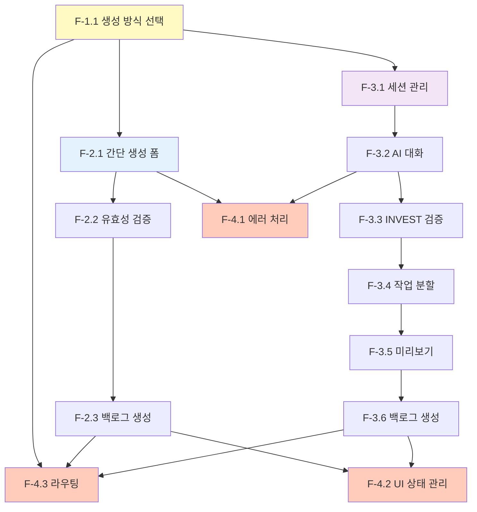

### 4.2 기능별 의존성 매트릭스

| 기능 ID | 의존 기능 | 의존 타입 | 설명 |
|---------|----------|----------|------|
| F-2.1 | F-1.1 | 선행 필수 | 간단 생성 선택 후 폼 표시 |
| F-2.2 | F-2.1 | 선행 필수 | 폼 입력 후 검증 |
| F-2.3 | F-2.2 | 선행 필수 | 검증 통과 후 생성 |
| F-3.1 | F-1.1 | 선행 필수 | AI 생성 선택 후 세션 확인 |
| F-3.2 | F-3.1 | 선행 필수 | 세션 준비 후 대화 시작 |
| F-3.3 | F-3.2 | 병렬 실행 | 대화 중 실시간 검증 |
| F-3.4 | F-3.3 | 조건부 | INVEST 충족 시 크기 판단 |
| F-3.5 | F-3.4 | 선행 필수 | 분할 결정 후 미리보기 |
| F-3.6 | F-3.5 | 선행 필수 | 미리보기 확인 후 생성 |
| F-4.1 | 모든 기능 | 공통 지원 | 모든 기능에서 에러 발생 가능 |
| F-4.2 | F-2.3, F-3.6 | 공통 지원 | 생성 완료 시 피드백 |
| F-4.3 | F-1.1, F-2.3, F-3.6 | 공통 지원 | 화면 전환 필요 시 |

### 4.3 우선순위 분류

| 우선순위 | 레벨 | 기능 ID | 이유 |
|---------|------|---------|------|
| **P0** | 필수 | F-1.1, F-2.1~2.3 | MVP 최소 기능: 간단 생성으로 백로그 생성 가능 |
| **P0** | 필수 | F-3.1, F-3.2 | AI 생성의 기본 대화 기능 |
| **P0** | 필수 | F-3.3, F-3.5, F-3.6 | INVEST 검증 및 백로그 생성 |
| **P1** | 중요 | F-3.4 | 작업 분할로 Small 원칙 적용 |
| **P1** | 중요 | F-3.1.3~5 (세션 복구) | 사용자 경험 개선 |
| **P1** | 중요 | F-3.2.4 (실시간 응답) | AI 응답 UX 개선 |
| **P2** | 선택 | F-3.4.4 (분할 개수 조정) | 세밀한 사용자 제어 |
| **P2** | 선택 | F-2.1.3 (글자 수 표시) | UX 편의 기능 |

---

## 5. 기능별 상세화 (각 기능 깊이 파기)

### 5.1 F-1.1 생성 방식 선택 모달

#### 5.1.1 기능 개요

| 항목 | 내용 |
|------|------|
| **목적** | 사용자가 백로그 생성 방법을 선택할 수 있는 진입점 제공 |
| **트리거** | '새 백로그 생성' 버튼 클릭 |
| **결과** | 간단 생성 폼 또는 AI 채팅 화면으로 이동 |
| **우선순위** | P0 (필수) |

#### 5.1.2 상세 요구사항

| 요구사항 ID | 설명 | 인수 조건 |
|------------|------|----------|
| F-1.1-R1 | 모달은 2개의 선택지를 명확히 구분하여 표시한다 | 각 옵션의 설명, 소요 시간, 결과물이 표시됨 |
| F-1.1-R2 | 각 선택지는 클릭 가능한 카드 형태로 제공한다 | 마우스 호버 시 시각적 피드백 |
| F-1.1-R3 | ESC 키 또는 X 버튼으로 모달을 닫을 수 있다 | 닫기 시 백로그 목록 페이지 유지 |
| F-1.1-R4 | 모달 외부 클릭 시 모달이 닫힌다 | 배경 클릭으로 닫기 |

#### 5.1.3 플로우 다이어그램

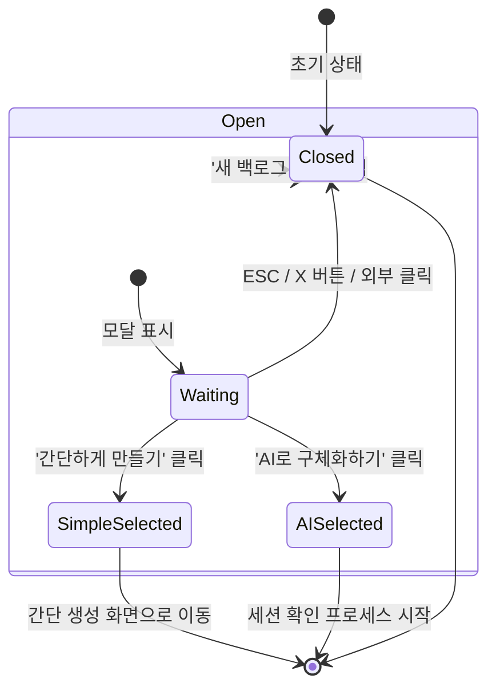

#### 5.1.4 UI 상태

| 상태 | 설명 | UI 변화 |
|------|------|---------|
| Closed | 모달 비표시 | 배경 페이지만 보임 |
| Open | 모달 표시 | 배경 딤 처리, 모달 페이드인 |
| Hovering | 선택지 호버 | 카드 배경색 변경, 그림자 증가 |
| SimpleSelected | 간단 생성 선택 | 페이지 전환 애니메이션 |
| AISelected | AI 생성 선택 | 세션 확인 후 페이지 전환 |

---

### 5.2 F-2.1~2.3 간단 생성 (폼 기반)

#### 5.2.1 기능 개요

| 항목 | 내용 |
|------|------|
| **목적** | 명확한 작업 내용을 빠르게 입력하여 1개 백로그 생성 |
| **트리거** | 생성 방식 선택 모달에서 '간단하게 만들기' 선택 |
| **결과** | 1개의 백로그 생성 및 상세 페이지로 이동 |
| **우선순위** | P0 (필수) |

#### 5.2.2 입력 필드 정의

| 필드명 | 타입 | 필수 | 최소 | 최대 | 기본값 | 검증 규칙 |
|--------|------|------|------|------|--------|----------|
| title | text | Y | 2자 | 100자 | - | 공백만 입력 불가 |
| description | textarea | Y | 10자 | 2000자 | - | 공백만 입력 불가 |
| acceptanceCriteria | textarea | Y | 5자 | 1000자 | - | 공백만 입력 불가 |

#### 5.2.3 유효성 검증 규칙

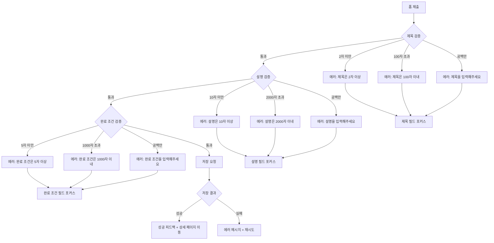

#### 5.2.4 에러 처리

| 에러 타입 | 에러 메시지 | 사용자 액션 | 시스템 복구 |
|----------|------------|------------|------------|
| 필수 항목 누락 | "모든 항목을 입력해주세요" | 첫 번째 빈 항목 확인 | 해당 필드 포커스 |
| 길이 초과 | "{필드}는 {최대}자 이내로 입력해주세요" | 텍스트 축소 | 글자 수 실시간 표시 |
| 공백만 입력 | "{필드}를 입력해주세요" | 내용 입력 | 필드 강조 |
| 네트워크 오류 | "네트워크 연결을 확인해주세요" | [재시도] 클릭 | 데이터 유지 |
| 시스템 오류 | "일시적인 오류가 발생했습니다" | [재시도] 클릭 | 데이터 유지 |

---

### 5.3 F-3.1 세션 관리

#### 5.3.1 기능 개요

| 항목 | 내용 |
|------|------|
| **목적** | AI 대화 세션의 생명주기를 관리하여 연속성 보장 |
| **트리거** | 'AI로 구체화하기' 선택 |
| **결과** | 신규 세션 생성 또는 기존 세션 복구 |
| **우선순위** | P0 (필수 - 생성), P1 (중요 - 복구) |

#### 5.3.2 세션 상태 정의

| 상태 | 설명 | 전환 조건 |
|------|------|----------|
| **없음** | 세션이 존재하지 않음 | 초기 상태 |
| **IN_PROGRESS** | 대화 진행 중 | 세션 생성 또는 복구 |
| **COMPLETED** | 백로그 생성 완료 | 백로그 생성 성공 |
| **ARCHIVED** | 사용자가 보관 선택 | 복구 시 '새로 시작' 선택 |
| **EXPIRED** | 7일 이상 경과 | 자동 만료 |

#### 5.3.3 세션 생명주기

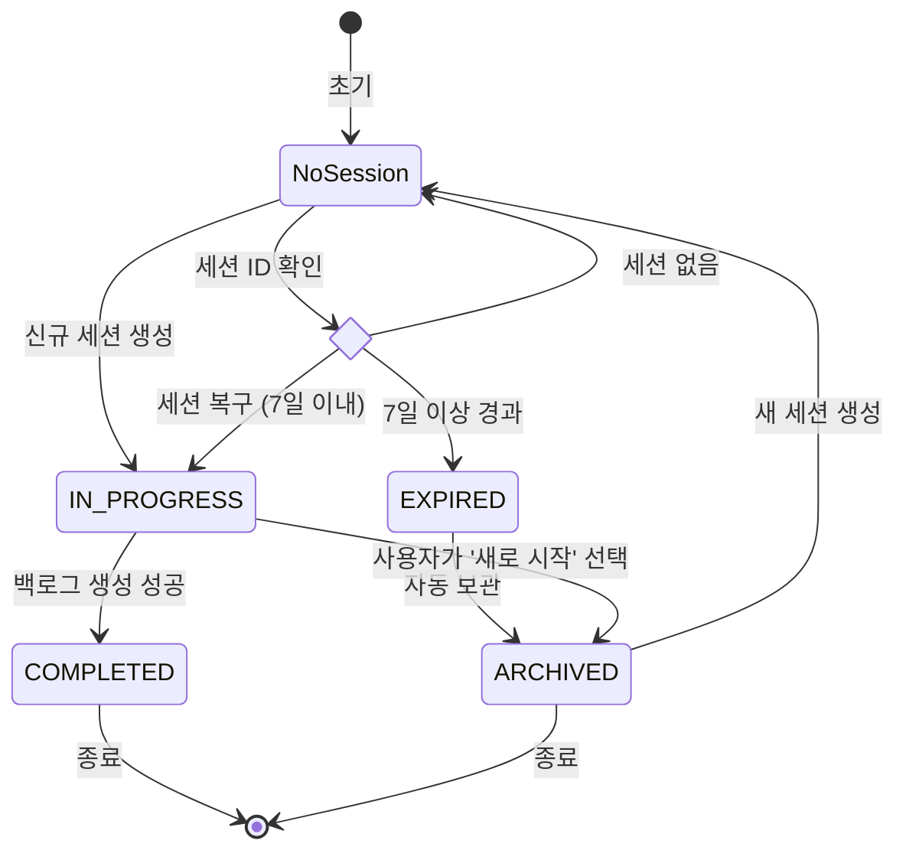

#### 5.3.4 세션 복구 프로세스

| 단계 | 조건 | 동작 | 사용자 인터랙션 |
|------|------|------|----------------|
| 1 | 저장된 세션 ID 존재 | 세션 상태 확인 | - |
| 2 | 세션 상태 = IN_PROGRESS | 복구 다이얼로그 표시 | [계속하기] / [새로 시작] 선택 |
| 3a | 사용자가 [계속하기] 선택 | 대화 히스토리 로드 + 미리보기 복원 | - |
| 3b | 사용자가 [새로 시작] 선택 | 기존 세션 ARCHIVED + 새 세션 생성 | - |
| 4 | 세션 상태 = COMPLETED/ARCHIVED | 세션 정보 정리 + 새 세션 생성 | - |
| 5 | 세션 만료 (7일 경과) | 자동 ARCHIVED + 새 세션 생성 | 만료 안내 표시 |

---

### 5.4 F-3.2 AI 대화

#### 5.4.1 기능 개요

| 항목 | 내용 |
|------|------|
| **목적** | AI와 실시간 대화를 통해 백로그 내용 구체화 |
| **트리거** | 세션 생성 또는 복구 완료 |
| **결과** | INVEST 원칙을 충족하는 백로그 초안 생성 |
| **우선순위** | P0 (필수) |

#### 5.4.2 메시지 송수신 플로우

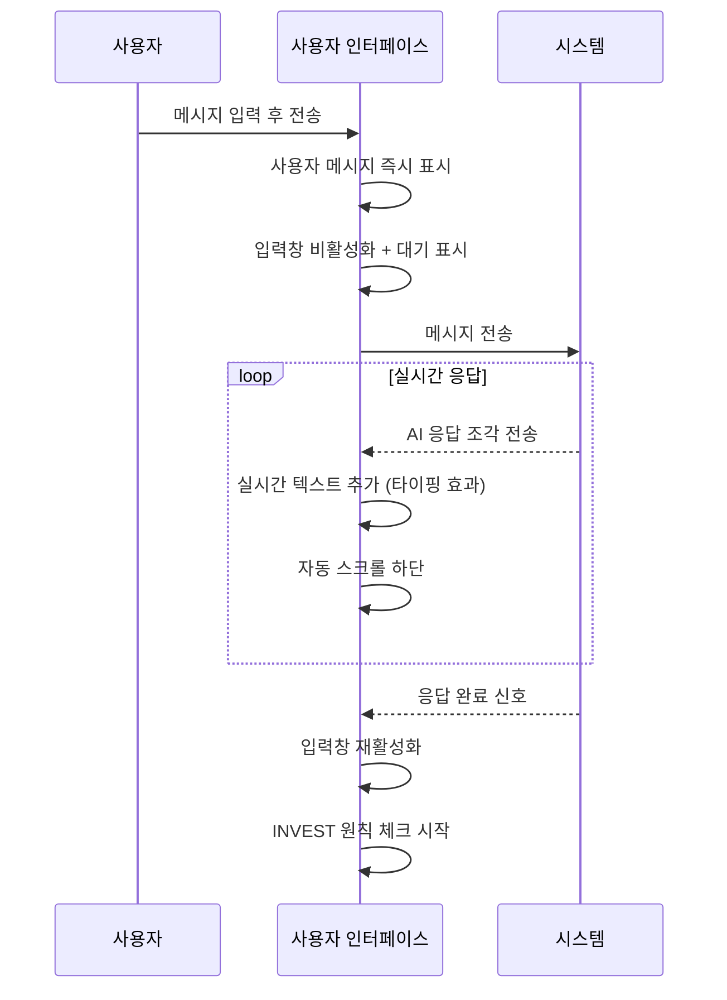

#### 5.4.3 실시간 응답 상세

| 단계 | 동작 | UX 효과 |
|------|------|---------|
| 1. 연결 | 실시간 응답 채널 연결 | - |
| 2. 수신 | 단어/문장 단위 조각 수신 | 실시간 타이핑 효과 |
| 3. 렌더링 | 받은 조각을 기존 텍스트에 추가 | 부드러운 텍스트 증가 |
| 4. 스크롤 | 새 텍스트 추가 시 하단으로 스크롤 | 최신 내용 항상 표시 |
| 5. 완료 | 응답 완료 및 채널 종료 | 입력창 활성화 |

#### 5.4.4 대화 히스토리 관리

| 항목 | 설명 |
|------|------|
| **저장 시점** | 메시지 전송/수신 완료 시 즉시 |
| **저장 위치** | 영구 저장소 |
| **로드 조건** | 세션 복구 시 |
| **표시 순서** | 시간순 (오래된 것부터) |
| **최대 개수** | 제한 없음 |

---

### 5.5 F-3.3 INVEST 검증

#### 5.5.1 기능 개요

| 항목 | 내용 |
|------|------|
| **목적** | AI가 INVEST 원칙 충족 여부를 판단하여 백로그 품질 보장 |
| **트리거** | AI 응답 생성 시 (메시지마다) |
| **결과** | 백로그 초안 생성 또는 추가 질문 |
| **우선순위** | P0 (필수) |

#### 5.5.2 INVEST 원칙 체크리스트

| 원칙 | 영문 | 판단 기준 | AI 질문 예시 |
|------|------|----------|-------------|
| **I** | Independent | 작업 범위가 명확히 정의됨 | "이 작업은 다른 작업과 독립적으로 진행 가능한가요?" |
| **N** | Negotiable | 목표는 명확하지만 방법은 열려있음 | "구현 방법을 여러 가지로 고려할 수 있나요?" |
| **V** | Valuable | 작업의 목적과 기대 효과가 설명됨 | "이 작업을 통해 얻고자 하는 결과는 무엇인가요?" |
| **E** | Estimable | 작업 내용이 충분히 구체적 | "작업 범위가 명확히 정의되어 있나요?" |
| **S** | Small | 너무 크지 않고 관리 가능한 크기 | "이 작업은 한 주 안에 완료 가능한 크기인가요?" |
| **T** | Testable | 완료 조건이 구체적으로 정의됨 | "어떤 상태가 되면 '완료'라고 할 수 있을까요?" |

#### 5.5.3 검증 플로우

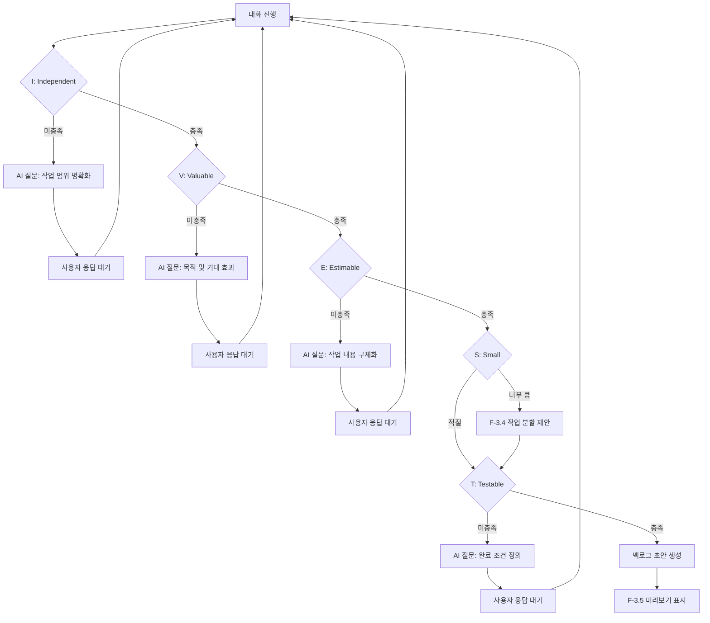

#### 5.5.4 AI 검증 프로세스

AI는 대화 중 다음을 체크합니다:

| 단계 | 검증 항목 | 충족 시 | 미충족 시 |
|------|----------|---------|----------|
| 1 | Independent: 작업 독립성 | 다음 단계 진행 | 작업 범위 명확화 질문 |
| 2 | Valuable: 가치 및 목적 | 다음 단계 진행 | 목적 및 기대 효과 질문 |
| 3 | Estimable: 구체성 | 다음 단계 진행 | 작업 내용 구체화 질문 |
| 4 | Small: 작업 크기 | 다음 단계 진행 | 작업 분할 제안 (F-3.4) |
| 5 | Testable: 완료 조건 | 백로그 초안 생성 | 완료 조건 정의 질문 |

**모든 원칙 충족 시**: 백로그 초안 생성 (제목, 설명, 완료 조건)
**작업이 큰 경우**: 논리적 단위로 분할 제안

---

### 5.6 F-3.4 작업 분할

#### 5.6.1 기능 개요

| 항목 | 내용 |
|------|------|
| **목적** | 큰 작업을 Small 원칙에 맞게 작은 단위로 분할 |
| **트리거** | INVEST 검증 중 Small 원칙 미충족 |
| **결과** | N개의 백로그 초안 생성 |
| **우선순위** | P1 (중요) |

#### 5.6.2 분할 판단 기준

| 조건 | 임계값 | 동작 |
|------|--------|------|
| 작업 설명 길이 | 500자 이상 | 분할 고려 |
| 완료 조건 개수 | 5개 이상 | 분할 고려 |
| 키워드 감지 | "그리고", "또한", "및" 3회 이상 | 분할 제안 |
| 명시적 요청 | "여러 개", "나눠서" 등 | 즉시 분할 |

#### 5.6.3 분할 제안 플로우

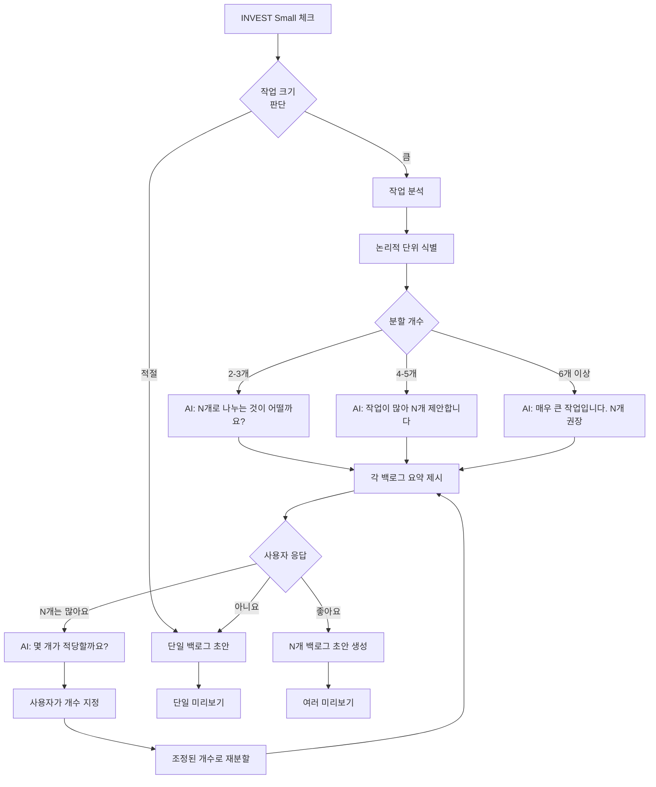

#### 5.6.4 분할 예시

**원본 아이디어:**
> "웹사이트를 개선하고 싶어요. 성능도 올리고 디자인도 바꾸고 싶어요."

**AI 분할 제안:**

| # | 제목 | 설명 요약 | 완료 조건 요약 |
|---|------|----------|---------------|
| 1 | 메인 페이지 로딩 속도 1초 단축 | 이미지 최적화 및 번들 크기 축소 | Lighthouse 90점 이상 |
| 2 | 반응형 헤더 UI 개선 | 모바일/데스크톱 헤더 디자인 개선 | 모든 디바이스 정상 표시 |
| 3 | 다크 모드 지원 | 전체 페이지 다크 모드 테마 추가 | 토글로 전환 가능 |

---

### 5.7 F-3.5 미리보기

#### 5.7.1 기능 개요

| 항목 | 내용 |
|------|------|
| **목적** | 백로그 생성 전 내용 확인 및 수정 기회 제공 |
| **트리거** | INVEST 검증 완료 및 백로그 초안 생성 |
| **결과** | 사용자 확인 후 생성 또는 대화 계속 |
| **우선순위** | P0 (필수) |

#### 5.7.2 미리보기 타입

| 타입 | 조건 | 레이아웃 | 버튼 텍스트 |
|------|------|---------|------------|
| **단일** | 1개 백로그 초안 | 우측 40% 패널 | "백로그 생성" |
| **여러** | N개 백로그 초안 | 우측 40% 패널 (스크롤) | "N개 백로그 생성" |

#### 5.7.3 미리보기 UI 구조

```
┌─────────────────────────────────────────┐
│  채팅 화면 (60%)   │  미리보기 (40%)    │
├────────────────────┼────────────────────┤
│                    │ 📋 백로그 미리보기  │
│  [대화 내역]       │                    │
│                    │ 제목               │
│  [사용자] ...      │ ─────────────────  │
│  [AI] ...          │ [백로그 제목]      │
│                    │                    │
│                    │ 설명               │
│                    │ ─────────────────  │
│                    │ [설명 내용]        │
│                    │                    │
│  [입력창]          │ 완료 조건          │
│                    │ ─────────────────  │
│                    │ [완료 조건]        │
│                    │                    │
│                    │                    │
│                    │   [백로그 생성] → │
└────────────────────┴────────────────────┘
```

#### 5.7.4 실시간 업데이트

| 트리거 | 동작 | 애니메이션 |
|--------|------|-----------|
| 새 백로그 초안 생성 | 미리보기 패널 슬라이드인 | 우측에서 좌측으로 200ms |
| 사용자가 추가 메시지 전송 | 미리보기 내용 업데이트 | 페이드 아웃/인 300ms |
| AI가 분할 제안 수락 | 단일 → 여러 미리보기 전환 | 크로스 페이드 400ms |
| 대화 계속 시 내용 변경 | 변경된 필드만 강조 표시 | 노란색 하이라이트 2초 |

---

### 5.8 F-3.6 백로그 생성 (AI)

#### 5.8.1 기능 개요

| 항목 | 내용 |
|------|------|
| **목적** | AI로 구체화한 백로그를 저장 |
| **트리거** | 미리보기에서 '백로그 생성' 버튼 클릭 |
| **결과** | 1개 또는 N개 백로그 생성 완료 |
| **우선순위** | P0 (필수) |

#### 5.8.2 생성 타입별 처리

| 타입 | 요청 데이터 | 결과 | 이동 페이지 |
|------|------------|------|------------|
| **단일** | 세션 ID, 백로그 데이터 (제목, 설명, 완료 조건) | 1개 백로그 생성 | 백로그 상세 페이지 |
| **여러** | 세션 ID, 여러 백로그 데이터 배열 | N개 백로그 일괄 생성 | 백로그 목록 페이지 |

#### 5.8.3 생성 플로우

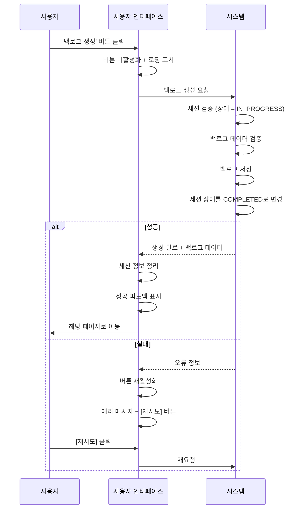

#### 5.8.4 에러 처리

| 에러 유형 | 원인 | 사용자 메시지 | 복구 방법 |
|----------|------|--------------|----------|
| 유효성 검증 실패 | 데이터 형식 오류 | "입력 내용을 다시 확인해주세요" | [재시도] - 대화 계속 |
| 세션 없음 | 세션 만료 또는 삭제됨 | "세션이 만료되었습니다" | 새 세션 생성 안내 |
| 세션 이미 완료 | 중복 생성 시도 | "이미 생성된 백로그입니다" | 목록 페이지로 이동 |
| 저장 오류 | 시스템 오류 | "일시적인 오류가 발생했습니다" | [재시도] - 데이터 유지 |
| 서비스 불가 | 시스템 점검 중 | "서버 점검 중입니다" | 안내 메시지 |

---

### 5.9 F-4.1 에러 처리 (공통)

#### 5.9.1 에러 분류 체계

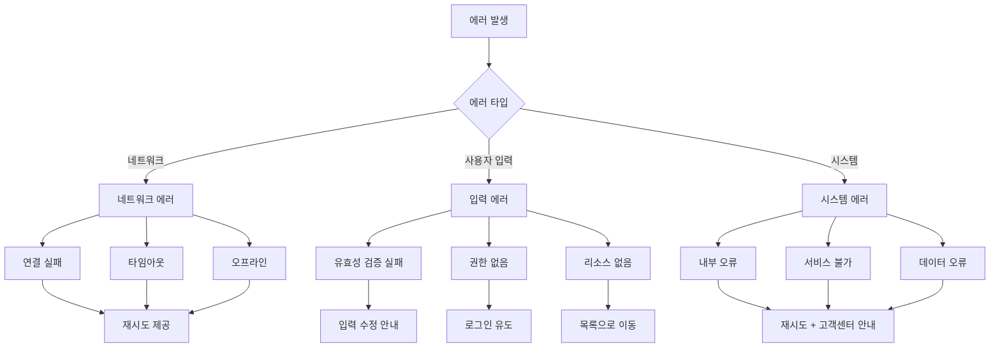

#### 5.9.2 에러별 처리 전략

| 에러 타입 | 우선 순위 | 사용자 액션 | 자동 복구 | 비고 |
|----------|----------|------------|----------|------|
| 네트워크 연결 실패 | P0 | [재시도] | 3초 후 자동 재시도 (최대 3회) | 데이터 유지 |
| 타임아웃 | P0 | [재시도] | - | 데이터 유지 |
| 유효성 검증 실패 | P0 | 입력 수정 | 해당 필드 포커스 | 에러 메시지 표시 |
| 인증 실패 | P0 | [로그인] | 로그인 페이지로 이동 | - |
| 권한 없음 | P1 | 안내 메시지 | - | - |
| 리소스 없음 | P1 | [목록으로] | - | - |
| 시스템 오류 | P0 | [재시도] | - | 데이터 유지 |
| 서비스 불가 | P1 | 점검 안내 | - | - |

---

## 6. 통합 및 검증 (전체 일관성 확인)

### 6.1 전체 시스템 통합 맵

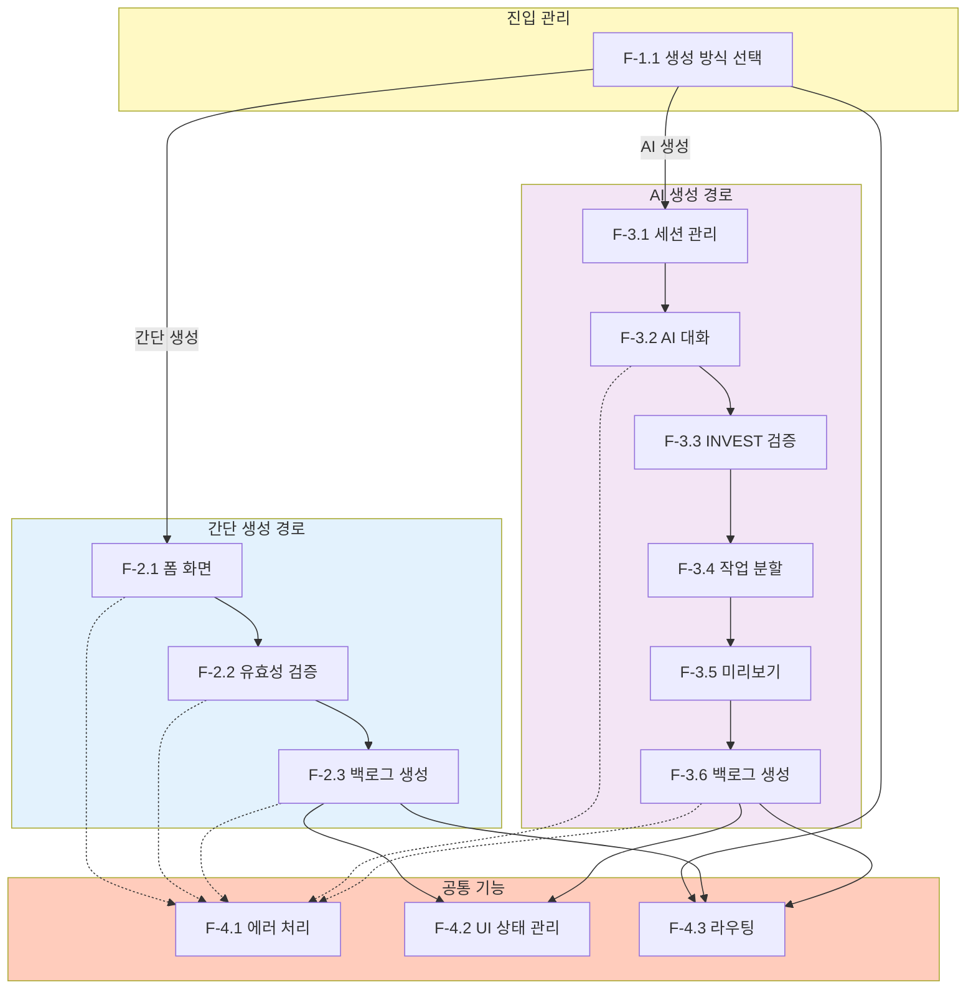

### 6.2 기능 완전성 검증

| 검증 항목 | 기준 | 결과 |
|----------|------|------|
| **모든 사용자 스토리 커버** | US-01 ~ US-04 모두 포함 | ✅ 완료 |
| **P0 기능 모두 포함** | FR-01~04, 06, 09~10 | ✅ 완료 |
| **진입점 → 완료 경로 존재** | 간단 생성, AI 생성 모두 | ✅ 완료 |
| **에러 처리 누락 없음** | 모든 주요 흐름에 에러 처리 | ✅ 완료 |
| **상태 전환 일관성** | 모든 상태가 정의된 전환만 가능 | ✅ 완료 |

### 6.3 기능 간 일관성 검증

| 검증 대상 | 일관성 규칙 | 검증 결과 |
|----------|------------|----------|
| **데이터 모델** | 02-data-models.md와 엔티티 일치 | ✅ 일치 |
| **라우팅** | 모든 화면 전환에 라우트 정의됨 | ✅ 완료 |
| **세션 상태** | 상태 전환이 명확히 정의됨 | ✅ 완료 |
| **백로그 생성** | 간단/AI 방식 모두 동일한 결과물 | ✅ 일치 |
| **INVEST 원칙** | 모든 백로그가 원칙 충족 | ✅ 보장됨 |

### 6.4 사용자 여정 일관성

| 여정 | 시작 | 중간 단계 | 종료 | 검증 |
|------|------|----------|------|------|
| **간단 생성** | 목록 페이지 | 모달 → 폼 → 검증 | 상세 페이지 | ✅ |
| **AI 단일 생성** | 목록 페이지 | 모달 → 대화 → 미리보기 | 상세 페이지 | ✅ |
| **AI 여러 생성** | 목록 페이지 | 모달 → 대화 → 분할 → 미리보기 | 목록 페이지 | ✅ |
| **세션 복구** | 목록 페이지 | 모달 → 복구 다이얼로그 → 대화 | 상세/목록 페이지 | ✅ |

### 6.5 비기능 요구사항 달성 가능성

| NFR ID | 요구사항 | 목표 | 검증 |
|--------|---------|------|------|
| NFR-01 | AI 응답 첫 응답 지연시간 | 1초 이내 | ✅ 달성 가능 |
| NFR-02 | 간단 생성 폼 제출 응답시간 | 500ms 이내 | ✅ 달성 가능 |
| NFR-03 | 간단 생성 완료 시간 | 평균 1-2분 | ✅ 달성 가능 |
| NFR-04 | AI 생성 완료 시간 | 평균 3-7분 | ✅ 달성 가능 |
| NFR-05 | 세션 데이터 보존 기간 | 7일 | ✅ 달성 가능 |
| NFR-06 | 브라우저 지원 | Chrome, Safari, Firefox 최신 2개 버전 | ✅ 달성 가능 |
| NFR-07 | 키보드 네비게이션 | 모든 기능 키보드로 접근 가능 | ✅ 달성 가능 |

### 6.6 위험 요소 및 완화 방안

| 위험 | 발생 확률 | 영향도 | 완화 방안 |
|------|----------|--------|----------|
| AI 응답 품질 저하 | 중간 | 높음 | 지속적 품질 모니터링 + 사용자 피드백 수집 |
| 실시간 연결 끊김 | 낮음 | 중간 | 재연결 로직 + 대체 방안 제공 |
| 세션 복구 실패 | 낮음 | 중간 | 세션 데이터 백업 + 에러 처리 |
| INVEST 검증 과다 질문 | 중간 | 중간 | 질문 최소화 전략 + 사용자 선택권 제공 |
| 분할 제안 정확도 | 중간 | 낮음 | 사용자 조정 옵션 + 재제안 기능 |

---

## 7. 다음 단계

이 요구사항 분석을 기반으로 다음 설계 및 구현 문서들이 작성됩니다:

1. **02-data-models.md** (완료) - 도메인 모델 및 엔티티 설계
2. **03-ui-design.md** (예정) - 화면 설계 및 사용자 인터페이스 명세
3. **04-api-design.md** (예정) - API 설계 및 통신 규격
4. **05-implementation-plan.md** (예정) - 구현 계획 및 개발 단계

---

## 부록

### A. 용어 정의

| 용어 | 정의 |
|------|------|
| **백로그 (Backlog)** | 사용자가 수행해야 할 작업 항목 |
| **INVEST 원칙** | 좋은 사용자 스토리/백로그의 6가지 특성 (Independent, Negotiable, Valuable, Estimable, Small, Testable) |
| **세션 (Session)** | AI와의 대화 단위, 고유 ID로 식별 |
| **미리보기 (Preview)** | 백로그 생성 전 내용 확인 패널 |
| **실시간 응답 (Streaming)** | AI 응답을 점진적으로 표시하는 방식 |

### B. 참조 문서

| 문서명 | 경로 | 관계 |
|--------|------|------|
| 레이아웃 및 네비게이션 | v1.0.0/DS/00-layout-navigation.md | 화면 구조 참조 |
| 인증 시스템 | v1.0.0/DS/01-authentication-system.md | 사용자 인증 참조 |
| 데이터 모델 | v1.0.0/DS/backlog-creation/02-data-models.md | 엔티티 구조 참조 |
