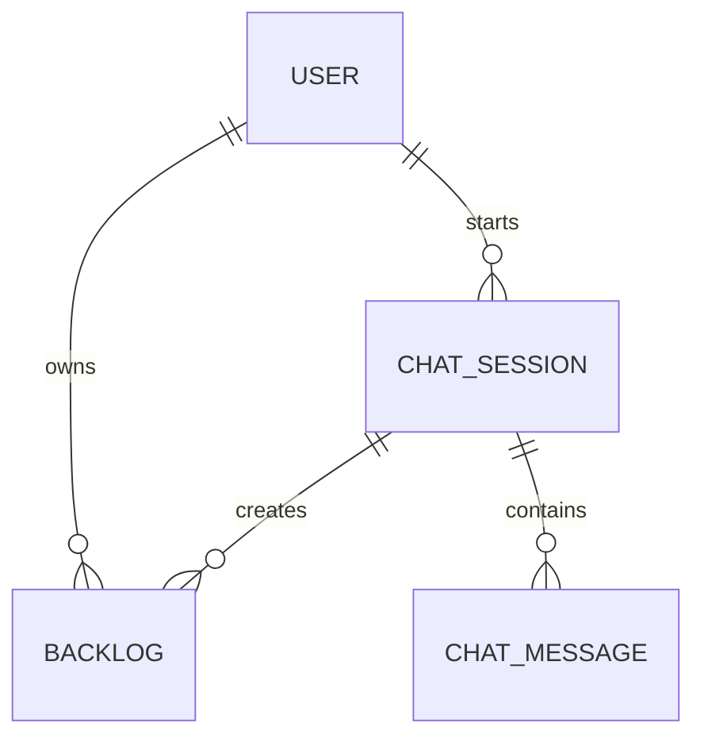
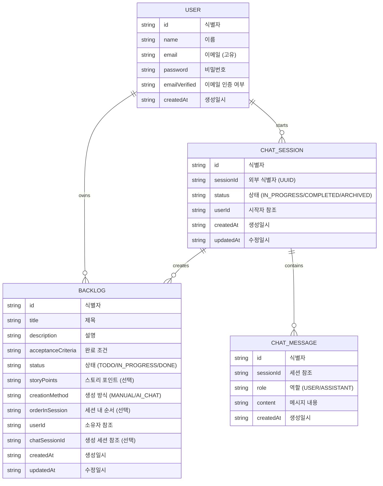
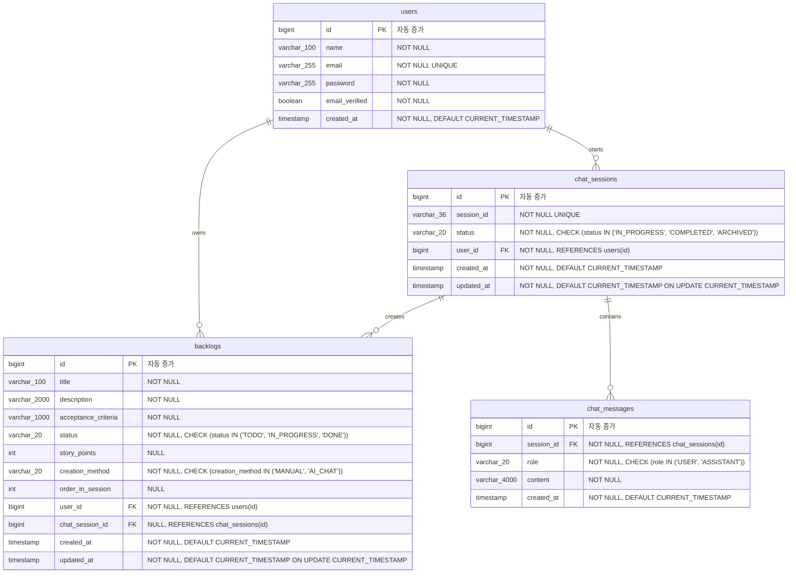
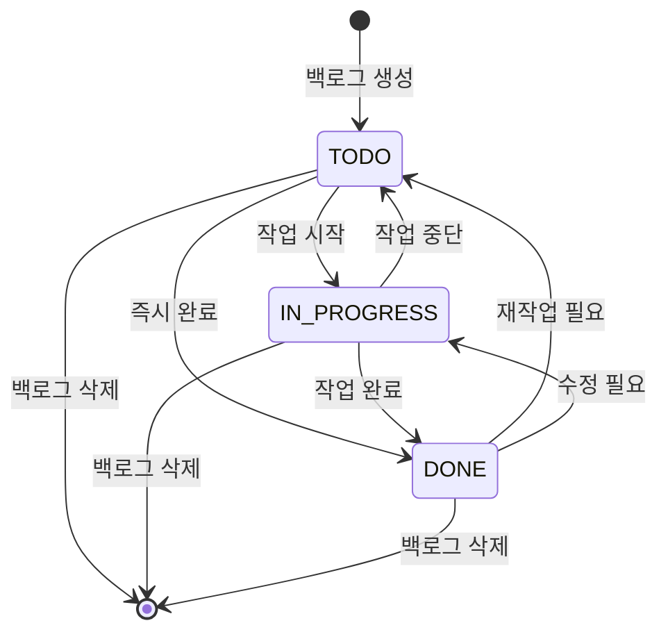
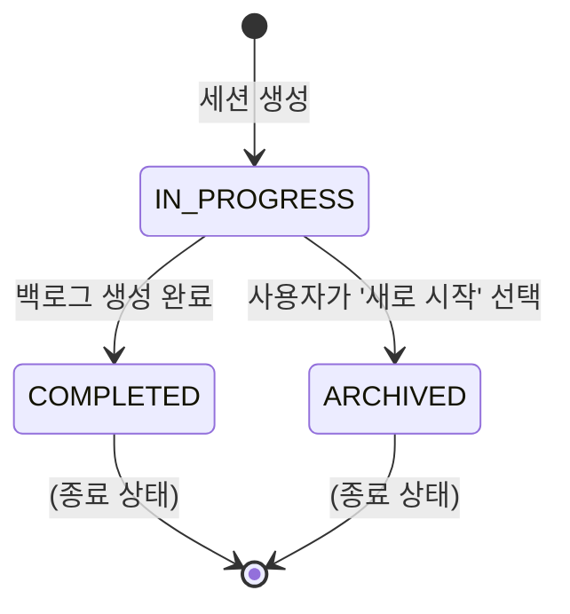

# AI 기반 백로그 생성 데이터 모델 설계 명세서

**작업 ID:** v1.0.0/DS/03  
**작성일:** 2025-10-21  
**상태:** 설계 완료  
**의존성:** v1.0.0/DS/02 (백로그 생성 플로우 설계)

---

## 1. 개요

### 1.1 목적

백로그 생성 기능에 필요한 도메인 모델을 설계한다. 비즈니스 요구사항을 분석하여 엔티티를 식별하고, 단일 책임 원칙에 따라 명확한 역할과 책임을 정의한다.

### 1.2 설계 원칙

- **단일 책임 원칙 (SRP)**: 각 엔티티는 하나의 명확한 책임만 가짐
- **도메인 주도 설계 (DDD)**: 비즈니스 도메인을 중심으로 모델링
- **불변성**: 생성 후 변경되지 않는 데이터는 명확히 구분
- **응집도**: 관련된 데이터와 로직을 한 곳에 모음

### 1.3 범위

이 문서는 도메인 모델링에 집중하며, 다음 내용을 다룹니다:

- 도메인 개념 식별
- 핵심 엔티티 목록 및 분류
- 엔티티 관계도 (ERD)
- 주요 엔티티 상세 설계

---

## 2. 도메인 개념 식별

### 2.1 비즈니스 요구사항 분석

Phase 1 플로우 설계 문서와 제품 명세서에서 명사를 추출합니다:

**사용자 스토리 1 (간단하게 만들기)**

> "명확한 작업 내용을 이미 알고 있을 때, **사용자**는 **폼**에 직접 입력하여 빠르게 **백로그**를 생성하고 싶어한다."

**사용자 스토리 2 (AI로 구체화하기)**

> "머릿속에 막연한 **아이디어**가 떠올랐을 때, **사용자**는 **AI**와의 자연스러운 **대화**를 통해 그 아이디어를 **INVEST 원칙**에 맞는 실행 가능한 **백로그**(들)로 변환하고 싶어한다."

**핵심 플로우**

- 사용자가 **생성 방식**을 선택한다
- **간단 생성**: 사용자가 **제목**, **설명**, **완료 조건**을 입력한다
- **AI 생성**: 사용자가 **채팅 세션**을 시작하고 **메시지**를 주고받는다
- AI가 **INVEST 원칙**을 체크하고 **백로그 초안**을 생성한다
- AI가 **작업 분할**을 제안할 수 있다
- 사용자가 확인 후 **백로그**를 생성한다
- 백로그는 **상태**(TODO, IN_PROGRESS, DONE)를 가진다

### 2.2 명사 추출 결과

| 명사                            | 출현 빈도 | 비고                      |
| ------------------------------- | --------- | ------------------------- |
| 사용자 (User)                   | 높음      | 기존 엔티티 (인증 시스템) |
| 백로그 (Backlog)                | 매우 높음 | **핵심 엔티티**           |
| 제목 (Title)                    | 중간      | 백로그 속성               |
| 설명 (Description)              | 중간      | 백로그 속성               |
| 완료 조건 (Acceptance Criteria) | 중간      | 백로그 속성               |
| 상태 (Status)                   | 중간      | 백로그 속성               |
| 생성 방식 (Creation Method)     | 중간      | 백로그 메타데이터         |
| AI 채팅 세션 (Chat Session)     | 높음      | **핵심 엔티티**           |
| 메시지 (Message)                | 높음      | **주요 엔티티**           |
| 대화 (Conversation)             | 중간      | 세션의 개념적 표현        |
| 백로그 초안 (Backlog Draft)     | 중간      | 임시 데이터               |
| INVEST 원칙                     | 낮음      | 비즈니스 규칙             |
| 작업 분할 (Task Split)          | 낮음      | 비즈니스 로직             |
| 스토리 포인트 (Story Points)    | 낮음      | 백로그 속성 (선택)        |

### 2.3 엔티티 vs 속성 구분

#### 엔티티로 판단되는 개념

독립적인 생명주기를 가지고, 고유 식별자(ID)가 필요한 개념:

| 개념            | 엔티티 판단 근거                                             |
| --------------- | ------------------------------------------------------------ |
| **User**        | 독립적 생명주기, 고유 식별 필요, 기존 엔티티                 |
| **Backlog**     | 독립적 생명주기, 고유 식별 필요, 핵심 비즈니스 개념          |
| **ChatSession** | 독립적 생명주기, 고유 식별 필요 (UUID), 대화의 컨텍스트 관리 |
| **ChatMessage** | 독립적 생명주기, 고유 식별 필요, 세션 내 순서 관리           |

#### 속성으로 판단되는 개념

엔티티의 특성을 설명하는 데이터:

| 개념                           | 속성 판단 근거                | 소속 엔티티      |
| ------------------------------ | ----------------------------- | ---------------- |
| 제목 (title)                   | 백로그를 설명하는 문자열      | Backlog          |
| 설명 (description)             | 백로그를 설명하는 문자열      | Backlog          |
| 완료 조건 (acceptanceCriteria) | 백로그를 설명하는 문자열      | Backlog          |
| 상태 (status)                  | 백로그의 현재 상태 값 (Enum)  | Backlog          |
| 생성 방식 (creationMethod)     | 백로그 생성 방법 (Enum)       | Backlog Metadata |
| 스토리 포인트 (storyPoints)    | 백로그의 작업량 추정치 (숫자) | Backlog          |
| 세션 상태 (sessionStatus)      | 세션의 현재 상태 값 (Enum)    | ChatSession      |
| 메시지 역할 (messageRole)      | 메시지 발신자 구분 (Enum)     | ChatMessage      |
| 메시지 내용 (content)          | 메시지 텍스트                 | ChatMessage      |

#### 값 객체로 판단되는 개념

불변이며 값으로 비교되는 개념:

| 개념                | 값 객체 판단 근거                                 |
| ------------------- | ------------------------------------------------- |
| **BacklogMetadata** | 생성 방식, 세션 내 순서 등 메타 정보의 묶음, 불변 |

#### 임시 데이터 (클라이언트 상태)

| 개념                       | 판단 근거                                                         |
| -------------------------- | ----------------------------------------------------------------- |
| 백로그 초안 (BacklogDraft) | AI가 생성한 임시 데이터, 서버 저장 불필요, 클라이언트 상태로 관리 |

---

## 3. 핵심 엔티티 목록 작성

### 3.1 전체 엔티티 목록

| 엔티티명    | 한글명      | 책임                       | 핵심 속성                                          |
| ----------- | ----------- | -------------------------- | -------------------------------------------------- |
| User        | 사용자      | 서비스 이용자 정보 관리    | id, name, email, password                          |
| Backlog     | 백로그      | 사용자의 작업 항목 관리    | id, title, description, acceptanceCriteria, status |
| ChatSession | 채팅 세션   | AI 대화 세션 생명주기 관리 | id, sessionId, status                              |
| ChatMessage | 채팅 메시지 | 대화 내용 저장             | id, role, content                                  |

### 3.2 엔티티 분류

#### 3.2.1 핵심 엔티티 (Core Entity)

비즈니스의 중심, 없으면 서비스 불가능

| 엔티티      | 분류 근거                                               |
| ----------- | ------------------------------------------------------- |
| **User**    | 모든 기능의 주체, 인증 및 권한 관리 필수                |
| **Backlog** | 서비스의 핵심 가치 제공, 백로그 없이는 서비스 의미 없음 |

#### 3.2.2 주요 엔티티 (Major Entity)

핵심 기능 지원, 초기 버전에 필요

| 엔티티          | 분류 근거                                      |
| --------------- | ---------------------------------------------- |
| **ChatSession** | AI 구체화 기능의 핵심, 대화 컨텍스트 관리 필수 |
| **ChatMessage** | 세션의 대화 내용 저장, 복구 및 히스토리 필요   |

#### 3.2.3 보조 엔티티 (Supporting Entity)

부가 기능, 추후 추가 가능

현재 범위에는 해당 없음

#### 3.2.4 확장 엔티티 (Optional Entity)

선택적 기능

현재 범위에는 해당 없음

### 3.3 엔티티 우선순위

구현 및 설계 우선순위:

1. **Backlog** (최우선) - 서비스의 핵심
2. **ChatSession** (높음) - AI 구체화 기능 필수
3. **ChatMessage** (높음) - 세션과 함께 구현
4. **User** (기존) - 이미 구현됨

---

## 4. 엔티티 관계도 (ERD)

### 4.1 레벨 1: 개념적 ERD (Conceptual)

비즈니스 개념 간의 관계만 표현, 구현 세부사항 제외



**관계 설명**:

- 사용자는 여러 백로그를 소유한다 (1:N)
- 사용자는 여러 채팅 세션을 시작한다 (1:N)
- 채팅 세션은 여러 메시지를 포함한다 (1:N)
- 채팅 세션은 여러 백로그를 생성할 수 있다 (1:N)

### 4.2 레벨 2: 논리적 ERD (Logical)

엔티티의 속성과 관계를 포함, 구현 기술은 제외



**관계 카디널리티**:

- USER : BACKLOG = 1 : N (필수)
- USER : CHAT_SESSION = 1 : N (필수)
- CHAT_SESSION : CHAT_MESSAGE = 1 : N (필수)
- CHAT_SESSION : BACKLOG = 1 : N (선택, AI 생성 시에만)

### 4.3 레벨 3: 물리적 ERD (Physical)

데이터베이스 구현을 위한 상세 스키마



**인덱스 전략**:

```sql
-- backlogs 테이블
CREATE INDEX idx_backlogs_user_id ON backlogs(user_id);
CREATE INDEX idx_backlogs_status ON backlogs(status);
CREATE INDEX idx_backlogs_user_status ON backlogs(user_id, status);
CREATE INDEX idx_backlogs_chat_session_id ON backlogs(chat_session_id);

-- chat_sessions 테이블
CREATE UNIQUE INDEX idx_chat_sessions_session_id ON chat_sessions(session_id);
CREATE INDEX idx_chat_sessions_user_status ON chat_sessions(user_id, status);

-- chat_messages 테이블
CREATE INDEX idx_chat_messages_session_created ON chat_messages(session_id, created_at);
```

### 4.4 관계 표기법

#### 4.4.1 카디널리티 (Cardinality)

#### 4.4.2 필수/선택 (Optionality)

#### 4.4.3 주요 관계 설명

**1. User → Backlog (1:N, 필수)**

- 사용자는 여러 백로그를 소유할 수 있다
- 백로그는 반드시 한 명의 사용자에게 속한다
- 외래키: `backlogs.user_id → users.id`
- 삭제 규칙: CASCADE (사용자 삭제 시 백로그도 삭제)

**2. User → ChatSession (1:N, 필수)**

- 사용자는 여러 채팅 세션을 시작할 수 있다
- 채팅 세션은 반드시 한 명의 사용자에게 속한다
- 외래키: `chat_sessions.user_id → users.id`
- 삭제 규칙: CASCADE

**3. ChatSession → ChatMessage (1:N, 필수)**

- 채팅 세션은 여러 메시지를 포함한다
- 메시지는 반드시 한 세션에 속한다
- 외래키: `chat_messages.session_id → chat_sessions.id`
- 삭제 규칙: CASCADE

**4. ChatSession → Backlog (1:N, 선택)**

- 채팅 세션은 여러 백로그를 생성할 수 있다
- 백로그는 채팅 세션이 없을 수 있다 (간단 생성 시)
- 외래키: `backlogs.chat_session_id → chat_sessions.id (nullable)`
- 삭제 규칙: SET NULL (세션 삭제 시 백로그는 유지, 참조만 제거)

---

## 5. 주요 엔티티 상세 설계

### 5.1 Backlog (백로그)

#### 5.1.1 기본 정보

| 항목          | 내용                                                         |
| ------------- | ------------------------------------------------------------ |
| **엔티티명**  | Backlog                                                      |
| **한글명**    | 백로그                                                       |
| **책임**      | 사용자의 작업 항목을 표현하고 관리한다                       |
| **생명주기**  | 사용자가 생성 → 상태 변경 (TODO → IN_PROGRESS → DONE) → 삭제 |
| **집합 루트** | 자기 자신 (Backlog Aggregate Root)                           |

#### 5.1.2 속성 정의

| 속성명             | 타입            | 필수 | 기본값 | 설명                      |
| ------------------ | --------------- | ---- | ------ | ------------------------- |
| id                 | Long            | Y    | AUTO   | 고유 식별자               |
| title              | String(100)     | Y    | -      | 백로그 제목               |
| description        | String(2000)    | Y    | -      | 백로그 상세 설명          |
| acceptanceCriteria | String(1000)    | Y    | -      | 완료 조건                 |
| status             | BacklogStatus   | Y    | TODO   | 백로그 상태               |
| storyPoints        | Integer         | N    | null   | 스토리 포인트 (추후 추정) |
| metadata           | BacklogMetadata | Y    | -      | 생성 메타데이터 (값 객체) |
| user               | User            | Y    | -      | 백로그 소유자 (다대일)    |
| chatSession        | ChatSession     | N    | null   | 생성 세션 (다대일, 선택)  |
| createdAt          | LocalDateTime   | Y    | NOW    | 생성 일시                 |
| updatedAt          | LocalDateTime   | Y    | NOW    | 수정 일시                 |

**속성 상세**:

**title (제목)**

- 용도: 백로그를 한 문장으로 요약
- 제약: 2자 이상, 100자 이하
- 예시: "메인 페이지 로딩 속도 1초 단축"

**description (설명)**

- 용도: 작업의 배경, 목적, 구현 방법 등 상세 내용
- 제약: 10자 이상, 2000자 이하
- 예시: "사용자 경험 개선을 위해 메인 페이지의 로딩 속도를 현재 2초에서 1초로 단축한다. 이미지 최적화 및 번들 크기 축소를 통해 달성한다."

**acceptanceCriteria (완료 조건)**

- 용도: 작업 완료 판단 기준
- 제약: 5자 이상, 1000자 이하
- 예시: "Lighthouse 성능 점수 90점 이상, 실제 사용자 측정 로딩 시간 1초 이내"

**status (상태)**

- 용도: 백로그의 현재 진행 상태
- 타입: Enum (TODO, IN_PROGRESS, DONE)
- 기본값: TODO

**storyPoints (스토리 포인트)**

- 용도: 작업량 추정치 (상대적 크기)
- 제약: 양수, nullable (추후 추정 기능에서 설정)
- 예시: 3, 5, 8, 13

**metadata (메타데이터)**

- 용도: 생성 방식 등 부가 정보
- 타입: BacklogMetadata (값 객체)
- 속성:
  - `creationMethod`: MANUAL 또는 AI_CHAT
  - `orderInSession`: AI 생성 시 순서 (1, 2, 3...), nullable

#### 5.1.3 제약 조건

**데이터베이스 제약**:

- PRIMARY KEY: `id`
- FOREIGN KEY: `user_id` → `users(id)` ON DELETE CASCADE
- FOREIGN KEY: `chat_session_id` → `chat_sessions(id)` ON DELETE SET NULL
- NOT NULL: `title`, `description`, `acceptance_criteria`, `status`, `creation_method`, `user_id`, `created_at`, `updated_at`
- CHECK: `status IN ('TODO', 'IN_PROGRESS', 'DONE')`
- CHECK: `creation_method IN ('MANUAL', 'AI_CHAT')`
- CHECK: `story_points > 0` (if not null)

**애플리케이션 제약**:

- 제목 길이: 2자 이상, 100자 이하
- 설명 길이: 10자 이상, 2000자 이하
- 완료 조건 길이: 5자 이상, 1000자 이하
- 생성 방식이 MANUAL이면 chatSessionId는 null이어야 함
- 생성 방식이 AI_CHAT이면 chatSessionId는 null이 아니어야 함

#### 5.1.4 상태 다이어그램



**상태 전환 규칙**:

- 생성 시 기본 상태는 TODO
- 모든 상태에서 삭제 가능
- TODO ↔ IN_PROGRESS ↔ DONE 자유롭게 전환 가능

#### 5.1.5 비즈니스 규칙

**BR-BACKLOG-001: 제목 고유성**

- 동일 사용자가 같은 제목의 백로그를 여러 개 가질 수 있음
- 이유: 반복되는 작업이나 비슷한 작업을 여러 번 생성할 수 있어야 함

**BR-BACKLOG-002: 생성 방식과 세션 연관성**

- MANUAL 방식: `chatSessionId` = null
- AI_CHAT 방식: `chatSessionId` ≠ null
- 애플리케이션 레벨에서 검증

**BR-BACKLOG-003: 세션 내 순서**

- AI_CHAT 방식으로 여러 백로그 생성 시 `orderInSession` 설정
- MANUAL 방식 또는 단일 백로그 생성 시 `orderInSession` = null

**BR-BACKLOG-004: 불변 속성**

- `createdAt`: 생성 후 변경 불가
- `metadata.creationMethod`: 생성 후 변경 불가
- `metadata.orderInSession`: 생성 후 변경 불가
- `chatSession`: 생성 후 변경 불가

**BR-BACKLOG-005: 스토리 포인트 추정**

- 초기 생성 시 `storyPoints` = null
- 추후 "스토리 포인트 추정" 기능에서 설정 (현재 범위 외)

#### 5.1.6 도메인 로직

**백로그 생성 (간단하게 만들기)**

```
입력: title, description, acceptanceCriteria, user
출력: Backlog

1. 유효성 검증
   - title: 2-100자
   - description: 10-2000자
   - acceptanceCriteria: 5-1000자
2. Backlog 생성
   - status = TODO
   - metadata.creationMethod = MANUAL
   - metadata.orderInSession = null
   - chatSession = null
   - createdAt = 현재 시간
   - updatedAt = 현재 시간
3. 저장 후 반환
```

**백로그 생성 (AI로 구체화하기)**

```
입력: List<BacklogData>, chatSession, user
출력: List<Backlog>

1. 세션 유효성 검증
   - 세션 존재 확인
   - 세션 상태 = IN_PROGRESS 확인
   - 세션 소유자 = 현재 사용자 확인
2. 각 BacklogData에 대해:
   a. 유효성 검증 (간단 생성과 동일)
   b. Backlog 생성
      - status = TODO
      - metadata.creationMethod = AI_CHAT
      - metadata.orderInSession = 순서 (1, 2, 3...)
      - chatSession = 입력 세션
      - createdAt = 현재 시간
      - updatedAt = 현재 시간
3. 모든 백로그 저장
4. 세션 상태를 COMPLETED로 변경
5. 백로그 목록 반환
```

**백로그 상태 변경**

```
입력: backlogId, newStatus
출력: Backlog

1. 백로그 조회
2. 권한 확인 (현재 사용자 = 백로그 소유자)
3. 상태 변경
   - backlog.status = newStatus
   - backlog.updatedAt = 현재 시간
4. 저장 후 반환
```

---

### 5.2 ChatSession (채팅 세션)

#### 5.2.1 기본 정보

| 항목          | 내용                                                       |
| ------------- | ---------------------------------------------------------- |
| **엔티티명**  | ChatSession                                                |
| **한글명**    | 채팅 세션                                                  |
| **책임**      | AI와의 대화 세션 생명주기를 관리한다                       |
| **생명주기**  | 생성 (IN_PROGRESS) → 완료 (COMPLETED) 또는 보관 (ARCHIVED) |
| **집합 루트** | 자기 자신 (ChatSession Aggregate Root)                     |

#### 5.2.2 속성 정의

| 속성명          | 타입              | 필수 | 기본값      | 설명                        |
| --------------- | ----------------- | ---- | ----------- | --------------------------- |
| id              | Long              | Y    | AUTO        | 내부 식별자                 |
| sessionId       | String(36)        | Y    | UUID        | 외부 노출용 식별자          |
| status          | SessionStatus     | Y    | IN_PROGRESS | 세션 상태                   |
| user            | User              | Y    | -           | 세션 소유자 (다대일)        |
| messages        | List<ChatMessage> | Y    | []          | 세션의 메시지 목록 (일대다) |
| createdBacklogs | List<Backlog>     | Y    | []          | 생성된 백로그 목록 (일대다) |
| createdAt       | LocalDateTime     | Y    | NOW         | 생성 일시                   |
| updatedAt       | LocalDateTime     | Y    | NOW         | 수정 일시                   |

**속성 상세**:

**sessionId (외부 식별자)**

- 용도: 클라이언트가 세션 복구 시 사용
- 형식: UUID (예: "550e8400-e29b-41d4-a716-446655440000")
- 제약: 고유 (UNIQUE)

**status (세션 상태)**

- 용도: 세션의 현재 상태
- 타입: Enum (IN_PROGRESS, COMPLETED, ARCHIVED)
- 기본값: IN_PROGRESS

**messages (메시지 목록)**

- 용도: 세션에 속한 모든 메시지
- 관계: 일대다 양방향
- 캐스케이드: ALL (세션 삭제 시 메시지도 삭제)
- 고아 제거: true

**createdBacklogs (생성된 백로그 목록)**

- 용도: 이 세션에서 생성된 백로그 추적
- 관계: 일대다 단방향
- 캐스케이드: 없음 (백로그는 독립적)

#### 5.2.3 제약 조건

**데이터베이스 제약**:

- PRIMARY KEY: `id`
- UNIQUE: `session_id`
- FOREIGN KEY: `user_id` → `users(id)` ON DELETE CASCADE
- NOT NULL: `session_id`, `status`, `user_id`, `created_at`, `updated_at`
- CHECK: `status IN ('IN_PROGRESS', 'COMPLETED', 'ARCHIVED')`

**애플리케이션 제약**:

- sessionId는 UUID 형식이어야 함
- 상태 전환 규칙을 준수해야 함 (아래 참조)

#### 5.2.4 상태 다이어그램



**상태 전환 규칙**:

- 생성 시 기본 상태는 IN_PROGRESS
- IN_PROGRESS → COMPLETED: 사용자가 백로그 생성 완료 시
- IN_PROGRESS → ARCHIVED: 사용자가 세션 복구 시 '새로 시작' 선택 시
- COMPLETED, ARCHIVED 상태에서는 더 이상 전환 불가 (종료 상태)

#### 5.2.5 비즈니스 규칙

**BR-SESSION-001: 세션 복구 조건**

- 사용자는 최대 1개의 IN_PROGRESS 세션을 가질 수 있음
- 새 세션 생성 시 기존 IN_PROGRESS 세션이 있으면 복구 확인 필요

**BR-SESSION-002: 세션 만료**

- 7일 이상 업데이트되지 않은 IN_PROGRESS 세션은 자동으로 ARCHIVED
- 복구 확인 시점에 만료 체크

**BR-SESSION-003: 세션 완료 조건**

- 백로그 생성 API 호출 시에만 COMPLETED 상태로 전환
- COMPLETED 세션은 재사용 불가

**BR-SESSION-004: 메시지 순서 보장**

- 메시지는 생성 시간순으로 정렬
- 메시지 조회 시 createdAt 기준 오��차순

#### 5.2.6 도메인 로직

**세션 생성**

```
입력: user
출력: ChatSession

1. 기존 IN_PROGRESS 세션 확인
   - 있으면: 예외 발생 또는 복구 플로우 진행
2. 새 세션 생성
   - sessionId = UUID 생성
   - status = IN_PROGRESS
   - user = 입력 사용자
   - messages = 빈 리스트
   - createdAt = 현재 시간
   - updatedAt = 현재 시간
3. 환영 메시지 자동 추가
   - role = ASSISTANT
   - content = "안녕하세요! 어떤 아이디어를..."
4. 저장 후 반환
```

**메시지 추가**

```
입력: sessionId, role, content
출력: ChatMessage

1. 세션 조회 및 검증
   - 세션 존재 확인
   - 세션 상태 = IN_PROGRESS 확인
   - 세션 소유자 = 현재 사용자 확인
2. 메시지 생성
   - role = 입력 역할
   - content = 입력 내용
   - createdAt = 현재 시간
3. 세션에 메시지 추가
   - session.addMessage(message)
   - session.updatedAt = 현재 시간
4. 저장 후 반환
```

**세션 완료**

```
입력: sessionId
출력: ChatSession

1. 세션 조회 및 검증
   - 세션 존재 확인
   - 세션 상태 = IN_PROGRESS 확인
2. 상태 변경
   - session.status = COMPLETED
   - session.updatedAt = 현재 시간
3. 저장 후 반환

예외:
- 상태가 IN_PROGRESS가 아니면: IllegalStateException
```

**세션 보관**

```
입력: sessionId
출력: ChatSession

1. 세션 조회 및 검증
   - 세션 존재 확인
   - 세션 상태 = IN_PROGRESS 확인
2. 상태 변경
   - session.status = ARCHIVED
   - session.updatedAt = 현재 시간
3. 저장 후 반환

예외:
- 상태가 IN_PROGRESS가 아니면: IllegalStateException
```

---

### 5.3 ChatMessage (채팅 메시지)

#### 5.3.1 기본 정보

| 항목          | 내용                                      |
| ------------- | ----------------------------------------- |
| **엔티티명**  | ChatMessage                               |
| **한글명**    | 채팅 메시지                               |
| **책임**      | AI와 사용자 간 주고받은 메시지를 저장한다 |
| **생명주기**  | 세션에 종속, 세션 삭제 시 함께 삭제       |
| **집합 루트** | ChatSession (ChatSession 집합의 일부)     |

#### 5.3.2 속성 정의

| 속성명    | 타입          | 필수 | 기본값 | 설명                        |
| --------- | ------------- | ---- | ------ | --------------------------- |
| id        | Long          | Y    | AUTO   | 고유 식별자                 |
| session   | ChatSession   | Y    | -      | 메시지가 속한 세션 (다대일) |
| role      | MessageRole   | Y    | -      | 메시지 발신자 역할          |
| content   | String(4000)  | Y    | -      | 메시지 내용                 |
| createdAt | LocalDateTime | Y    | NOW    | 생성 일시                   |

**속성 상세**:

**role (메시지 역할)**

- 용도: 메시지 발신자 구분
- 타입: Enum (USER, ASSISTANT)
- USER: 사용자가 보낸 메시지
- ASSISTANT: AI가 보낸 메시지

**content (메시지 내용)**

- 용도: 실제 메시지 텍스트
- 제약: 1자 이상, 4000자 이하
- 공백만 포함 불가

#### 5.3.3 제약 조건

**데이터베이스 제약**:

- PRIMARY KEY: `id`
- FOREIGN KEY: `session_id` → `chat_sessions(id)` ON DELETE CASCADE
- NOT NULL: `session_id`, `role`, `content`, `created_at`
- CHECK: `role IN ('USER', 'ASSISTANT')`

**애플리케이션 제약**:

- content 길이: 1자 이상, 4000자 이하
- content는 공백만 포함할 수 없음

#### 5.3.4 비즈니스 규칙

**BR-MESSAGE-001: 메시지 순서**

- 세션 내 메시지는 생성 시간순으로 정렬됨
- createdAt 기준 오름차순

**BR-MESSAGE-002: 불변성**

- 메시지는 생성 후 수정 불가
- 삭제는 세션 삭제 시에만 가능 (CASCADE)

**BR-MESSAGE-003: 역할 교대**

- 일반적으로 USER → ASSISTANT → USER → ASSISTANT 순서
- 하지만 강제하지 않음 (환영 메시지는 ASSISTANT로 시작)

---

### 5.4 값 객체 및 Enum

#### 5.4.1 BacklogMetadata (값 객체)

#### 5.4.2 BacklogStatus (Enum)

#### 5.4.3 CreationMethod (Enum)

#### 5.4.4 SessionStatus (Enum)

#### 5.4.5 MessageRole (Enum)

---

## 6. 완료 조건 검증

### 6.1 도메인 모델링 완료 조건

- [x] 도메인 개념이 식별되었다 (명사 추출 → 엔티티/속성 구분)
- [x] 핵심 엔티티 목록이 작성되었다
- [x] 엔티티가 분류되었다 (핵심/주요/보조/확장)
- [x] 엔티티 관계도가 3단계로 작성되었다 (개념적/논리적/물리적)
- [x] 관계 표기법이 정의되었다
- [x] 주요 엔티티가 상세 설계되었다 (Backlog, ChatSession, ChatMessage)

### 6.2 엔티티별 설계 완료 여부

| 엔티티          | 기본 정보 | 속성 정의 | 제약 조건 | 상태 다이어그램 | 비즈니스 규칙 | 도메인 로직 |
| --------------- | --------- | --------- | --------- | --------------- | ------------- | ----------- |
| Backlog         | ✅        | ✅        | ✅        | ✅              | ✅            | ✅          |
| ChatSession     | ✅        | ✅        | ✅        | ✅              | ✅            | ✅          |
| ChatMessage     | ✅        | ✅        | ✅        | -               | ✅            | -           |
| BacklogMetadata | ✅        | ✅        | -         | -               | -             | -           |
| Enum 타입       | ✅        | ✅        | -         | -               | -             | -           |

---

## 7. 다음 단계

Phase 2 완료. 다음은 **Phase 3: 화면 와이어프레임 설계**로 진행합니다.

Phase 3에서는 다음 항목들을 설계합니다:

- 백로그 목록 페이지 (진입점)
- 생성 방식 선택 모달
- 간단 생성 폼 화면
- AI 채팅 화면 (모바일/데스크톱)
- 백로그 미리보기 패널
- 백로그 상세 페이지
- 컴포넌트 배치 및 레이아웃
