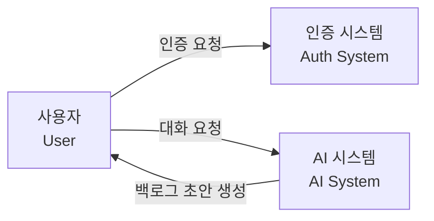
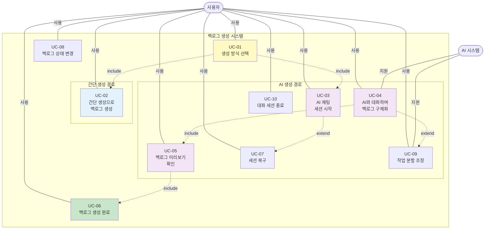
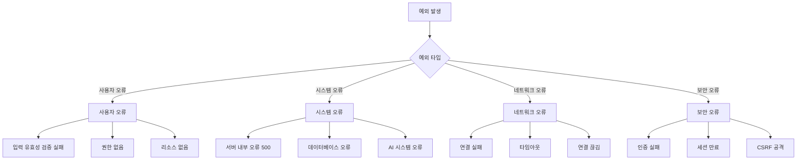
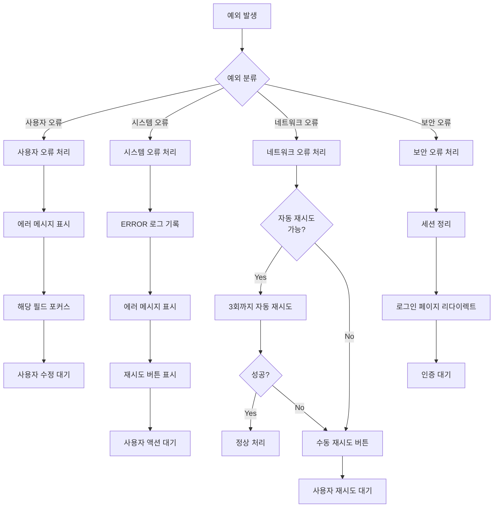

# 백로그 생성 기능 유스케이스 정의 명세서

**작업 ID:** v1.0.0/DS/backlog-creation/03
**작성일:** 2025-10-22
**상태:** 설계 완료
**의존성:** v1.0.0/DS/backlog-creation/01 (요구사항 분석), v1.0.0/DS/backlog-creation/02 (데이터 모델)

---

## 1. 개요

### 1.1 목적

백로그 생성 기능의 유스케이스를 정의하여 사용자와 시스템 간의 상호작용을 명확히 한다. 각 유스케이스별로 정상 플로우, 대안 플로우, 예외 상황을 상세히 기술한다.

### 1.2 범위

- 유스케이스 목록 및 액터 정의
- 유스케이스 다이어그램
- 주요 시나리오 (정상/대안 플로우)
- 예외 처리 명세

### 1.3 참조 문서

- 01-requirements-analysis.md: 기능 요구사항 및 사용자 스토리
- 02-data-models.md: 도메인 모델 및 엔티티 설계

---

## 2. 액터 정의

### 2.1 액터 목록

| 액터명 | 타입 | 설명 | 역할 |
|--------|------|------|------|
| **사용자 (User)** | 주 액터 (Primary) | 로그인한 서비스 이용자 | 백로그 생성, AI와 대화, 백로그 관리 |
| **AI 시스템 (AI System)** | 부 액터 (Secondary) | LLM 기반 AI 어시스턴트 | 사용자와 대화, INVEST 원칙 검증, 백로그 초안 생성 |
| **인증 시스템 (Auth System)** | 부 액터 (Secondary) | 사용자 인증 시스템 | 사용자 인증 및 권한 확인 |

### 2.2 액터 관계



---

## 3. 유스케이스 목록

### 3.1 전체 유스케이스 목록

| UC ID | 유스케이스명 | 액터 | 우선순위 | 관련 FR | 비고 |
|-------|-------------|------|---------|---------|------|
| UC-01 | 생성 방식 선택 | 사용자 | P0 | FR-01 | 진입점 |
| UC-02 | 간단 생성으로 백로그 생성 | 사용자 | P0 | FR-02, FR-09 | 간단 생성 경로 |
| UC-03 | AI 채팅 세션 시작 | 사용자, AI 시스템 | P0 | FR-03, FR-07 | AI 생성 경로 진입 |
| UC-04 | AI와 대화하며 백로그 구체화 | 사용자, AI 시스템 | P0 | FR-04, FR-05, FR-11 | 핵심 기능 |
| UC-05 | 백로그 미리보기 확인 | 사용자 | P0 | FR-06 | 생성 전 확인 |
| UC-06 | 백로그 생성 완료 | 사용자 | P0 | - | 최종 단계 |
| UC-07 | 세션 복구 | 사용자 | P1 | FR-08 | 연속성 보장 |
| UC-08 | 백로그 상태 변경 | 사용자 | P2 | - | 추가 기능 |
| UC-09 | 작업 분할 조정 | 사용자, AI 시스템 | P2 | FR-05 | AI 생성 보조 |
| UC-10 | 대화 세션 종료 | 사용자 | P1 | FR-07 | 세션 관리 |

### 3.2 유스케이스 분류

#### 3.2.1 핵심 유스케이스 (P0)

백로그 생성의 기본 플로우를 구성하는 필수 유스케이스

- UC-01: 생성 방식 선택
- UC-02: 간단 생성으로 백로그 생성
- UC-03: AI 채팅 세션 시작
- UC-04: AI와 대화하며 백로그 구체화
- UC-05: 백로그 미리보기 확인
- UC-06: 백로그 생성 완료

#### 3.2.2 중요 유스케이스 (P1)

사용자 경험 개선을 위한 중요 유스케이스

- UC-07: 세션 복구
- UC-10: 대화 세션 종료

#### 3.2.3 선택 유스케이스 (P2)

추가 편의 기능

- UC-08: 백로그 상태 변경
- UC-09: 작업 분할 조정

---

## 4. 유스케이스 다이어그램

### 4.1 전체 유스케이스 다이어그램



### 4.2 관계 유형

| 관계 | 표기 | 의미 |
|------|------|------|
| **Include** | A -.->|include| B | A는 항상 B를 포함한다 (필수) |
| **Extend** | A -.->|extend| B | A는 조건부로 B를 확장한다 (선택) |
| **Association** | Actor ---|사용| UC | 액터가 유스케이스를 사용한다 |

**주요 관계 설명:**

- UC-01 **includes** UC-02: 생성 방식 선택 시 간단 생성 경로 포함
- UC-01 **includes** UC-03: 생성 방식 선택 시 AI 생성 경로 포함
- UC-03 **extends** UC-07: 세션 시작 시 기존 세션이 있으면 복구 선택 가능
- UC-04 **includes** UC-05: 대화 완료 후 미리보기 필수
- UC-04 **extends** UC-09: 대화 중 작업이 크면 분할 조정 가능
- UC-05 **includes** UC-06: 미리보기 확인 후 생성 완료

---

## 5. 주요 시나리오

### 5.1 UC-01: 생성 방식 선택

#### 5.1.1 기본 정보

| 항목 | 내용 |
|------|------|
| **UC ID** | UC-01 |
| **유스케이스명** | 생성 방식 선택 |
| **액터** | 사용자 |
| **우선순위** | P0 (필수) |
| **트리거** | 사용자가 '새 백로그 생성' 버튼 클릭 |
| **사전조건** | - 사용자가 로그인되어 있음<br/>- 백로그 목록 페이지에 있음 |
| **사후조건** | - 간단 생성 폼 또는 AI 채팅 화면으로 이동 |

#### 5.1.2 정상 플로우

| 단계 | 액터 | 시스템 동작 |
|------|------|------------|
| 1 | 사용자 | '새 백로그 생성' 버튼 클릭 |
| 2 | | 생성 방식 선택 모달 표시 |
| 3 | | 두 가지 옵션 제시:<br/>- 간단하게 만들기 (소요: 1-2분, 결과: 1개)<br/>- AI로 구체화하기 (소요: 3-7분, 결과: 1-N개) |
| 4 | 사용자 | 원하는 방식 선택 (클릭) |
| 5a | | [간단 생성] 선택 시: 간단 생성 폼 페이지로 이동 (UC-02) |
| 5b | | [AI 생성] 선택 시: AI 채팅 세션 시작 (UC-03) |

#### 5.1.3 대안 플로우

**A1: 모달 닫기**

| 단계 | 동작 |
|------|------|
| 4-A1 | 사용자가 ESC 키 또는 X 버튼 또는 모달 외부 클릭 |
| 4-A2 | 모달 닫힘, 백로그 목록 페이지 유지 |

#### 5.1.4 예외 플로우

**E1: 사용자 미인증**

| 단계 | 동작 |
|------|------|
| 1-E1 | 시스템이 사용자 인증 확인 |
| 1-E2 | 미인증 상태: 로그인 페이지로 리다이렉트 |

---

### 5.2 UC-02: 간단 생성으로 백로그 생성

#### 5.2.1 기본 정보

| 항목 | 내용 |
|------|------|
| **UC ID** | UC-02 |
| **유스케이스명** | 간단 생성으로 백로그 생성 |
| **액터** | 사용자 |
| **우선순위** | P0 (필수) |
| **트리거** | UC-01에서 '간단하게 만들기' 선택 |
| **사전조건** | - 사용자가 간단 생성 방식 선택<br/>- 작업 내용이 명확함 |
| **사후조건** | - 1개의 백로그 생성됨<br/>- 백로그 상세 페이지로 이동 |

#### 5.2.2 정상 플로우

| 단계 | 액터 | 시스템 동작 |
|------|------|------------|
| 1 | | 간단 생성 폼 화면 표시 |
| 2 | | 입력 필드 제시:<br/>- 제목 (2-100자)<br/>- 설명 (10-2000자)<br/>- 완료 조건 (5-1000자) |
| 3 | 사용자 | 각 필드에 내용 입력 |
| 4 | | 실시간 글자 수 표시 (선택) |
| 5 | 사용자 | '백로그 생성' 버튼 클릭 |
| 6 | | 입력 데이터 유효성 검증:<br/>- 제목: 2-100자, 공백 아님<br/>- 설명: 10-2000자, 공백 아님<br/>- 완료 조건: 5-1000자, 공백 아님 |
| 7 | | 백로그 생성:<br/>- status = TODO<br/>- creationMethod = MANUAL<br/>- chatSessionId = null<br/>- userId = 현재 사용자 ID |
| 8 | | 백로그 저장 (DB) |
| 9 | | 성공 피드백 표시 (토스트/알림) |
| 10 | | 생성된 백로그 상세 페이지로 이동 |

#### 5.2.3 대안 플로우

**A1: 뒤로가기**

| 단계 | 동작 |
|------|------|
| 3-A1 | 사용자가 '뒤로가기' 버튼 클릭 |
| 3-A2 | 확인 다이얼로그 표시: "작성 중인 내용이 있습니다. 나가시겠습니까?" |
| 3-A3a | [나가기] 선택: 백로그 목록 페이지로 이동, 입력 내용 폐기 |
| 3-A3b | [취소] 선택: 폼 화면 유지, 입력 내용 보존 |

#### 5.2.4 예외 플로우

**E1: 유효성 검증 실패**

| 단계 | 동작 |
|------|------|
| 6-E1 | 유효성 검증 실패 (예: 제목 1자) |
| 6-E2 | 에러 메시지 표시: "제목은 2자 이상 입력해주세요" |
| 6-E3 | 해당 필드 포커스 및 강조 표시 |
| 6-E4 | 사용자가 수정 후 재시도 |

**E2: 네트워크 오류**

| 단계 | 동작 |
|------|------|
| 8-E1 | 네트워크 연결 실패 |
| 8-E2 | 에러 메시지 표시: "네트워크 연결을 확인해주세요" |
| 8-E3 | [재시도] 버튼 표시 |
| 8-E4 | 입력 데이터 유지 (로컬 저장) |
| 8-E5 | 사용자가 [재시도] 클릭 시 단계 6부터 재시작 |

**E3: 시스템 오류**

| 단계 | 동작 |
|------|------|
| 8-E1 | 서버 내부 오류 (500) |
| 8-E2 | 에러 메시지 표시: "일시적인 오류가 발생했습니다" |
| 8-E3 | [재시도] 버튼 표시 |
| 8-E4 | 입력 데이터 유지 |

---

### 5.3 UC-03: AI 채팅 세션 시작

#### 5.3.1 기본 정보

| 항목 | 내용 |
|------|------|
| **UC ID** | UC-03 |
| **유스케이스명** | AI 채팅 세션 시작 |
| **액터** | 사용자, AI 시스템 |
| **우선순위** | P0 (필수) |
| **트리거** | UC-01에서 'AI로 구체화하기' 선택 |
| **사전조건** | - 사용자가 AI 생성 방식 선택<br/>- AI 시스템 가용 |
| **사후조건** | - 새 채팅 세션 생성됨 (IN_PROGRESS)<br/>- AI 채팅 화면으로 이동<br/>- 환영 메시지 표시됨 |

#### 5.3.2 정상 플로우 (신규 세션)

| 단계 | 액터 | 시스템 동작 |
|------|------|------------|
| 1 | | 기존 IN_PROGRESS 세션 확인 |
| 2 | | 기존 세션 없음 확인 |
| 3 | | 새 채팅 세션 생성:<br/>- sessionId = UUID 생성<br/>- status = IN_PROGRESS<br/>- userId = 현재 사용자 ID<br/>- createdAt = 현재 시간 |
| 4 | | 세션 저장 (DB) |
| 5 | | 세션 ID를 로컬 스토리지에 저장 |
| 6 | AI 시스템 | 환영 메시지 생성 및 저장:<br/>- role = ASSISTANT<br/>- content = "안녕하세요! 어떤 아이디어를 구체화하고 싶으신가요?" |
| 7 | | AI 채팅 화면으로 이동 |
| 8 | | 환영 메시지 표시 |

#### 5.3.3 대안 플로우 (세션 복구)

**A1: 기존 세션 있음**

| 단계 | 동작 |
|------|------|
| 2-A1 | 기존 IN_PROGRESS 세션 발견 |
| 2-A2 | 세션 만료 확인 (7일 이상 경과?) |
| 2-A3a | 만료되지 않음: UC-07 (세션 복구)로 이동 |
| 2-A3b | 만료됨: 세션 상태를 ARCHIVED로 변경 후 단계 3부터 계속 |

#### 5.3.4 예외 플로우

**E1: AI 시스템 불가용**

| 단계 | 동작 |
|------|------|
| 6-E1 | AI 시스템 응답 없음 (타임아웃) |
| 6-E2 | 에러 메시지 표시: "AI 서비스에 일시적으로 연결할 수 없습니다" |
| 6-E3 | [재시도] 버튼 표시 |
| 6-E4 | 생성된 세션은 유지 (삭제하지 않음) |

---

### 5.4 UC-04: AI와 대화하며 백로그 구체화

#### 5.4.1 기본 정보

| 항목 | 내용 |
|------|------|
| **UC ID** | UC-04 |
| **유스케이스명** | AI와 대화하며 백로그 구체화 |
| **액터** | 사용자, AI 시스템 |
| **우선순위** | P0 (필수) |
| **트리거** | UC-03 완료 후 자동 시작 |
| **사전조건** | - 채팅 세션이 IN_PROGRESS 상태<br/>- AI 시스템 가용 |
| **사후조건** | - INVEST 원칙을 충족하는 백로그 초안 생성됨<br/>- 백로그 미리보기 표시됨 |

#### 5.4.2 정상 플로우

| 단계 | 액터 | 시스템 동작 |
|------|------|------------|
| 1 | 사용자 | 메시지 입력창에 아이디어 입력 |
| 2 | 사용자 | [전송] 버튼 클릭 또는 Enter 키 |
| 3 | | 사용자 메시지 즉시 화면 표시 |
| 4 | | 메시지 저장:<br/>- role = USER<br/>- content = 입력 내용<br/>- sessionId = 현재 세션 ID |
| 5 | | 입력창 비활성화 + 타이핑 인디케이터 표시 |
| 6 | | AI 시스템에 메시지 전송 (대화 히스토리 포함) |
| 7 | AI 시스템 | 대화 맥락 분석 및 INVEST 원칙 체크:<br/>- I (Independent): 작업 범위 명확성<br/>- V (Valuable): 목적 및 가치<br/>- E (Estimable): 구체성<br/>- S (Small): 작업 크기<br/>- T (Testable): 완료 조건 |
| 8a | AI 시스템 | [INVEST 미충족] 추가 질문 생성:<br/>"이 작업의 완료 조건은 무엇인가요?" |
| 8b | AI 시스템 | [INVEST 충족] 백로그 초안 생성 (JSON 형식) |
| 9 | | AI 응답을 실시간 스트리밍으로 수신 |
| 10 | | 수신한 텍스트 조각을 화면에 타이핑 효과로 표시 |
| 11 | | 자동 스크롤 (최신 메시지 하단 고정) |
| 12 | | AI 응답 완료 후 메시지 저장:<br/>- role = ASSISTANT<br/>- content = AI 응답 전체 |
| 13 | | 입력창 재활성화 |
| 14a | | [추가 질문] 사용자 응답 대기 → 단계 1로 반복 |
| 14b | | [백로그 초안 생성] UC-05 (미리보기)로 진행 |

#### 5.4.3 대안 플로우

**A1: 작업 분할 제안**

| 단계 | 동작 |
|------|------|
| 7-A1 | AI가 작업 크기가 크다고 판단 (Small 원칙 미충족) |
| 7-A2 | AI가 N개로 분할 제안:<br/>"이 작업은 크기가 커서 3개로 나누는 것을 추천합니다:<br/>1. [제목1]...<br/>2. [제목2]...<br/>3. [제목3]..." |
| 7-A3 | 사용자 응답 대기 |
| 7-A4a | [동의] "좋아요" → N개 백로그 초안 생성 (UC-09) |
| 7-A4b | [거부] "아니요, 하나로 할래요" → 단일 백로그 초안 생성 |

**A2: 대화 중단**

| 단계 | 동작 |
|------|------|
| 1-A1 | 사용자가 대화 중 페이지 이탈 (뒤로가기, 창 닫기 등) |
| 1-A2 | 세션 ID는 로컬 스토리지에 유지됨 |
| 1-A3 | 세션 상태는 IN_PROGRESS 유지 |
| 1-A4 | 다음 방문 시 UC-07 (세션 복구) 가능 |

#### 5.4.4 예외 플로우

**E1: AI 응답 실패**

| 단계 | 동작 |
|------|------|
| 7-E1 | AI 시스템 오류 또는 타임아웃 |
| 7-E2 | 에러 메시지 표시: "AI 응답을 생성하는 중 오류가 발생했습니다" |
| 7-E3 | [재시도] 버튼 표시 |
| 7-E4 | 입력창 재활성화 |
| 7-E5 | 사용자 메시지는 저장되어 있음 |

**E2: 네트워크 연결 끊김**

| 단계 | 동작 |
|------|------|
| 9-E1 | 스트리밍 중 연결 끊김 |
| 9-E2 | 부분 응답까지만 화면 표시 |
| 9-E3 | 에러 메시지 표시: "연결이 끊겼습니다" |
| 9-E4 | [재시도] 버튼 표시 |
| 9-E5 | 재시도 시 마지막 사용자 메시지부터 재전송 |

---

### 5.5 UC-05: 백로그 미리보기 확인

#### 5.5.1 기본 정보

| 항목 | 내용 |
|------|------|
| **UC ID** | UC-05 |
| **유스케이스명** | 백로그 미리보기 확인 |
| **액터** | 사용자 |
| **우선순위** | P0 (필수) |
| **트리거** | UC-04에서 AI가 백로그 초안 생성 완료 |
| **사전조건** | - 백로그 초안 데이터 존재 (1개 또는 N개) |
| **사후조건** | - 사용자가 백로그 내용 확인<br/>- 생성 승인 또는 대화 계속 선택 |

#### 5.5.2 정상 플로우 (단일 백로그)

| 단계 | 액터 | 시스템 동작 |
|------|------|------------|
| 1 | | AI가 백로그 초안 생성 (JSON 형식) |
| 2 | | 우측 패널 (40% 너비) 슬라이드인 애니메이션 |
| 3 | | 미리보기 패널 표시:<br/>**제목:** [백로그 제목]<br/>**설명:** [백로그 설명]<br/>**완료 조건:** [완료 조건] |
| 4 | | [백로그 생성] 버튼 표시 (하단) |
| 5 | 사용자 | 미리보기 내용 검토 |
| 6a | 사용자 | [백로그 생성] 버튼 클릭 → UC-06으로 진행 |
| 6b | 사용자 | 대화창에 추가 메시지 입력 → 미리보기 업데이트 |

#### 5.5.3 정상 플로우 (여러 백로그)

| 단계 | 액터 | 시스템 동작 |
|------|------|------------|
| 1 | | AI가 N개 백로그 초안 생성 |
| 2 | | 우측 패널 슬라이드인 |
| 3 | | 미리보기 패널 표시 (스크롤 가능):<br/>**백로그 1**<br/>제목: [제목1]<br/>설명: [설명1]<br/>완료 조건: [조건1]<br/>---<br/>**백로그 2**<br/>...<br/>**백로그 N** |
| 4 | | [N개 백로그 생성] 버튼 표시 |
| 5 | 사용자 | 모든 백로그 내용 검토 |
| 6 | 사용자 | [N개 백로그 생성] 버튼 클릭 → UC-06으로 진행 |

#### 5.5.4 대안 플로우

**A1: 내용 수정 요청**

| 단계 | 동작 |
|------|------|
| 5-A1 | 사용자가 내용에 만족하지 않음 |
| 5-A2 | 대화창에 수정 요청 입력: "제목을 좀 더 구체적으로 바꿔줘" |
| 5-A3 | AI가 수정된 백로그 초안 생성 |
| 5-A4 | 미리보기 패널 내용 업데이트 (페이드 아웃/인 애니메이션) |
| 5-A5 | 변경된 부분 노란색 하이라이트 (2초간) |

**A2: 미리보기 닫기**

| 단계 | 동작 |
|------|------|
| 5-A1 | 사용자가 미리보기 패널 X 버튼 클릭 |
| 5-A2 | 미리보기 패널 슬라이드아웃 |
| 5-A3 | 백로그 초안 데이터는 유지 (삭제 안 됨) |
| 5-A4 | 대화 계속 가능 |

#### 5.5.5 예외 플로우

**E1: 백로그 초안 파싱 실패**

| 단계 | 동작 |
|------|------|
| 1-E1 | AI 응답이 예상 형식(JSON)이 아님 |
| 1-E2 | 에러 로그 기록 |
| 1-E3 | 사용자에게 메시지 표시: "백로그 초안을 생성하는 중 문제가 발생했습니다" |
| 1-E4 | 대화 계속 가능 |

---

### 5.6 UC-06: 백로그 생성 완료

#### 5.6.1 기본 정보

| 항목 | 내용 |
|------|------|
| **UC ID** | UC-06 |
| **유스케이스명** | 백로그 생성 완료 |
| **액터** | 사용자 |
| **우선순위** | P0 (필수) |
| **트리거** | UC-05에서 [백로그 생성] 버튼 클릭 |
| **사전조건** | - 백로그 초안 데이터 검증 완료 |
| **사후조건** | - 백로그 DB에 저장됨<br/>- 세션 상태 COMPLETED로 변경<br/>- 백로그 상세/목록 페이지로 이동 |

#### 5.6.2 정상 플로우 (단일 백로그)

| 단계 | 액터 | 시스템 동작 |
|------|------|------------|
| 1 | 사용자 | [백로그 생성] 버튼 클릭 |
| 2 | | 버튼 비활성화 + 로딩 인디케이터 표시 |
| 3 | | 세션 유효성 검증:<br/>- 세션 존재 확인<br/>- 세션 상태 = IN_PROGRESS 확인<br/>- 세션 소유자 = 현재 사용자 확인 |
| 4 | | 백로그 생성:<br/>- title = 초안 제목<br/>- description = 초안 설명<br/>- acceptanceCriteria = 초안 완료 조건<br/>- status = TODO<br/>- creationMethod = AI_CHAT<br/>- chatSessionId = 현재 세션 ID<br/>- orderInSession = null (단일)<br/>- userId = 현재 사용자 ID |
| 5 | | 백로그 저장 (DB) |
| 6 | | 세션 상태 변경:<br/>- status = COMPLETED<br/>- updatedAt = 현재 시간 |
| 7 | | 로컬 스토리지에서 세션 ID 제거 |
| 8 | | 성공 피드백 표시: "백로그가 생성되었습니다" |
| 9 | | 생성된 백로그 상세 페이지로 이동 |

#### 5.6.3 정상 플로우 (여러 백로그)

| 단계 | 액터 | 시스템 동작 |
|------|------|------------|
| 1-3 | | 단일 백로그와 동일 |
| 4 | | N개 백로그 일괄 생성:<br/>각 백로그마다:<br/>- orderInSession = 1, 2, 3... (순서)<br/>- 나머지는 단일 백로그와 동일 |
| 5 | | 트랜잭션으로 모든 백로그 저장 (원자성 보장) |
| 6-7 | | 단일 백로그와 동일 |
| 8 | | 성공 피드백 표시: "3개의 백로그가 생성되었습니다" |
| 9 | | 백로그 목록 페이지로 이동 (생성된 백로그들 표시) |

#### 5.6.4 대안 플로우

**A1: 생성 취소**

| 단계 | 동작 |
|------|------|
| 1-A1 | 사용자가 [백로그 생성] 대신 미리보기 닫기 |
| 1-A2 | 백로그 생성하지 않음 |
| 1-A3 | 세션 상태 IN_PROGRESS 유지 |
| 1-A4 | 대화 계속 가능 |

#### 5.6.5 예외 플로우

**E1: 세션 유효성 검증 실패**

| 단계 | 동작 |
|------|------|
| 3-E1 | 세션이 이미 COMPLETED 또는 ARCHIVED 상태 |
| 3-E2 | 에러 메시지 표시: "세션이 만료되었습니다" |
| 3-E3 | 로컬 스토리지 세션 ID 제거 |
| 3-E4 | 백로그 목록 페이지로 이동 |

**E2: 저장 실패**

| 단계 | 동작 |
|------|------|
| 5-E1 | DB 저장 오류 (예: 제약 조건 위반) |
| 5-E2 | 트랜잭션 롤백 |
| 5-E3 | 에러 메시지 표시: "백로그 저장 중 오류가 발생했습니다" |
| 5-E4 | [재시도] 버튼 표시 |
| 5-E5 | 버튼 재활성화 |
| 5-E6 | 백로그 초안 데이터 유지 |

**E3: 일괄 저장 부분 실패 (여러 백로그)**

| 단계 | 동작 |
|------|------|
| 5-E1 | N개 중 일부 저장 실패 |
| 5-E2 | 전체 트랜잭션 롤백 (all-or-nothing) |
| 5-E3 | 에러 메시지 표시: "백로그 저장 중 오류가 발생했습니다" |
| 5-E4 | [재시도] 버튼 표시 |

---

### 5.7 UC-07: 세션 복구

#### 5.7.1 기본 정보

| 항목 | 내용 |
|------|------|
| **UC ID** | UC-07 |
| **유스케이스명** | 세션 복구 |
| **액터** | 사용자 |
| **우선순위** | P1 (중요) |
| **트리거** | UC-03에서 기존 IN_PROGRESS 세션 발견 |
| **사전조건** | - 로컬 스토리지에 세션 ID 존재<br/>- 해당 세션이 DB에 존재 |
| **사후조건** | - [계속하기] 선택 시: 기존 대화 복구<br/>- [새로 시작] 선택 시: 기존 세션 ARCHIVED, 새 세션 생성 |

#### 5.7.2 정상 플로우 (계속하기)

| 단계 | 액터 | 시스템 동작 |
|------|------|------------|
| 1 | | 로컬 스토리지에서 세션 ID 조회 |
| 2 | | 세션 조회 (DB) |
| 3 | | 세션 상태 확인 = IN_PROGRESS |
| 4 | | 세션 만료 확인 (7일 경과 여부) |
| 5 | | 만료되지 않음 확인 |
| 6 | | 복구 다이얼로그 표시:<br/>"이전에 진행 중이던 대화가 있습니다.<br/>계속하시겠습니까?" |
| 7 | 사용자 | [계속하기] 버튼 클릭 |
| 8 | | 세션의 모든 메시지 조회 (createdAt 오름차순) |
| 9 | | AI 채팅 화면으로 이동 |
| 10 | | 대화 히스토리 표시 (메시지 목록) |
| 11 | | 백로그 초안이 있었다면 미리보기 패널도 복원 |
| 12 | | 입력창 활성화, 대화 계속 가능 |

#### 5.7.3 대안 플로우 (새로 시작)

| 단계 | 동작 |
|------|------|
| 7-A1 | 사용자가 [새로 시작] 버튼 클릭 |
| 7-A2 | 기존 세션 상태 변경:<br/>- status = ARCHIVED<br/>- updatedAt = 현재 시간 |
| 7-A3 | 로컬 스토리지에서 기존 세션 ID 제거 |
| 7-A4 | UC-03 (새 세션 생성)으로 진행 |

#### 5.7.4 예외 플로우

**E1: 세션 만료**

| 단계 | 동작 |
|------|------|
| 4-E1 | 세션 생성/수정일로부터 7일 이상 경과 |
| 4-E2 | 세션 상태 자동 변경:<br/>- status = ARCHIVED |
| 4-E3 | 안내 메시지 표시: "이전 세션이 만료되어 새로 시작합니다" |
| 4-E4 | UC-03 (새 세션 생성)으로 진행 |

**E2: 세션 없음**

| 단계 | 동작 |
|------|------|
| 2-E1 | 로컬 세션 ID는 있지만 DB에 세션 없음 |
| 2-E2 | 로컬 스토리지 세션 ID 제거 |
| 2-E3 | UC-03 (새 세션 생성)으로 진행 |

---

### 5.8 UC-08: 백로그 상태 변경

#### 5.8.1 기본 정보

| 항목 | 내용 |
|------|------|
| **UC ID** | UC-08 |
| **유스케이스명** | 백로그 상태 변경 |
| **액터** | 사용자 |
| **우선순위** | P2 (선택) |
| **트리거** | 백로그 상세/목록 페이지에서 상태 변경 버튼 클릭 |
| **사전조건** | - 백로그가 존재<br/>- 사용자가 백로그 소유자 |
| **사후조건** | - 백로그 상태가 변경됨<br/>- updatedAt 갱신됨 |

#### 5.8.2 정상 플로우

| 단계 | 액터 | 시스템 동작 |
|------|------|------------|
| 1 | 사용자 | 백로그 상세 페이지에서 상태 드롭다운 클릭 |
| 2 | | 상태 옵션 표시:<br/>- TODO<br/>- IN_PROGRESS<br/>- DONE |
| 3 | 사용자 | 원하는 상태 선택 |
| 4 | | 백로그 조회 및 권한 확인 (소유자 일치) |
| 5 | | 백로그 상태 변경:<br/>- status = 선택한 상태<br/>- updatedAt = 현재 시간 |
| 6 | | 백로그 저장 (DB) |
| 7 | | 성공 피드백 표시 (UI 업데이트) |

#### 5.8.3 예외 플로우

**E1: 권한 없음**

| 단계 | 동작 |
|------|------|
| 4-E1 | 현재 사용자 ≠ 백로그 소유자 |
| 4-E2 | 에러 메시지 표시: "권한이 없습니다" |
| 4-E3 | 상태 변경 취소 |

---

### 5.9 UC-09: 작업 분할 조정

#### 5.9.1 기본 정보

| 항목 | 내용 |
|------|------|
| **UC ID** | UC-09 |
| **유스케이스명** | 작업 분할 조정 |
| **액터** | 사용자, AI 시스템 |
| **우선순위** | P2 (선택) |
| **트리거** | UC-04에서 AI가 작업 분할 제안 (Small 원칙 미충족) |
| **사전조건** | - AI가 작업이 크다고 판단<br/>- 분할 제안 생성됨 |
| **사후조건** | - 사용자가 분할 개수 결정<br/>- N개 백로그 초안 생성 또는 단일 유지 |

#### 5.9.2 정상 플로우

| 단계 | 액터 | 시스템 동작 |
|------|------|------------|
| 1 | AI 시스템 | 작업 크기 판단: Small 원칙 미충족 |
| 2 | AI 시스템 | 논리적 단위로 작업 분할 (예: 3개) |
| 3 | AI 시스템 | 분할 제안 메시지 생성:<br/>"이 작업은 크기가 커서 3개로 나누는 것을 추천합니다:<br/>1. [제목1] - [설명 요약]<br/>2. [제목2] - [설명 요약]<br/>3. [제목3] - [설명 요약]<br/><br/>이렇게 나누는 것이 어떨까요?" |
| 4 | | AI 메시지 화면 표시 |
| 5 | 사용자 | 분할 제안 검토 |
| 6a | 사용자 | "좋아요" 또는 "동의합니다" 입력 → 단계 7 |
| 6b | 사용자 | "아니요, 하나로 할래요" 입력 → 단계 10 |
| 6c | 사용자 | "N개는 많아요, M개로 해주세요" 입력 → 단계 11 |
| 7 | AI 시스템 | 3개 백로그 초안 생성 (각각 상세 내용 포함) |
| 8 | | 미리보기 패널에 3개 백로그 표시 |
| 9 | | UC-05 (미리보기)로 진행 |
| 10 | AI 시스템 | 단일 백로그 초안 생성 |
| 10-2 | | 미리보기 패널에 1개 백로그 표시 |
| 10-3 | | UC-05로 진행 |
| 11 | AI 시스템 | 사용자 요청 개수(M개)로 재분할 |
| 11-2 | | 재분할된 내용 메시지로 표시 |
| 11-3 | 사용자 | 확인 후 "좋아요" → 단계 7 |

#### 5.9.3 대안 플로우

**A1: 사용자가 직접 분할 기준 제시**

| 단계 | 동작 |
|------|------|
| 5-A1 | 사용자가 "A 기능과 B 기능으로 나눠줘" 입력 |
| 5-A2 | AI가 사용자 기준으로 재분할 |
| 5-A3 | 재분할된 내용 표시 |

---

### 5.10 UC-10: 대화 세션 종료

#### 5.10.1 기본 정보

| 항목 | 내용 |
|------|------|
| **UC ID** | UC-10 |
| **유스케이스명** | 대화 세션 종료 |
| **액터** | 사용자 |
| **우선순위** | P1 (중요) |
| **트리거** | 사용자가 백로그 생성 없이 대화 종료 선택 |
| **사전조건** | - 세션이 IN_PROGRESS 상태 |
| **사후조건** | - 세션 상태 ARCHIVED로 변경<br/>- 백로그 목록 페이지로 이동 |

#### 5.10.2 정상 플로우

| 단계 | 액터 | 시스템 동작 |
|------|------|------------|
| 1 | 사용자 | 채팅 화면에서 [나가기] 또는 [종료] 버튼 클릭 |
| 2 | | 확인 다이얼로그 표시:<br/>"대화를 종료하시겠습니까?<br/>저장되지 않은 내용은 보관됩니다." |
| 3 | 사용자 | [종료] 버튼 클릭 |
| 4 | | 세션 상태 변경:<br/>- status = ARCHIVED<br/>- updatedAt = 현재 시간 |
| 5 | | 로컬 스토리지에서 세션 ID 제거 |
| 6 | | 백로그 목록 페이지로 이동 |

#### 5.10.3 대안 플로우

**A1: 종료 취소**

| 단계 | 동작 |
|------|------|
| 3-A1 | 사용자가 [취소] 버튼 클릭 |
| 3-A2 | 다이얼로그 닫힘 |
| 3-A3 | 채팅 화면 유지, 대화 계속 가능 |

---

## 6. 예외 처리

### 6.1 예외 분류 체계



### 6.2 예외별 처리 전략

| 예외 코드 | 예외명 | HTTP 상태 | 사용자 메시지 | 복구 방법 | 로깅 |
|----------|--------|----------|-------------|----------|------|
| **사용자 오류** |
| E-001 | 입력 유효성 실패 | 400 | "입력 내용을 확인해주세요" | 해당 필드 포커스, 에러 메시지 표시 | INFO |
| E-002 | 필수 항목 누락 | 400 | "모든 항목을 입력해주세요" | 첫 번째 빈 항목 강조 | INFO |
| E-003 | 길이 초과 | 400 | "{필드}는 {최대}자 이내로 입력해주세요" | 글자 수 표시 | INFO |
| E-004 | 권한 없음 | 403 | "권한이 없습니다" | 백로그 목록으로 이동 | WARN |
| E-005 | 리소스 없음 | 404 | "백로그를 찾을 수 없습니다" | 백로그 목록으로 이동 | WARN |
| **시스템 오류** |
| E-101 | 서버 내부 오류 | 500 | "일시적인 오류가 발생했습니다" | [재시도] 버튼 | ERROR |
| E-102 | 데이터베이스 오류 | 500 | "데이터 저장 중 오류가 발생했습니다" | [재시도] 버튼 | ERROR |
| E-103 | AI 시스템 오류 | 503 | "AI 서비스에 일시적으로 연결할 수 없습니다" | [재시도] 버튼 | ERROR |
| E-104 | 세션 생성 실패 | 500 | "세션을 생성할 수 없습니다" | 새로고침 안내 | ERROR |
| **네트워크 오류** |
| E-201 | 연결 실패 | - | "네트워크 연결을 확인해주세요" | 자동 재시도 (3회) | WARN |
| E-202 | 타임아웃 | 408 | "요청 시간이 초과되었습니다" | [재시도] 버튼 | WARN |
| E-203 | 연결 끊김 | - | "연결이 끊겼습니다" | [재시도] 버튼 | WARN |
| **보안 오류** |
| E-301 | 인증 실패 | 401 | "로그인이 필요합니다" | 로그인 페이지로 리다이렉트 | WARN |
| E-302 | 세션 만료 | 401 | "세션이 만료되었습니다" | 로그인 페이지로 리다이렉트 | INFO |
| E-303 | CSRF 토큰 불일치 | 403 | "보안 오류가 발생했습니다" | 새로고침 안내 | ERROR |

### 6.3 공통 예외 처리 플로우



### 6.4 유스케이스별 주요 예외

| 유스케이스 | 주요 예외 | 빈도 | 우선순위 |
|----------|---------|------|---------|
| UC-01 | E-301 인증 실패 | 낮음 | P0 |
| UC-02 | E-001 입력 유효성 실패 | 높음 | P0 |
| UC-02 | E-102 데이터베이스 오류 | 낮음 | P0 |
| UC-03 | E-104 세션 생성 실패 | 낮음 | P0 |
| UC-03 | E-103 AI 시스템 오류 | 중간 | P0 |
| UC-04 | E-103 AI 시스템 오류 | 중간 | P0 |
| UC-04 | E-203 연결 끊김 | 중간 | P1 |
| UC-05 | E-101 서버 내부 오류 | 낮음 | P1 |
| UC-06 | E-102 데이터베이스 오류 | 낮음 | P0 |
| UC-06 | E-302 세션 만료 | 낮음 | P1 |
| UC-07 | E-005 세션 없음 | 중간 | P1 |
| UC-08 | E-004 권한 없음 | 낮음 | P2 |

### 6.5 에러 메시지 가이드라인

#### 6.5.1 작성 원칙

1. **사용자 중심**: 기술 용어 대신 이해하기 쉬운 표현 사용
2. **명확성**: 무엇이 문제인지 구체적으로 설명
3. **해결 방안 제시**: 사용자가 무엇을 해야 하는지 안내
4. **긍정적 톤**: 부정적이거나 비난하는 표현 지양

#### 6.5.2 좋은 예시 vs 나쁜 예시

| 상황 | 나쁜 예시 | 좋은 예시 |
|------|---------|----------|
| 입력 길이 초과 | "Validation failed: title length > 100" | "제목은 100자 이내로 입력해주세요 (현재 152자)" |
| 네트워크 오류 | "Error: ECONNREFUSED" | "네트워크 연결을 확인해주세요" |
| 권한 없음 | "403 Forbidden" | "이 백로그를 수정할 권한이 없습니다" |
| AI 오류 | "AI service timeout" | "AI 응답을 생성하는 중 시간이 초과되었습니다. 다시 시도해주세요" |

---

## 7. 완료 조건 검증

### 7.1 유스케이스 정의 완료 조건

- [x] 액터가 정의되었다 (사용자, AI 시스템, 인증 시스템)
- [x] 유스케이스 목록이 작성되었다 (UC-01 ~ UC-10)
- [x] 유스케이스가 우선순위별로 분류되었다 (P0/P1/P2)
- [x] 유스케이스 다이어그램이 작성되었다 (Mermaid)
- [x] 주요 유스케이스의 시나리오가 상세히 작성되었다
  - [x] 기본 정보 (트리거, 사전조건, 사후조건)
  - [x] 정상 플로우
  - [x] 대안 플로우
  - [x] 예외 플로우
- [x] 예외 처리 명세가 작성되었다
  - [x] 예외 분류 체계
  - [x] 예외별 처리 전략
  - [x] 공통 예외 처리 플로우
  - [x] 에러 메시지 가이드라인

### 7.2 유스케이스별 완료 여부

| UC ID | 유스케이스명 | 기본 정보 | 정상 플로우 | 대안 플로우 | 예외 플로우 | 완료 |
|-------|-------------|----------|------------|------------|------------|------|
| UC-01 | 생성 방식 선택 | ✅ | ✅ | ✅ | ✅ | ✅ |
| UC-02 | 간단 생성으로 백로그 생성 | ✅ | ✅ | ✅ | ✅ | ✅ |
| UC-03 | AI 채팅 세션 시작 | ✅ | ✅ | ✅ | ✅ | ✅ |
| UC-04 | AI와 대화하며 백로그 구체화 | ✅ | ✅ | ✅ | ✅ | ✅ |
| UC-05 | 백로그 미리보기 확인 | ✅ | ✅ | ✅ | ✅ | ✅ |
| UC-06 | 백로그 생성 완료 | ✅ | ✅ | ✅ | ✅ | ✅ |
| UC-07 | 세션 복구 | ✅ | ✅ | ✅ | ✅ | ✅ |
| UC-08 | 백로그 상태 변경 | ✅ | ✅ | - | ✅ | ✅ |
| UC-09 | 작업 분할 조정 | ✅ | ✅ | ✅ | - | ✅ |
| UC-10 | 대화 세션 종료 | ✅ | ✅ | ✅ | - | ✅ |

### 7.3 요구사항 추적성

| 기능 요구사항 | 관련 유스케이스 | 커버 여부 |
|-------------|---------------|----------|
| FR-01 생성 방식 선택 | UC-01 | ✅ |
| FR-02 간단 생성 폼 | UC-02 | ✅ |
| FR-03 AI 채팅 인터페이스 | UC-03, UC-04 | ✅ |
| FR-04 INVEST 원칙 판단 | UC-04 | ✅ |
| FR-05 작업 분할 제안 | UC-04, UC-09 | ✅ |
| FR-06 백로그 미리보기 | UC-05 | ✅ |
| FR-07 대화 세션 관리 | UC-03, UC-07, UC-10 | ✅ |
| FR-08 세션 복구 | UC-07 | ✅ |
| FR-09 유효성 검증 | UC-02, UC-06 | ✅ |
| FR-10 에러 처리 | 모든 UC | ✅ |
| FR-11 실시간 응답 | UC-04 | ✅ |
| FR-12 반응형 UI | (UI 설계 문서에서 다룸) | - |

---

## 8. 다음 단계

Phase 1 완료. 다음은 **Phase 2: API 설계 (04-api-design.md)**로 진행합니다.

Phase 2에서는 다음 항목들을 설계합니다:

1. API 목록 작성 (RESTful 엔드포인트)
2. API 상세 명세 (요청/응답 스키마)
3. 시퀀스 다이어그램 (주요 플로우별)

---

## 부록

### A. 유스케이스 템플릿

```markdown
### UC-XX: [유스케이스명]

#### 기본 정보

| 항목 | 내용 |
|------|------|
| **UC ID** | UC-XX |
| **유스케이스명** | [이름] |
| **액터** | [주 액터, 부 액터] |
| **우선순위** | P0/P1/P2 |
| **트리거** | [시작 조건] |
| **사전조건** | [전제 조건들] |
| **사후조건** | [결과 상태들] |

#### 정상 플로우

| 단계 | 액터 | 시스템 동작 |
|------|------|------------|
| 1 | | ... |

#### 대안 플로우

**A1: [대안 시나리오명]**

| 단계 | 동작 |
|------|------|
| X-A1 | ... |

#### 예외 플로우

**E1: [예외 상황명]**

| 단계 | 동작 |
|------|------|
| X-E1 | ... |
```

### B. 참조 문서

| 문서명 | 경로 | 관계 |
|--------|------|------|
| 요구사항 분석 | v1.0.0/DS/backlog-creation/01-requirements-analysis.md | 기능 요구사항 참조 |
| 데이터 모델 | v1.0.0/DS/backlog-creation/02-data-models.md | 엔티티 및 상태 참조 |
| API 설계 | v1.0.0/DS/backlog-creation/04-api-design.md | 유스케이스 구현 방법 |
