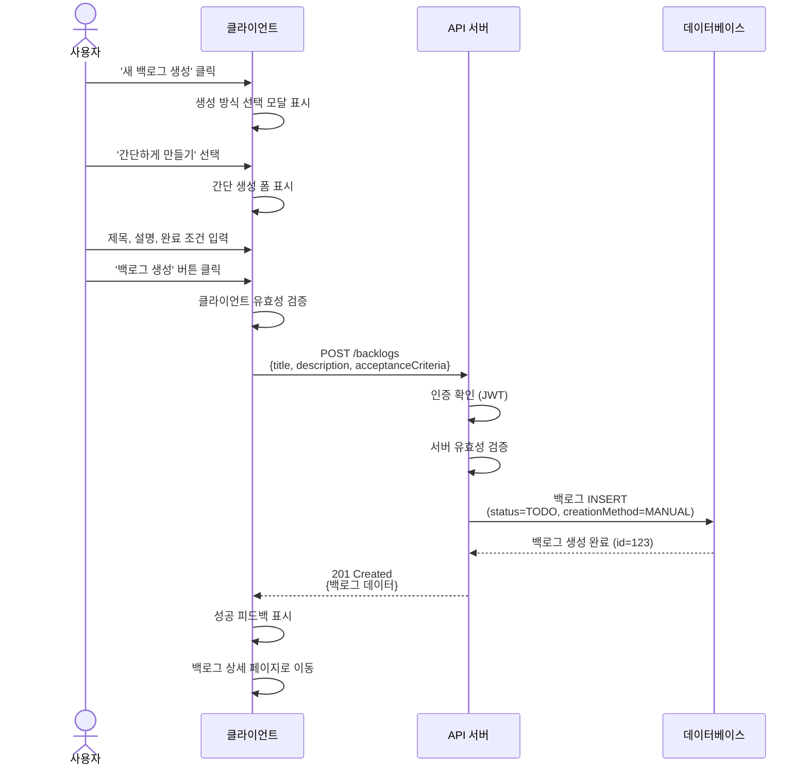
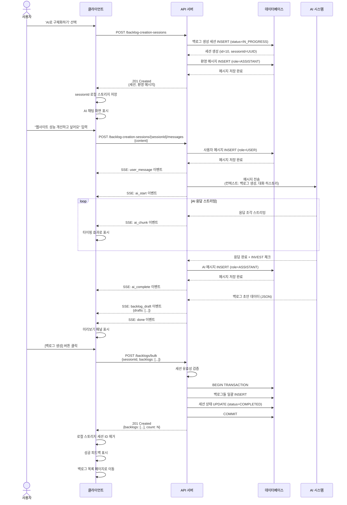
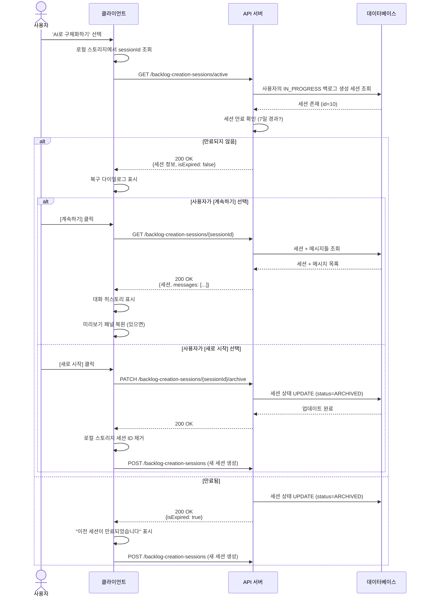

# 백로그 생성 기능 API 설계 명세서

**작업 ID:** v1.0.0/DS/backlog-creation/04
**작성일:** 2025-10-22
**상태:** 설계 완료
**의존성:** v1.0.0/DS/backlog-creation/03 (유스케이스 정의)

---

## 1. 개요

### 1.1 목적

백로그 생성 기능의 RESTful API를 설계하여 클라이언트와 서버 간의 통신 규격을 정의한다. 각 API 엔드포인트별로 요청/응답 스키마, 상태 코드, 인증 요구사항을 명세한다.

### 1.2 설계 원칙

- **RESTful 아키텍처**: HTTP 메서드와 리소스 중심 설계
- **일관성**: RFC 7807 Problem JSON 형식의 에러 응답
- **보안**: 모든 API는 인증 필수
- **명확성**: 자기 설명적인 엔드포인트 경로
- **버전 관리**: API 버전을 URL에 포함 (/api/v1/...)

### 1.3 범위

- 백로그 관리 API
- 백로그 생성 세션 관리 API (AI 대화 전용)
- AI 대화 API (실시간 스트리밍)

---

## 2. API 공통 명세

### 2.1 기본 URL

```
Production:  https://api.aipacemaker.com/api/v1
Development: http://localhost:3000/api/v1
```

### 2.2 공통 헤더

#### 요청 헤더

| 헤더명 | 필수 | 설명 | 예시 |
|--------|------|------|------|
| `Authorization` | Y | 인증 토큰 | `Bearer eyJhbGciOiJIUzI1NiIsInR5cCI6IkpXVCJ9...` |
| `Content-Type` | Y | 요청 본문 타입 | `application/json` |
| `Accept` | N | 응답 형식 | `application/json` |

#### 응답 헤더

| 헤더명 | 설명 |
|--------|------|
| `Content-Type` | 응답 본문 타입 (`application/json` or `application/problem+json`) |
| `X-Request-ID` | 요청 추적 ID (UUID) |
| `X-RateLimit-Limit` | 요청 제한 (시간당 최대 요청 수) |
| `X-RateLimit-Remaining` | 남은 요청 수 |

### 2.3 공통 응답 형식

#### 성공 응답

성공 시 해당 리소스 또는 리소스 목록을 직접 반환합니다.

**단일 리소스**
```json
{
  "id": 123,
  "title": "메인 페이지 로딩 속도 1초 단축",
  "status": "TODO",
  "createdAt": "2025-10-22T10:30:00Z",
  "updatedAt": "2025-10-22T10:30:00Z"
}
```

**리소스 목록 (페이지네이션)**
```json
{
  "items": [...],
  "pagination": {
    "page": 1,
    "limit": 20,
    "total": 100,
    "totalPages": 5
  }
}
```

#### 에러 응답 (RFC 7807 Problem JSON)

```http
Content-Type: application/problem+json
```

```json
{
  "type": "https://api.aipacemaker.com/errors/validation-error",
  "title": "입력 데이터 검증 실패",
  "status": 400,
  "detail": "제목은 2자 이상 입력해주세요",
  "instance": "/api/v1/backlogs",
  "errors": [
    {
      "field": "title",
      "message": "제목은 2자 이상 입력해주세요",
      "code": "E-001"
    }
  ]
}
```

**Problem JSON 필드**

| 필드 | 타입 | 필수 | 설명 |
|------|------|------|------|
| type | string (URI) | Y | 에러 타입을 식별하는 URI |
| title | string | Y | 에러 유형의 간단한 설명 |
| status | number | Y | HTTP 상태 코드 |
| detail | string | Y | 이 에러의 구체적인 설명 (사용자에게 표시) |
| instance | string (URI) | Y | 에러가 발생한 요청 URI |
| errors | array | N | 필드별 상세 에러 (유효성 검증 실패 시) |

**에러 타입 URI**

| URI | HTTP 상태 | 설명 |
|-----|----------|------|
| `/errors/validation-error` | 400 | 입력 데이터 검증 실패 |
| `/errors/unauthorized` | 401 | 인증 실패 |
| `/errors/forbidden` | 403 | 권한 없음 |
| `/errors/not-found` | 404 | 리소스 없음 |
| `/errors/conflict` | 409 | 리소스 충돌 |
| `/errors/internal-server-error` | 500 | 서버 내부 오류 |
| `/errors/service-unavailable` | 503 | 서비스 일시 불가 |

### 2.4 HTTP 상태 코드

| 상태 코드 | 의미 | 사용 상황 |
|----------|------|----------|
| **2xx 성공** |
| 200 | OK | 요청 성공 (조회, 수정) |
| 201 | Created | 리소스 생성 성공 |
| 204 | No Content | 요청 성공, 응답 본문 없음 (삭제) |
| **4xx 클라이언트 오류** |
| 400 | Bad Request | 잘못된 요청 (유효성 검증 실패) |
| 401 | Unauthorized | 인증 실패 |
| 403 | Forbidden | 권한 없음 |
| 404 | Not Found | 리소스 없음 |
| 409 | Conflict | 리소스 충돌 (중복 등) |
| 422 | Unprocessable Entity | 비즈니스 로직 검증 실패 |
| 429 | Too Many Requests | 요청 제한 초과 |
| **5xx 서버 오류** |
| 500 | Internal Server Error | 서버 내부 오류 |
| 503 | Service Unavailable | 서비스 일시 불가 (AI 시스템 등) |

### 2.5 인증 및 인가

**인증 방식**: JWT (JSON Web Token)

**토큰 획득**: 로그인 API를 통해 발급 (인증 시스템 참조)

**권한 확인**:
- 모든 백로그 API: 백로그 소유자만 접근 가능
- 모든 세션 API: 세션 소유자만 접근 가능

**인증 실패 시 (401)**:
```json
{
  "type": "https://api.aipacemaker.com/errors/unauthorized",
  "title": "인증 실패",
  "status": 401,
  "detail": "로그인이 필요합니다",
  "instance": "/api/v1/backlogs"
}
```

**권한 없음 (403)**:
```json
{
  "type": "https://api.aipacemaker.com/errors/forbidden",
  "title": "접근 권한 없음",
  "status": 403,
  "detail": "이 리소스에 접근할 권한이 없습니다",
  "instance": "/api/v1/backlogs/123"
}
```

### 2.6 페이지네이션

목록 조회 API는 페이지네이션 지원

**요청 파라미터**:
- `page`: 페이지 번호 (기본값: 1)
- `limit`: 페이지당 항목 수 (기본값: 20, 최대: 100)
- `sort`: 정렬 기준 (기본값: `createdAt`)
- `order`: 정렬 순서 (`asc` | `desc`, 기본값: `desc`)

**응답 형식**:
```json
{
  "items": [...],
  "pagination": {
    "page": 1,
    "limit": 20,
    "total": 100,
    "totalPages": 5
  }
}
```

---

## 3. API 목록

### 3.1 백로그 관리 API

| 번호 | 메서드 | 경로 | 설명 | 우선순위 |
|------|--------|------|------|---------|
| API-01 | POST | `/backlogs` | 백로그 생성 (간단 생성) | P0 |
| API-02 | POST | `/backlogs/bulk` | 백로그 일괄 생성 (AI 생성) | P0 |
| API-03 | GET | `/backlogs` | 백로그 목록 조회 | P0 |
| API-04 | GET | `/backlogs/:id` | 백로그 상세 조회 | P0 |
| API-05 | PATCH | `/backlogs/:id` | 백로그 수정 (상태 변경 등) | P1 |
| API-06 | DELETE | `/backlogs/:id` | 백로그 삭제 | P1 |

### 3.2 백로그 생성 세션 API

백로그 생성을 위한 AI 대화 세션을 관리합니다.

| 번호 | 메서드 | 경로 | 설명 | 우선순위 |
|------|--------|------|------|---------|
| API-11 | POST | `/backlog-creation-sessions` | 백로그 생성 세션 시작 | P0 |
| API-12 | GET | `/backlog-creation-sessions/active` | 활성 세션 조회 (IN_PROGRESS) | P1 |
| API-13 | GET | `/backlog-creation-sessions/:sessionId` | 세션 상세 조회 (메시지 포함) | P0 |
| API-14 | PATCH | `/backlog-creation-sessions/:sessionId/archive` | 세션 보관 (ARCHIVED) | P1 |
| API-15 | POST | `/backlog-creation-sessions/:sessionId/messages` | 메시지 전송 + AI 응답 (SSE) | P0 |

### 3.3 유틸리티 API

| 번호 | 메서드 | 경로 | 설명 | 우선순위 |
|------|--------|------|------|---------|
| API-31 | GET | `/health` | 헬스 체크 | P0 |

---

## 4. API 상세 명세

### 4.1 백로그 관리 API

---

#### API-01: 백로그 생성 (간단 생성)

**기본 정보**

| 항목 | 내용 |
|------|------|
| **메서드** | POST |
| **경로** | `/backlogs` |
| **설명** | 간단 생성 방식으로 1개의 백로그를 생성한다 |
| **인증** | 필수 |
| **관련 UC** | UC-02 |

**요청**

```http
POST /api/v1/backlogs
Authorization: Bearer {token}
Content-Type: application/json
```

```json
{
  "title": "메인 페이지 로딩 속도 1초 단축",
  "description": "사용자 경험 개선을 위해 메인 페이지의 로딩 속도를 현재 2초에서 1초로 단축한다. 이미지 최적화 및 번들 크기 축소를 통해 달성한다.",
  "acceptanceCriteria": "Lighthouse 성능 점수 90점 이상, 실제 사용자 측정 로딩 시간 1초 이내"
}
```

**요청 스키마**

| 필드 | 타입 | 필수 | 제약 | 설명 |
|------|------|------|------|------|
| title | string | Y | 2-100자 | 백로그 제목 |
| description | string | Y | 10-2000자 | 백로그 설명 |
| acceptanceCriteria | string | Y | 5-1000자 | 완료 조건 |

**응답 (201 Created)**

```json
{
  "id": 123,
  "title": "메인 페이지 로딩 속도 1초 단축",
  "description": "사용자 경험 개선을 위해...",
  "acceptanceCriteria": "Lighthouse 성능 점수 90점 이상...",
  "status": "TODO",
  "storyPoints": null,
  "creationMethod": "MANUAL",
  "orderInSession": null,
  "userId": 1,
  "creationSessionId": null,
  "createdAt": "2025-10-22T10:30:00Z",
  "updatedAt": "2025-10-22T10:30:00Z"
}
```

**에러 응답**

**400 - 유효성 검증 실패**
```json
{
  "type": "https://api.aipacemaker.com/errors/validation-error",
  "title": "입력 데이터 검증 실패",
  "status": 400,
  "detail": "제목은 2자 이상 입력해주세요",
  "instance": "/api/v1/backlogs",
  "errors": [
    {
      "field": "title",
      "message": "제목은 2자 이상 입력해주세요",
      "code": "E-001"
    }
  ]
}
```

**401 - 인증 실패**
```json
{
  "type": "https://api.aipacemaker.com/errors/unauthorized",
  "title": "인증 실패",
  "status": 401,
  "detail": "로그인이 필요합니다",
  "instance": "/api/v1/backlogs"
}
```

---

#### API-02: 백로그 일괄 생성 (AI 생성)

**기본 정보**

| 항목 | 내용 |
|------|------|
| **메서드** | POST |
| **경로** | `/backlogs/bulk` |
| **설명** | AI 대화를 통해 생성된 1개 이상의 백로그를 일괄 생성한다 |
| **인증** | 필수 |
| **관련 UC** | UC-06 |

**요청**

```http
POST /api/v1/backlogs/bulk
Authorization: Bearer {token}
Content-Type: application/json
```

```json
{
  "sessionId": "550e8400-e29b-41d4-a716-446655440000",
  "backlogs": [
    {
      "title": "메인 페이지 이미지 최적화",
      "description": "메인 페이지의 모든 이미지를 WebP 형식으로 변환하고 lazy loading을 적용하여 초기 로딩 속도를 개선한다.",
      "acceptanceCriteria": "모든 이미지가 WebP로 변환됨, lazy loading 적용됨, 이미지 로딩 시간 50% 감소"
    },
    {
      "title": "JavaScript 번들 크기 축소",
      "description": "사용하지 않는 라이브러리 제거 및 코드 스플리팅을 통해 JavaScript 번들 크기를 줄인다.",
      "acceptanceCriteria": "번들 크기 30% 감소, 초기 로딩 JS 크기 500KB 이하"
    }
  ]
}
```

**요청 스키마**

| 필드 | 타입 | 필수 | 제약 | 설명 |
|------|------|------|------|------|
| sessionId | string | Y | UUID 형식 | 백로그 생성 세션 ID |
| backlogs | array | Y | 1개 이상 | 백로그 배열 |
| backlogs[].title | string | Y | 2-100자 | 백로그 제목 |
| backlogs[].description | string | Y | 10-2000자 | 백로그 설명 |
| backlogs[].acceptanceCriteria | string | Y | 5-1000자 | 완료 조건 |

**응답 (201 Created)**

```json
{
  "sessionId": "550e8400-e29b-41d4-a716-446655440000",
  "backlogs": [
    {
      "id": 124,
      "title": "메인 페이지 이미지 최적화",
      "description": "메인 페이지의 모든 이미지를...",
      "acceptanceCriteria": "모든 이미지가 WebP로 변환됨...",
      "status": "TODO",
      "creationMethod": "AI_CHAT",
      "orderInSession": 1,
      "creationSessionId": 10,
      "userId": 1,
      "createdAt": "2025-10-22T10:35:00Z",
      "updatedAt": "2025-10-22T10:35:00Z"
    },
    {
      "id": 125,
      "title": "JavaScript 번들 크기 축소",
      "description": "사용하지 않는 라이브러리 제거...",
      "acceptanceCriteria": "번들 크기 30% 감소...",
      "status": "TODO",
      "creationMethod": "AI_CHAT",
      "orderInSession": 2,
      "creationSessionId": 10,
      "userId": 1,
      "createdAt": "2025-10-22T10:35:00Z",
      "updatedAt": "2025-10-22T10:35:00Z"
    }
  ],
  "count": 2
}
```

**에러 응답**

**404 - 세션 없음**
```json
{
  "type": "https://api.aipacemaker.com/errors/not-found",
  "title": "리소스를 찾을 수 없음",
  "status": 404,
  "detail": "백로그 생성 세션을 찾을 수 없습니다",
  "instance": "/api/v1/backlogs/bulk"
}
```

**409 - 세션 상태 충돌**
```json
{
  "type": "https://api.aipacemaker.com/errors/conflict",
  "title": "리소스 상태 충돌",
  "status": 409,
  "detail": "세션이 이미 완료되었습니다",
  "instance": "/api/v1/backlogs/bulk"
}
```

**비즈니스 로직**

1. 세션 유효성 검증 (존재, IN_PROGRESS 상태, 소유자 일치)
2. 모든 백로그 데이터 유효성 검증
3. 트랜잭션으로 일괄 저장 (all-or-nothing)
4. 세션 상태를 COMPLETED로 변경
5. 생성된 백로그 목록 반환

---

#### API-03: 백로그 목록 조회

**기본 정보**

| 항목 | 내용 |
|------|------|
| **메서드** | GET |
| **경로** | `/backlogs` |
| **설명** | 사용자의 백로그 목록을 조회한다 (페이지네이션 지원) |
| **인증** | 필수 |

**요청**

```http
GET /api/v1/backlogs?page=1&limit=20&status=TODO&sort=createdAt&order=desc
Authorization: Bearer {token}
```

**쿼리 파라미터**

| 파라미터 | 타입 | 필수 | 기본값 | 설명 |
|---------|------|------|--------|------|
| page | number | N | 1 | 페이지 번호 |
| limit | number | N | 20 | 페이지당 항목 수 (최대 100) |
| status | string | N | - | 상태 필터 (TODO, IN_PROGRESS, DONE) |
| sort | string | N | createdAt | 정렬 기준 (createdAt, updatedAt, title) |
| order | string | N | desc | 정렬 순서 (asc, desc) |

**응답 (200 OK)**

```json
{
  "items": [
    {
      "id": 123,
      "title": "메인 페이지 로딩 속도 1초 단축",
      "description": "사용자 경험 개선을 위해...",
      "status": "TODO",
      "creationMethod": "MANUAL",
      "createdAt": "2025-10-22T10:30:00Z",
      "updatedAt": "2025-10-22T10:30:00Z"
    }
  ],
  "pagination": {
    "page": 1,
    "limit": 20,
    "total": 45,
    "totalPages": 3
  }
}
```

---

#### API-04: 백로그 상세 조회

**기본 정보**

| 항목 | 내용 |
|------|------|
| **메서드** | GET |
| **경로** | `/backlogs/:id` |
| **설명** | 특정 백로그의 상세 정보를 조회한다 |
| **인증** | 필수 |

**요청**

```http
GET /api/v1/backlogs/123
Authorization: Bearer {token}
```

**응답 (200 OK)**

```json
{
  "id": 123,
  "title": "메인 페이지 로딩 속도 1초 단축",
  "description": "사용자 경험 개선을 위해 메인 페이지의 로딩 속도를 현재 2초에서 1초로 단축한다. 이미지 최적화 및 번들 크기 축소를 통해 달성한다.",
  "acceptanceCriteria": "Lighthouse 성능 점수 90점 이상, 실제 사용자 측정 로딩 시간 1초 이내",
  "status": "TODO",
  "storyPoints": null,
  "creationMethod": "MANUAL",
  "orderInSession": null,
  "userId": 1,
  "creationSessionId": null,
  "createdAt": "2025-10-22T10:30:00Z",
  "updatedAt": "2025-10-22T10:30:00Z"
}
```

**에러 응답**

**404 - 백���그 없음**
```json
{
  "type": "https://api.aipacemaker.com/errors/not-found",
  "title": "리소스를 찾을 수 없음",
  "status": 404,
  "detail": "백로그를 찾을 수 없습니다",
  "instance": "/api/v1/backlogs/123"
}
```

---

#### API-05: 백로그 수정

**기본 정보**

| 항목 | 내용 |
|------|------|
| **메서드** | PATCH |
| **경로** | `/backlogs/:id` |
| **설명** | 백로그 정보를 수정한다 (주로 상태 변경) |
| **인증** | 필수 |
| **관련 UC** | UC-08 |

**요청**

```http
PATCH /api/v1/backlogs/123
Authorization: Bearer {token}
Content-Type: application/json
```

```json
{
  "status": "IN_PROGRESS"
}
```

**요청 스키마**

| 필드 | 타입 | 필수 | 제약 | 설명 |
|------|------|------|------|------|
| status | string | N | TODO, IN_PROGRESS, DONE | 백로그 상태 |
| title | string | N | 2-100자 | 백로그 제목 |
| description | string | N | 10-2000자 | 백로그 설명 |
| acceptanceCriteria | string | N | 5-1000자 | 완료 조건 |
| storyPoints | number | N | 양수 | 스토리 포인트 |

**응답 (200 OK)**

```json
{
  "id": 123,
  "status": "IN_PROGRESS",
  "updatedAt": "2025-10-22T11:00:00Z"
}
```

---

#### API-06: 백로그 삭제

**기본 정보**

| 항목 | 내용 |
|------|------|
| **메서드** | DELETE |
| **경로** | `/backlogs/:id` |
| **설명** | 백로그를 삭제한다 |
| **인증** | 필수 |

**요청**

```http
DELETE /api/v1/backlogs/123
Authorization: Bearer {token}
```

**응답 (204 No Content)**

```
(본문 없음)
```

---

### 4.2 백로그 생성 세션 API

백로그 생성 세션은 AI와의 대화를 통해 백로그를 구체화하는 전용 세션입니다.

---

#### API-11: 백로그 생성 세션 시작

**기본 정보**

| 항목 | 내용 |
|------|------|
| **메서드** | POST |
| **경로** | `/backlog-creation-sessions` |
| **설명** | 백로그 생성을 위한 AI 대화 세션을 시작한다 |
| **인증** | 필수 |
| **관련 UC** | UC-03 |

**요청**

```http
POST /api/v1/backlog-creation-sessions
Authorization: Bearer {token}
Content-Type: application/json
```

```json
{}
```

**응답 (201 Created)**

```json
{
  "id": 10,
  "sessionId": "550e8400-e29b-41d4-a716-446655440000",
  "status": "IN_PROGRESS",
  "userId": 1,
  "purpose": "BACKLOG_CREATION",
  "createdAt": "2025-10-22T10:00:00Z",
  "updatedAt": "2025-10-22T10:00:00Z",
  "welcomeMessage": {
    "id": 1,
    "role": "ASSISTANT",
    "content": "안녕하세요! 어떤 백로그를 만들고 싶으신가요? 막연한 아이디어라도 괜찮습니다. 함께 INVEST 원칙에 맞게 구체화해보겠습니다.",
    "createdAt": "2025-10-22T10:00:00Z"
  }
}
```

**비즈니스 로직**

1. UUID로 sessionId 생성
2. 백로그 생성 세션 생성 (status = IN_PROGRESS, purpose = BACKLOG_CREATION)
3. 환영 메시지 자동 추가 (role = ASSISTANT)
4. 세션 + 환영 메시지 반환

---

#### API-12: 활성 세션 조회

**기본 정보**

| 항목 | 내용 |
|------|------|
| **메서드** | GET |
| **경로** | `/backlog-creation-sessions/active` |
| **설명** | 현재 사용자의 IN_PROGRESS 상태 백로그 생성 세션을 조회한다 |
| **인증** | 필수 |
| **관련 UC** | UC-07 |

**요청**

```http
GET /api/v1/backlog-creation-sessions/active
Authorization: Bearer {token}
```

**응답 (200 OK) - 세션 있음**

```json
{
  "id": 10,
  "sessionId": "550e8400-e29b-41d4-a716-446655440000",
  "status": "IN_PROGRESS",
  "purpose": "BACKLOG_CREATION",
  "userId": 1,
  "createdAt": "2025-10-22T10:00:00Z",
  "updatedAt": "2025-10-22T10:15:00Z",
  "messageCount": 5,
  "isExpired": false
}
```

**응답 (200 OK) - 세션 없음**

```json
null
```

**비즈니스 로직**

1. 현재 사용자의 IN_PROGRESS 백로그 생성 세션 조회
2. 세션이 있으면:
   - 7일 경과 여부 확인 (`isExpired`)
   - 메시지 개수 카운트
3. 세션 정보 반환 (없으면 null)

---

#### API-13: 세션 상세 조회

**기본 정보**

| 항목 | 내용 |
|------|------|
| **메서드** | GET |
| **경로** | `/backlog-creation-sessions/:sessionId` |
| **설명** | 백로그 생성 세션의 상세 정보 및 모든 메시지를 조회한다 |
| **인증** | 필수 |
| **관련 UC** | UC-07 |

**요청**

```http
GET /api/v1/backlog-creation-sessions/550e8400-e29b-41d4-a716-446655440000
Authorization: Bearer {token}
```

**응답 (200 OK)**

```json
{
  "id": 10,
  "sessionId": "550e8400-e29b-41d4-a716-446655440000",
  "status": "IN_PROGRESS",
  "purpose": "BACKLOG_CREATION",
  "userId": 1,
  "createdAt": "2025-10-22T10:00:00Z",
  "updatedAt": "2025-10-22T10:15:00Z",
  "messages": [
    {
      "id": 1,
      "role": "ASSISTANT",
      "content": "안녕하세요! 어떤 백로그를...",
      "createdAt": "2025-10-22T10:00:00Z"
    },
    {
      "id": 2,
      "role": "USER",
      "content": "웹사이트 성능을 개선하고 싶어요",
      "createdAt": "2025-10-22T10:05:00Z"
    },
    {
      "id": 3,
      "role": "ASSISTANT",
      "content": "좋습니다! 성능 개선은 중요한 작업이네요...",
      "createdAt": "2025-10-22T10:05:30Z"
    }
  ]
}
```

---

#### API-14: 세션 보관

**기본 정보**

| 항목 | 내용 |
|------|------|
| **메서드** | PATCH |
| **경로** | `/backlog-creation-sessions/:sessionId/archive` |
| **설명** | 백로그 생성 세션을 ARCHIVED 상태로 변경한다 |
| **인증** | 필수 |
| **관련 UC** | UC-10 |

**요청**

```http
PATCH /api/v1/backlog-creation-sessions/550e8400-e29b-41d4-a716-446655440000/archive
Authorization: Bearer {token}
Content-Type: application/json
```

```json
{}
```

**응답 (200 OK)**

```json
{
  "id": 10,
  "sessionId": "550e8400-e29b-41d4-a716-446655440000",
  "status": "ARCHIVED",
  "updatedAt": "2025-10-22T10:30:00Z"
}
```

---

#### API-15: 메시지 전송 및 AI 응답 (SSE)

**기본 정보**

| 항목 | 내용 |
|------|------|
| **메서드** | POST |
| **경로** | `/backlog-creation-sessions/:sessionId/messages` |
| **설명** | 백로그 생성 세션에 사용자 메시지를 전송하고 AI 응답을 실시간 스트리밍으로 받는다 |
| **인증** | 필수 |
| **응답 형식** | Server-Sent Events (SSE) |
| **관련 UC** | UC-04 |

**요청**

```http
POST /api/v1/backlog-creation-sessions/550e8400-e29b-41d4-a716-446655440000/messages
Authorization: Bearer {token}
Content-Type: application/json
```

```json
{
  "content": "웹사이트 성능을 개선하고 싶어요"
}
```

**요청 스키마**

| 필드 | 타입 | 필수 | 제약 | 설명 |
|------|------|------|------|------|
| content | string | Y | 1-4000자 | 사용자 메시지 내용 |

**응답 (200 OK) - Server-Sent Events**

```http
Content-Type: text/event-stream
Cache-Control: no-cache
Connection: keep-alive
```

**이벤트 스트림 예시**

```
event: user_message
data: {"id": 2, "role": "USER", "content": "웹사이트 성능을 개선하고 싶어요", "createdAt": "2025-10-22T10:05:00Z"}

event: ai_start
data: {"messageId": 3}

event: ai_chunk
data: {"chunk": "좋습니다! "}

event: ai_chunk
data: {"chunk": "성능 개선은 "}

event: ai_chunk
data: {"chunk": "중요한 작업이네요. "}

event: ai_chunk
data: {"chunk": "어떤 부분을 개선하고 싶으신가요?"}

event: ai_complete
data: {"id": 3, "role": "ASSISTANT", "content": "좋습니다! 성능 개선은 중요한 작업이네요. 어떤 부분을 개선하고 싶으신가요?", "createdAt": "2025-10-22T10:05:30Z"}

event: done
data: {}
```

**이벤트 타입**

| 이벤트 | 데이터 | 설명 |
|--------|--------|------|
| `user_message` | 사용자 메시지 객체 | 사용자 메시지 저장 완료 |
| `ai_start` | `{messageId}` | AI 응답 시작 |
| `ai_chunk` | `{chunk}` | AI 응답 조각 (실시간) |
| `ai_complete` | AI 메시지 객체 | AI 응답 완료 및 저장 |
| `backlog_draft` | 백로그 초안 객체 | 백로그 초안 생성됨 (INVEST 충족 시) |
| `error` | Problem JSON | 에러 발생 |
| `done` | `{}` | 스트림 종료 |

**백로그 초안 이벤트 예시**

```
event: backlog_draft
data: {"drafts": [{"title": "메인 페이지 이미지 최적화", "description": "...", "acceptanceCriteria": "..."}]}
```

**에러 이벤트 예시**

```
event: error
data: {"type": "https://api.aipacemaker.com/errors/service-unavailable", "title": "AI 서비스 일시 불가", "status": 503, "detail": "AI 응답을 생성하는 중 오류가 발생했습니다", "instance": "/api/v1/backlog-creation-sessions/550e8400-e29b-41d4-a716-446655440000/messages"}
```

**비즈니스 로직**

1. 사용자 메시지 저장 → `user_message` 이벤트
2. AI 시스템에 메시지 전송 (대화 히스토리 포함, 백로그 생성 컨텍스트 제공)
3. AI 응답 스트리밍 시작 → `ai_start` 이벤트
4. AI 응답 조각 수신 → `ai_chunk` 이벤트 반복
5. AI 응답 완료 및 저장 → `ai_complete` 이벤트
6. INVEST 원칙 체크 (AI 내부 로직)
7. 백로그 초안 생성 시 → `backlog_draft` 이벤트
8. 스트림 종료 → `done` 이벤트

---

### 4.3 유틸리티 API

---

#### API-31: 헬스 체크

**기본 정보**

| 항목 | 내용 |
|------|------|
| **메서드** | GET |
| **경로** | `/health` |
| **설명** | API 서버 상태를 확인한다 |
| **인증** | 불필요 |

**요청**

```http
GET /api/v1/health
```

**응답 (200 OK)**

```json
{
  "status": "healthy",
  "timestamp": "2025-10-22T10:00:00Z",
  "services": {
    "database": "connected",
    "ai": "available"
  }
}
```

---

## 5. 시퀀스 다이어그램

### 5.1 간단 생성 플로우



### 5.2 AI 생성 플로우 (세션 생성 → 대화 → 백로그 생성)



### 5.3 세션 복구 플로우



---

## 6. 완료 조건 검증

### 6.1 API 설계 완료 조건

- [x] 공통 명세 작성 (기본 URL, 헤더, Problem JSON 응답)
- [x] 인증 및 인가 정책 정의
- [x] API 목록 작성 (백로그 6개, 백로그 생성 세션 5개, 유틸 1개)
- [x] 주요 API 상세 명세 작성
  - [x] 요청 스키마
  - [x] 응답 스키마
  - [x] Problem JSON 에러 응답
  - [x] 비즈니스 로직
- [x] 시퀀스 다이어그램 작성 (3개)
  - [x] 간단 생성 플로우
  - [x] AI 생성 플로우
  - [x] 세션 복구 플로우

### 6.2 유스케이스 추적성

| 유스케이스 | 관련 API | 커버 여부 |
|----------|---------|----------|
| UC-01 생성 방식 선택 | (프론트엔드 전용) | - |
| UC-02 간단 생성 | API-01 | ✅ |
| UC-03 세션 시작 | API-11, API-12 | ✅ |
| UC-04 AI 대화 | API-15 | ✅ |
| UC-05 미리보기 | (프론트엔드 전용) | - |
| UC-06 백로그 생성 완료 | API-02 | ✅ |
| UC-07 세션 복구 | API-12, API-13 | ✅ |
| UC-08 백로그 상태 변경 | API-05 | ✅ |
| UC-09 작업 분할 조정 | API-15 (내부 로직) | ✅ |
| UC-10 세션 종료 | API-14 | ✅ |

---

## 7. 구현 가이드

### 7.1 우선순위별 구현 순서

**Phase 1 (P0 - MVP)**

1. API-01: 백로그 생성 (간단)
2. API-03: 백로그 목록 조회
3. API-04: 백로그 상세 조회
4. API-11: 백로그 생성 세션 시작
5. API-15: 메시지 전송 및 AI 응답 (SSE)
6. API-13: 세션 상세 조회
7. API-02: 백로그 일괄 생성

**Phase 2 (P1 - 중요)**

8. API-12: 활성 세션 조회
9. API-14: 세션 보관
10. API-05: 백로그 수정

**Phase 3 (P2 - 선택)**

11. API-06: 백로그 삭제

### 7.2 기술 스택 권장사항

**백엔드**
- Framework: Next.js App Router (API Routes)
- Database: PostgreSQL (Vercel Postgres 또는 Supabase)
- ORM: Prisma
- AI: OpenAI API (GPT-4)
- Authentication: NextAuth.js

**실시간 통신**
- SSE (Server-Sent Events) for AI 응답 스트리밍

**배포**
- Vercel (Frontend + API)
- Vercel Postgres (Database)

### 7.3 보안 고려사항

1. **인증**: JWT 토큰 기반 인증 (NextAuth.js)
2. **인가**: 리소스 소유자만 접근 가능 (백로그, 세션)
3. **CORS**: 허용된 도메인만 API 접근
4. **Rate Limiting**: IP별 요청 제한 (시간당 1000회)
5. **입력 검증**: 모든 입력 데이터 서버 측 검증
6. **SQL Injection 방지**: ORM (Prisma) 사용
7. **XSS 방지**: 클라이언트 출력 시 이스케이핑

### 7.4 성능 최적화

1. **데이터베이스 인덱스**: 자주 조회되는 컬럼 (userId, status, sessionId)
2. **캐싱**: 세션 정보 Redis 캐싱 (선택)
3. **페이지네이션**: 목록 API는 기본 페이지네이션
4. **SSE 연결 관리**: 클라이언트 연결 종료 시 리소스 정리
5. **AI 응답 타임아웃**: 30초 제한

---

## 8. 다음 단계

Phase 2 완료. 이제 **구현 단계**로 진행합니다.

구현 단계에서 할 일:

1. **데이터베이스 스키마 생성** (Prisma Schema)
2. **API 구현** (우선순위 순서대로)
3. **테스트 작성** (단위 테스트, 통합 테스트)
4. **프론트엔드 통합**

---

## 부록

### A. Problem JSON 에러 타입 전체 목록

| 에러 타입 URI | HTTP 상태 | 제목 | 상황 예시 |
|-------------|----------|------|----------|
| `/errors/validation-error` | 400 | 입력 데이터 검증 실패 | 필드 유효성 검증 실패 |
| `/errors/unauthorized` | 401 | 인증 실패 | JWT 토큰 없음 또는 만료 |
| `/errors/forbidden` | 403 | 접근 권한 없음 | 다른 사용자의 리소스 접근 시도 |
| `/errors/not-found` | 404 | 리소스를 찾을 수 없음 | 존재하지 않는 백로그 ID |
| `/errors/conflict` | 409 | 리소스 상태 충돌 | 이미 완료된 세션에 메시지 전송 시도 |
| `/errors/internal-server-error` | 500 | 서버 내부 오류 | 예상치 못한 서버 에러 |
| `/errors/service-unavailable` | 503 | 서비스 일시 불가 | AI 시스템 다운 |

### B. API 테스트 예시 (cURL)

**백로그 생성 (간단)**

```bash
curl -X POST https://api.aipacemaker.com/api/v1/backlogs \
  -H "Authorization: Bearer {token}" \
  -H "Content-Type: application/json" \
  -d '{
    "title": "메인 페이지 로딩 속도 1초 단축",
    "description": "사용자 경험 개선을 위해 메인 페이지의 로딩 속도를 현재 2초에서 1초로 단축한다.",
    "acceptanceCriteria": "Lighthouse 성능 점수 90점 이상"
  }'
```

**백로그 생성 세션 시작**

```bash
curl -X POST https://api.aipacemaker.com/api/v1/backlog-creation-sessions \
  -H "Authorization: Bearer {token}" \
  -H "Content-Type: application/json"
```

**메시지 전송 (SSE)**

```bash
curl -N -X POST https://api.aipacemaker.com/api/v1/backlog-creation-sessions/{sessionId}/messages \
  -H "Authorization: Bearer {token}" \
  -H "Content-Type: application/json" \
  -d '{
    "content": "웹사이트 성능을 개선하고 싶어요"
  }'
```

### C. 참조 문서

| 문서명 | 경로 | 관계 |
|--------|------|------|
| 요구사항 분석 | v1.0.0/DS/backlog-creation/01-requirements-analysis.md | 기능 요구사항 |
| 데이터 모델 | v1.0.0/DS/backlog-creation/02-data-models.md | 엔티티 스키마 |
| 유스케이스 정의 | v1.0.0/DS/backlog-creation/03-use-cases.md | API 기능 명세 |

### D. 용어 정의

| 용어 | 설명 |
|------|------|
| **SSE** | Server-Sent Events, 서버에서 클라이언트로 실시간 데이터 전송 |
| **JWT** | JSON Web Token, 인증 토큰 형식 |
| **UUID** | Universally Unique Identifier, 고유 식별자 |
| **INVEST** | Independent, Negotiable, Valuable, Estimable, Small, Testable |
| **Problem JSON** | RFC 7807 표준 에러 응답 형식 |
| **백로그 생성 세션** | AI와의 대화를 통해 백로그를 구체화하는 전용 세션 |
